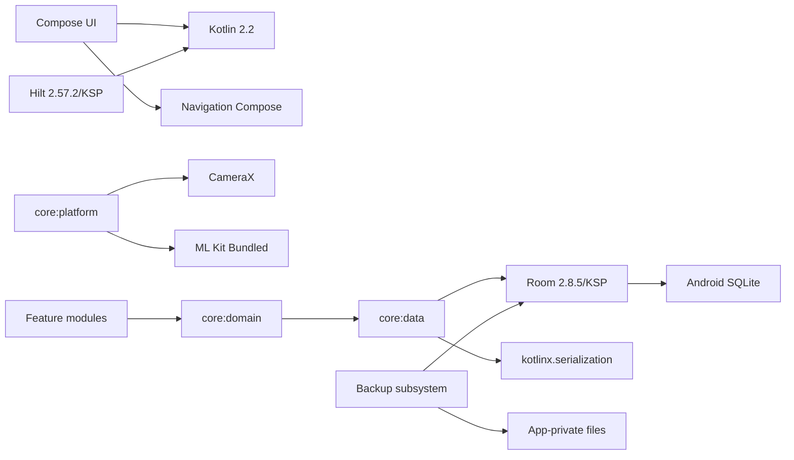

# 技术选型对比与最终决策

**文档编号**：A01
**版本**：`0.2.0`
**状态**：`Review`
**日期**：2026-11-04
**负责人**：首席架构师 / 技术负责人
**关联决策**：D-001 ~ D-016、D-022、D-025

---

## 1. 选型方法与原则

### 1.1 评估维度

| 维度 | 权重 | 判断标准 |
|---|---:|---|
| 稳定性 | 25% | 成熟稳定版本、破坏性变更频率 |
| 长期可维护 | 25% | 官方支持周期、社区、迁移路径、锁定风险 |
| 与离线/Android 契合 | 20% | 无网可用、后台/文件/相机/数据库能力 |
| 工程可验证性 | 15% | 可测试、可静态检查、可回滚 |
| 依赖与复杂度 | 10% | 运行时/构建时间/学习成本 |
| 性能 | 5% | 目标数据规模下是否足够 |

### 1.2 原则

- 优先稳定与长期维护，不以“开发快”为唯一标准。
- 能以平台成熟能力解决的，不引入跨平台运行时。
- 能用编译期检查的，不依赖运行期约定。
- 不为想象中的未来预建抽象；只保留低成本扩展缝。
- 每项选择必须能说明“出了什么问题、怎么恢复”。

## 2. 最终选型总表

| 领域 | 最终选择 | 一句话理由 | 锁定级别 |
|---|---|---|---|
| 应用平台 | 原生 Android | 只面向 Android，跨平台收益为零 | 架构锁定 |
| 语言 | Kotlin 2.2.20 | Android 官方首选，协程/空安全/生态成熟 | 架构锁定 |
| UI | Jetpack Compose + Material 3 | 官方现代 UI，状态驱动，测试友好 | 架构锁定 |
| 导航 | Navigation Compose 2.9.8（类型安全路由） | 与 Compose 原生集成，避免自研路由 | 基线锁定 |
| 最低/目标 SDK | min 26 / compile & target 36 | 覆盖现代设备，满足平台要求 | 架构锁定 |
| 本地数据库 | Room 2.8.5 + Android 平台 SQLite | 官方 ORM、编译期 SQL 校验、迁移测试成熟 | 架构锁定 |
| 数据访问 | Repository + DAO + 显式事务边界 | UI 不接触 SQL；事务可审计 | 架构锁定 |
| 依赖注入 | Hilt 2.57.2（KSP） | 编译期校验，适合多模块 | 架构锁定 |
| 异步 | Coroutines 1.10.2 + Flow | 结构化并发，生命周期安全 | 架构锁定 |
| 图片 | 应用私有文件 + Coil 3.3.0 | 避免 BLOB，缩略图/缓存成熟 | 架构锁定 |
| 扫码 | CameraX 1.4.2 + ML Kit 17.3.0 Bundled | 本地模型、二维码/条形码、离线可用 | 架构锁定 |
| 备份 | 自定义 ZIP + WorkManager 2.10.5 + SAF | 可控、可校验、可测试、可版本化 | 架构锁定 |
| 序列化 | kotlinx.serialization 1.9.0 | 快照/备份 manifest 的稳定 JSON | 基线锁定 |
| 日志 | Timber 5.0.1 + 本地文件树 | 轻量、可扩展、无云端依赖 | 基线锁定 |
| 测试 | JUnit4 + Truth + MockK + Turbine + Robolectric + Compose Test | Android 生态标准组合 | 基线锁定 |
| 构建 | Gradle 8.14.3 + AGP 8.13.0 + Version Catalog | 多模块一致、可维护 | 基线锁定 |
| 同步 | 本阶段不实现 | 单用户离线；只留数据缝 | 明确不做 |

## 3. 应用平台：原生 Android

| 方案 | 优势 | 缺点/风险 | 长期维护 | 结论 |
|---|---|---|---|---|
| 原生 Kotlin + Compose | 平台能力完整；数据库/相机/文件/后台无桥接；性能与调试最好 | 只能 Android；Compose 版本演进 | 高 | **采用** |
| Flutter | 跨平台；UI 一致；开发效率高 | SQLite/文件/相机/SAF/后台桥接增加风险；双栈排查 | 中高 | 不采用 |
| React Native | Web 技能复用；生态大 | 原生模块桥接复杂；后台限制多；升级链脆弱 | 中 | 不采用 |
| Kotlin Multiplatform | 共享逻辑；未来可扩展 | 当前无多端需求；KMP 构建复杂度 | 中 | 不采用 |

**决策：采用原生 Android。** 核心难点在本地事务、文件备份、扫码、后台任务和数据迁移；这些恰是跨平台桥接最薄的部分。项目只要求 Android 手机，跨平台没有实际收益。

**风险：** Compose/AGP/Kotlin 版本联动紧。对策：版本目录锁定，按“Kotlin → Compose Compiler → AGP/Gradle”顺序升级。

## 4. UI 与导航

### 4.1 UI：Compose + Material 3

| 方案 | 优势 | 缺点 | 结论 |
|---|---|---|---|
| Compose + M3 | 官方现代方案；状态驱动；组件复用；UI 测试可编程 | 学习曲线；重组性能；版本联动 | **采用** |
| XML View + ViewBinding | 成熟；工具链稳定 | 样板代码多；复杂列表状态繁琐 | 不采用 |
| WebView/H5 | 跨端 | 离线/文件/扫码/性能不匹配 | 不采用 |

约束：

- 单 Activity；页面用 Compose Route。
- 屏幕状态由 `UiState` 驱动；Composable 不直接调用 Repository。
- 图片区域按 `images.isEmpty()` 条件渲染，禁止空占位。
- 支持字体缩放、深色模式、TalkBack 基本可用。

### 4.2 导航：Navigation Compose

- 类型安全路由（`@Serializable` route 对象），避免字符串拼接。
- 导航集中在 `:app` 的 `CulinaryNavHost`；feature 只暴露 Route 与导航回调。
- 深链暂不需要；未来统一在 `:app` 注册。
- 不使用第三方路由框架。

## 5. 本地数据库：Room + 平台 SQLite

| 方案 | 优势 | 缺点/风险 | 长期维护 | 结论 |
|---|---|---|---|---|
| Room + 平台 SQLite | 官方；编译期 SQL 校验；DAO/Flow/Paging；迁移测试；生态最大 | 受平台 SQLite 版本限制；迁移需纪律 | 高 | **采用** |
| SQLDelight | 类型安全 SQL；跨平台 | 额外代码生成/驱动；Android 集成与迁移测试需自建 | 中高 | 不采用 |
| Realm | 对象模型直观 | Device Sync/Atlas Device SDK 已收缩，长期风险高；并发模型特殊 | 低 | 不采用 |
| ObjectBox | 性能好；NoSQL 直观 | 关系/复杂查询弱；许可与生态风险 | 中 | 不采用 |
| 原生 SQLiteOpenHelper | 完全可控；零依赖 | 样板/手写 SQL 错误多；迁移/事务/Flow 自建 | 中 | 不采用 |

### 5.1 平台 SQLite 约束

- Android 26 自带 SQLite 约 3.18，新设备可能 3.4x。**不得使用** 3.18 之后才有的语法/特性（`STRICT` 表、`RETURNING`、把 `VACUUM INTO` 当唯一备份路径）。
- 备份用 `PRAGMA wal_checkpoint(TRUNCATE)` + 文件复制作为兼容路径；支持 `VACUUM INTO` 时只作优化。
- 单位换算、配方展开在领域层完成；数据库只做存取与聚合。
- 若未来特定 OEM 出现 SQLite 缺陷，再评估 `androidx.sqlite` bundled driver；首版不引入。

### 5.2 数据访问

- Room `@Dao` 只负责 SQL；`core:data` 的 Repository 负责事务、映射、错误转换。
- 领域层只依赖 Repository 接口，不依赖 Room 类型。
- 禁止在 Composable/ViewModel 中直接使用 DAO 或 `Cursor`。
- 写入统一走 `TransactionRunner`（E02）。

### 5.3 风险与对策

| 风险 | 对策 |
|---|---|
| 平台 SQLite 版本差异 | 只用 3.18 兼容子集；API 26/33/36 测试 |
| 迁移写错 | 迁移前备份；MigrationTestHelper；禁止破坏性迁移 |
| 多写 `SQLITE_BUSY` | WAL + 单写者 + busy_timeout + 有限重试 |
| 大表查询卡顿 | 外键索引、分页、避免 N+1；性能基准 |

## 6. 依赖注入：Hilt 2.57.2

| 方案 | 优势 | 缺点 | 结论 |
|---|---|---|---|
| Hilt | 编译期图校验；生命周期集成；多模块成熟；测试替换方便 | KSP/构建复杂度；学习成本 | **采用** |
| Koin | 轻量；DSL 简单 | 运行期才报错；大型图难追踪；服务定位器倾向 | 不采用 |
| 手写 DI | 零依赖；透明 | 13–16 模块（待 D-004）Composition Root 膨胀；测试替换成本高 | 不采用 |

**版本约束（已实测）：** Hilt `2.59+` 要求 AGP 9+；本项目 AGP 8.13 基线必须使用 Hilt `2.57.2`。升级 AGP 9 时再同步升级 Hilt。

其他约束：

- KSP 替代 kapt。
- `@HiltAndroidApp` 仅在 `:app`；feature 不创建 Component。
- 绑定在 `core:data` / `core:platform` 的 `di` 包；领域层不出现 Hilt 注解。
- 禁止把 `Context` 注入领域对象。

## 7. 异步与状态

- Coroutines + Flow；结构化并发，禁止 `GlobalScope`。
- ViewModel 暴露 `StateFlow<UiState>`；Compose 用 `collectAsStateWithLifecycle`。
- 一次性事件用 `Channel`/`SharedFlow`，不用 `LiveData` 单例。
- I/O 调度器统一由 `DispatcherProvider` 提供。
- 数据库写入通过 `TransactionRunner` 串行化；主线程不做 I/O。

## 8. 图片与文件

| 方案 | 优势 | 缺点 | 结论 |
|---|---|---|---|
| 应用私有文件 + 元数据表 + Coil | 数据库轻；备份可控；图片可独立校验 | 需管理生命周期/孤儿清理 | **采用** |
| 数据库 BLOB | 事务简单；备份一体 | 数据库膨胀、VACUUM 慢、内存压力 | 不采用 |
| 公共相册路径 | 用户可见 | 分区存储/权限复杂；外部删除；隐私差 | 不采用 |
| 云图床 | 省空间 | 违背离线优先；隐私；网络依赖 | 不采用 |

约束：

- 文件存 `filesDir/images/<前两位>/<uuid>.<ext>`；数据库只存相对路径与元数据。
- 先写临时文件，rename 原子落盘，再写元数据；失败清理临时文件。
- 图片可选；文件缺失不阻塞档案读取，按无图显示并记录诊断。
- 备份只包含被引用的图片；恢复后做孤儿清理。

## 9. 扫码：CameraX + ML Kit Barcode Bundled

| 方案 | 优势 | 缺点 | 结论 |
|---|---|---|---|
| CameraX + ML Kit Bundled | 本地模型；二维码/一维码；离线；官方生态 | APK 增大；需相机权限；需真机实测 | **采用** |
| ZXing | 纯 Java；无 GMS；轻 | 识别率/速度较弱；相机集成自建 | 仅后备实现 |
| Google Code Scanner | 接入极简 | 依赖 Play Services；无法保证离线/无 GMS | 不采用 |
| 商业 SDK | 识别强 | 费用/许可/闭源 | 不采用 |

约束：

- 领域层只依赖 `BarcodeScanner` 接口；实现放 `core:platform`。
- 默认 Bundled 模型，不依赖运行时下载。
- 失败/无权限/无相机时保留手工输入条码。
- 在线商品查询只定义 `ProductLookupSource` 接口，v1 不实现。

## 10. 备份与恢复

| 方案 | 优势 | 缺点 | 结论 |
|---|---|---|---|
| 自定义 ZIP（DB + 图片 + manifest + 校验） | 完全可控；可版本化；可校验；可测试 | 需自己实现与维护 | **采用** |
| Android Auto Backup | 系统托管；少写代码 | 配额/内容不透明；大图片不可靠；无法预检/版本清单 | 不作为主方案 |
| 云盘 API | 跨设备 | 账号/网络/隐私/依赖；本阶段不做 | 不采用 |
| 只导出数据库 | 简单 | 丢图片；无法校验完整数据 | 不采用 |

约束见 [E05 备份与恢复](../03-engineering/E05-BACKUP-RESTORE.md)。恢复必须先预检、先备份当前数据、失败可回滚。备份格式版本独立于 App/DB 版本。

## 11. 序列化与时间

- `kotlinx.serialization` 用于计划快照、备份 manifest、诊断导出、变更日志 before/after。
- 不使用 Gson/Moshi：避免反射与额外依赖。
- 时间：`java.time`（min 26 原生支持）；审计时间存 UTC epoch millis；业务日期存 `YYYY-MM-DD`；计划保存 IANA 时区。
- 禁止在数据库中存本地化时间字符串作为排序依据。

## 12. 日志与诊断

- Timber 门面；自定义 `FileLogTree` 写应用私有滚动日志。
- 不接云端崩溃/分析 SDK；v1 不申请网络权限。
- 日志分级、脱敏、滚动、导出；崩溃处理器先落盘再交回系统。
- 详见 [E03 异常与日志](../03-engineering/E03-ERROR-LOGGING.md)。

## 13. 测试技术

| 层次 | 工具 | 说明 |
|---|---|---|
| 单元 | JUnit4 + Truth + MockK | 领域规则、单位、图算法 |
| 协程 | coroutines-test + Turbine | 虚拟时间、Flow 断言 |
| 数据库 | Room in-memory + Robolectric/instrumented | DAO、约束、事务 |
| 迁移 | Room `MigrationTestHelper` | 每个 schema 版本 |
| UI | Compose UI Test | 关键屏幕与无图状态 |
| 端到端 | instrumented + 手工清单 | 真机、离线、进程死亡 |
| 静态 | Detekt + ktlint + Android Lint | CI 门禁 |

**为什么不用 JUnit5：** Android instrumented runner 以 JUnit4 为标准；JUnit5 需额外插件与 runner，收益不足。统一 JUnit4。

## 14. 构建与依赖治理

- Gradle Kotlin DSL；`gradle/libs.versions.toml` 单一版本源。
- `build-logic/convention` 提供 `culinary.android.library`、`culinary.android.compose`、`culinary.android.hilt`、`culinary.android.room`、`culinary.jvm.library`。
- KSP 取代 kapt。
- Release 开启 R8、资源压缩；保留必要规则。
- 升级策略：
  - 架构级（Kotlin、AGP、Gradle、Room、Compose、Hilt）major/minor 升级必须单独 PR + 全量回归。
  - 普通库 patch 可自动合并，前提 CI 全绿。
  - 禁止快照版、alpha/beta（除非 ADR）、动态版本 `+`。

## 15. 版本基线（已实测）

以下版本在 `tools/dependency-spike` 中实际构建通过；详见 [V01 技术验证](../04-readiness/V01-DEPENDENCY-VALIDATION.md)。

| 组件 | 版本 | 状态 |
|---|---|---|
| Android Studio | AI-252.27397.103.2522.14617522 | 已安装 |
| JDK（构建） | 21.0.8（Studio JBR） | 已安装 |
| Java/Kotlin 目标 | JVM 17 | 决策 |
| Gradle | 8.14.3 | 已验证 |
| Android Gradle Plugin | 8.13.0 | 已验证 |
| Kotlin | 2.2.20 | 已验证 |
| KSP | 2.2.20-2.0.4 | 已验证 |
| Compose BOM | 2025.10.01 | 已验证 |
| Activity Compose | 1.11.0 | 已验证 |
| Lifecycle | 2.9.4 | 已验证 |
| Navigation Compose | 2.9.8 | 已验证 |
| Room | 2.8.5 | 已验证 |
| Hilt | 2.57.2 | 已验证 |
| Hilt Navigation Compose | 1.3.0 | 已验证 |
| CameraX | 1.4.2 | 已验证 |
| ML Kit Barcode | 17.3.0 (bundled) | 已验证 |
| Coil | 3.3.0 | 已验证 |
| WorkManager | 2.10.5 | 已验证 |
| kotlinx.serialization | 1.9.0 | 已验证 |
| Timber | 5.0.1 | 已验证 |
| compileSdk / targetSdk | 36 | SDK 已安装 |
| minSdk | 26 | 决策 |

**锁定规则：** 技术路线现在锁定；patch 版本由 `libs.versions.toml` 固定；禁止开发中途更换数据库、DI、UI 技术栈。

**网络说明：** Google Maven 在当前网络下直连失败；使用可信镜像（阿里云）验证通过。镜像地址与回退策略见 R02。

## 16. 兼容关系图

## 17. 明确拒绝的方案

| 方案 | 拒绝理由 |
|---|---|
| Flutter/React Native | 无跨平台需求；平台链路增加风险 |
| Realm/ObjectBox | 长期生态/许可/迁移风险；关系查询不匹配 |
| SQLDelight | 当前收益不足；多一套代码生成与测试链 |
| SQLCipher | 首版依赖系统 FBE；原生库/性能/迁移复杂度 |
| 云端数据库/账号 | 违反离线优先与单用户边界 |
| AI 作为核心 | 明确禁止 |
| 动态版本依赖 | 构建不可复现 |
| 多进程数据库访问 | 放大锁与一致性问题 |

## 18. 选型风险登记

| 风险 | 概率 | 影响 | 缓解 |
|---|---|---|---|
| Compose/AGP/Kotlin 不兼容 | 中 | 构建失败 | 版本目录 + 已实测基线 + 升级 PR |
| Hilt 误升级到 2.59+ | 中 | 构建失败 | 版本注释 + CI 校验 |
| 平台 SQLite 差异 | 中 | 查询/迁移异常 | 只用 3.18 子集；多 API 测试 |
| ML Kit 在目标机不可用 | 低 | 扫码失败 | 手工输入兜底；接口可换 ZXing |
| 备份恢复复杂导致数据丢失 | 中 | 高 | 预检、校验、预恢复备份、演练 |
| 依赖库合并网络权限 | 中 | 破坏离线承诺 | manifest 移除 + aapt CI 检查 |

## 19. 变更记录

| 版本 | 日期 | 变更 | 作者 |
|---|---|---|---|
| 0.1.0 | 2026-11-04 | 初稿；完成平台、DB、DI、扫码、备份、测试选型；补入实测版本与 Hilt/权限约束 | 架构组 |
| 0.2.0 | 2026-11-04 | 按 D-004 改为 13 模块候选；Hilt 手写 DI 对比同步 | 架构组 |
