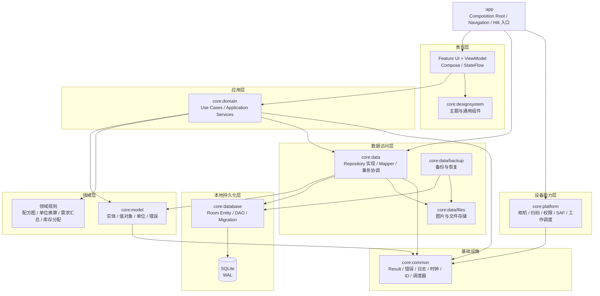
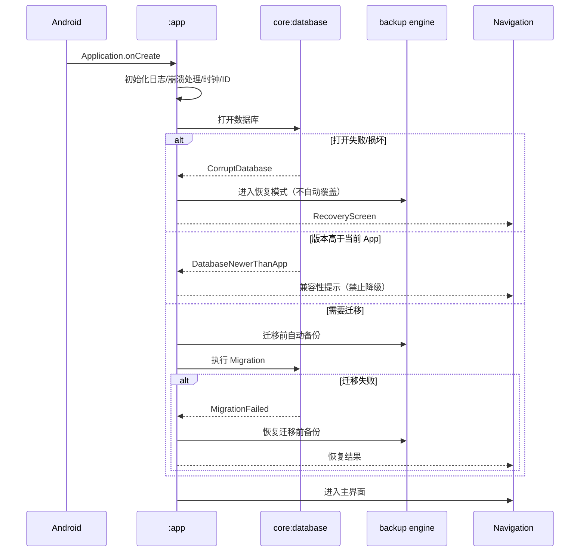

# CULINARY 软件整体架构设计书

**文档编号**：A02
**版本**：`0.1.0`
**状态**：`Review`
**日期**：2026-11-04
**负责人**：首席架构师 / 技术负责人
**关联决策**：D-001、D-003、D-004、D-012

---

## 1. 架构目标

CULINARY 的架构必须同时满足四个目标：

1. **离线可靠**：没有网络也能完成全部核心业务。
2. **数据正确**：配方关系、单位换算、库存余额、历史快照不能靠界面“看起来对”。
3. **边界清楚**：修改一个模块不被迫修改无关模块；UI 不直接操作数据库。
4. **可长期维护**：单开发者也能在数年后理解、测试、迁移和恢复。

架构不追求“企业级”复杂度。所有分层都必须有实际职责；不为想象中的微服务、事件总线或多端同步预建空壳。

## 2. 架构风格

采用**分层 + 按业务能力分模块 + 显式事务边界**的实用 Clean Architecture。

- **分层**保证依赖方向：外层依赖内层，内层不知道外层。
- **分模块**保证业务边界：知识档案、执行管理、基础设施各自独立。
- **显式事务**保证跨模块业务（计划确认、采购入库）原子性。
- **不采用**：微服务、独立进程、事件溯源、CQRS、插件化 APK。个人软件规模不需要，且会显著增加故障面。

## 3. 分层视图



> 图中的 `core:data/files`、`core:data/backup` 是 `core:data` 内部包，不是额外 Gradle 模块；若未来超过可维护规模，再提取为独立模块。这样避免当前模块数量爆炸，又保留清晰边界。

## 4. 各层职责

### 4.1 表现层（Presentation）

**组成：** `:feature:*`、`:core:designsystem`、`:app` 的导航与主题装配。

**负责：**

- 渲染 `UiState`，把用户操作转成 ViewModel 事件。
- 管理页面级生命周期、导航参数、输入焦点、动画、无障碍。
- 调用 Use Case；把 `Outcome` 映射为界面状态与提示。
- 处理纯展示逻辑（格式化、条件显示图片区域、空状态）。

**不负责：**

- 不写 SQL、不碰 DAO、不碰 `Cursor`。
- 不实现单位换算、配方展开、库存扣减等业务规则。
- 不直接调用 Repository（ViewModel 只依赖 Use Case）。
- 不持有跨页面全局业务状态。
- 不根据“当前页面”偷偷修改其他模块的数据。

### 4.2 应用层（Application）

**组成：** `core:domain` 的 Use Case / Application Service。

**负责：**

- 编排一个完整业务动作：创建配方版本、确认计划、登记收货、执行备份。
- 定义事务边界：哪些写入必须一起成功/失败。
- 调用领域规则与 Repository 接口。
- 返回类型化结果 `Outcome<T>`，不返回 Room 实体或 Android 类型。
- 做权限之外的应用级校验：状态机、版本、引用完整性。

**不负责：**

- 不包含 Compose、Android `Context`、Room 注解。
- 不直接发 SQL。
- 不处理 UI 文案（返回错误码，由表现层映射）。
- 不包含“页面流程”；页面流程属于表现层。

### 4.3 领域层（Domain）

**组成：** `core:model`（实体、值对象、单位、错误）+ `core:domain/rule`（纯规则）。

**负责：**

- 表达业务概念：食材、商品、配方版本、组成行、批次、需求、缺口。
- 不变量：数量必须为正、单位必须同维度、预留不得超过在手、配方不得循环。
- 纯计算：配方图展开、单位换算、需求合并、缺口计算、FEFO 建议。
- 领域错误：`RecipeCycleError`、`UnitIncompatibleError`、`InsufficientStockError`。

**不负责：**

- 不知道数据库表、文件路径、HTTP、Android API。
- 不做持久化；不打开事务；不记录日志到文件。
- 不依赖框架（除 `core:common` 的纯 Kotlin 工具）。

**纯度的实际标准：** 领域层单元测试可在 JVM 上直接运行，不需要 Android 模拟器、不需要数据库、不需要 `Context`。

### 4.4 数据访问层（Data Access）

**组成：** `core:data` 的 Repository 实现、Mapper、事务协调器、文件存储、备份引擎。

**负责：**

- 实现 `core:domain` 定义的 Repository 接口。
- 把领域模型映射为 Room Entity，反之亦然。
- 管理事务：`TransactionRunner`；把多个 DAO 操作组合为原子写。
- 把 SQLite/文件异常翻译为领域错误。
- 管理图片文件生命周期、备份文件、临时文件。
- 提供 `Flow` 查询；一次性查询用 `suspend`。

**不负责：**

- 不包含 UI 状态与文案。
- 不实现业务规则（例如“什么算缺口”）；规则在领域层。
- 不直接依赖 feature 模块。
- 不跨模块直接改别人的表；所有写入通过本模块的 Repository。

### 4.5 本地持久化层（Persistence）

**组成：** `core:database`。

**负责：**

- Room `@Entity`、`@Dao`、`@Database`、`@TypeConverter`。
- Schema 导出、版本号、Migration。
- 约束、索引、触发器、视图。
- SQL 查询与聚合。

**不负责：**

- 不包含业务编排。
- 不向 UI 暴露 Entity。
- 不依赖 `core:domain`（避免数据库层反向依赖领域层）；由 `core:data` 做映射。
- 不处理文件、图片、权限。

### 4.6 文件与图片管理层

**组成：** `core:data/files`（包级边界）。

**负责：**

- 应用私有目录布局、原子写入、临时文件、孤儿清理。
- 图片导入、压缩、校验、元数据。
- 备份中的图片打包与恢复。
- 文件缺失/损坏的诊断。

**不负责：**

- 不决定“哪张图是主图”（业务规则在领域/应用层）。
- 不直接渲染图片（Coil 在 UI 层读取路径/URI）。
- 不访问网络。

### 4.7 设备能力层（Platform）

**组成：** `core:platform`。

**负责：**

- CameraX 预览与扫码、ML Kit 识别。
- 权限请求与状态。
- SAF 文件选择、保存、目录授权。
- WorkManager 调度。
- 系统分享、打开文件、设备信息。
- 把平台异常/权限结果翻译为 `Outcome`。

**不负责：**

- 不包含配方、库存、采购规则。
- 不直接写业务数据库。
- 不决定备份内容（只提供文件/调度能力）。

### 4.8 基础设施层（Infrastructure）

**组成：** `core:common`。

**负责：**

- `Outcome` / 错误模型 / 错误码。
- 日志门面、相关 ID、脱敏。
- `Clock`、`IdGenerator`、`DispatcherProvider`。
- 通用扩展（安全格式化、日期、字符串规范化）。
- 配置常量。

**不负责：**

- 不包含业务实体。
- 不包含 Android UI。
- 不变成“什么都往里塞”的垃圾桶；通用能力必须有至少两个使用方。

### 4.9 组合根（Composition Root）

**组成：** `:app`。

**负责：**

- `@HiltAndroidApp`、Application、MainActivity。
- 导航图、路由注册、全局 Scaffold/主题。
- Hilt 模块装配（实现模块在各层，app 只依赖）。
- 启动诊断、数据库打开、迁移前备份编排。
- 进程级崩溃处理。

**不负责：**

- 不实现业务规则。
- 不直接写 DAO。
- 不成为“所有代码的入口”；页面逻辑在 feature。

## 5. 依赖规则

### 5.1 允许的依赖方向

```text
app
 ├─> feature:*
 ├─> core:data
 ├─> core:platform
 ├─> core:designsystem
 └─> core:common

feature:* ──> core:domain ──> core:model ──> core:common
     └─────> core:designsystem
     └─────> core:common

core:data ──> core:domain
          ──> core:database
          ──> core:model
          ──> core:common

core:database ──> core:common
core:platform ──> core:domain (仅实现端口) + core:common
```

### 5.2 禁止的依赖

| 禁止 | 原因 |
|---|---|
| feature → feature | 页面互相依赖会形成环，无法独立测试/删除 |
| feature → core:database | UI 绕过业务与事务，直接绑死表结构 |
| feature → core:data（实现） | 表现层只应依赖领域接口 |
| core:domain → core:data/core:database/core:platform | 内层不得知道外层实现 |
| core:database → core:domain | 持久化模型不应反向依赖领域模型；由 data 映射 |
| core:model → Android/Room/Compose | 领域模型必须可 JVM 单测 |
| core:common → 任何业务模块 | 基础设施不能反向依赖 |
| 任意模块 → :app | app 是组合根，不能被依赖 |

### 5.3 依赖实现方式

- 模块对外只暴露 `api` 中真正需要的类型；实现细节用 `implementation`。
- Repository 接口在 `core:domain`；实现在 `core:data`，通过 Hilt 绑定。
- `core:database` 的 Entity/DAO 标记 `internal`，不跨模块暴露。
- feature 之间需要协作时，通过 `core:domain` 的 Use Case 或导航回调，不直接 import 对方类。
- 循环依赖在 Gradle 层就不允许出现；CI 运行依赖分析。

### 5.4 依赖检查

- 每个模块的 `build.gradle.kts` 只声明允许的依赖。
- CI 增加 `dependency-analysis` 或自定义 Gradle 任务，检测：
  - feature 间依赖；
  - domain 对 Android/Room 的依赖；
  - database 对 domain 的依赖；
  - 未使用的直接依赖。
- Code Review 必须检查是否有“为了省事”跨层调用。

## 6. 通信机制

### 6.1 UI → 应用层

- ViewModel 接收 UI 事件（`onSaveClicked`、`onConfirmPlan`）。
- ViewModel 调用 Use Case，收集 `Outcome`。
- ViewModel 更新 `StateFlow<UiState>`；UI 只渲染。
- 不使用 EventBus、LiveData 单例、全局可变状态。

### 6.2 应用层 → 数据层

- Use Case 依赖 Repository 接口。
- 多仓库写入由 Use Case 调用 `TransactionRunner.write { ... }` 包裹。
- Repository 不返回 Entity；返回领域模型或查询投影。
- 读取使用 `Flow` 订阅；一次性读取用 `suspend`。

### 6.3 数据层 → 数据库

- Repository 调用 DAO；DAO 只做 SQL。
- Mapper 是纯函数，放 `core:data/mapper`。
- 事务协调器统一获取写锁、设置超时、重试、日志。

### 6.4 跨模块业务

例：计划确认需要读配方、展开、查库存、写需求、写预留。

- 由 `ConfirmProductionPlanUseCase` 编排。
- 在一个写事务中完成所有写入。
- 不通过“计划模块调用库存模块的 Repository”形成模块环；库存 Repository 接口在 `core:domain`，计划 Use Case 依赖接口。

### 6.5 事件与通知

- 进程内数据变化通过 Room `Flow` 通知；不使用自定义事件总线。
- 跨页面一次性结果用导航返回值/SavedStateHandle。
- 后台任务（备份）完成后通过 WorkManager 状态 + 数据库记录通知 UI，不依赖内存广播。

## 7. 线程与并发模型

| 场景 | 线程/调度器 | 规则 |
|---|---|---|
| Compose 渲染 | Main | 不做 I/O |
| ViewModel 状态更新 | Main | `viewModelScope` |
| 领域计算 | Default | 纯 CPU；可取消 |
| 数据库读写 | IO（受限） | 所有写经 `TransactionRunner` |
| 图片解码/压缩 | IO/Default | 不阻塞主线程 |
| 扫码 | CameraX Executor | 识别结果切回 Main |
| 备份/恢复 | WorkManager + IO | 前台可见进度；可取消 |
| 文件复制 | IO | 分块，校验 SHA-256 |

**写并发：** 单进程、单写者队列（详见 E02）。读使用 WAL 并发，不因写入阻塞所有读取。

## 8. 事务边界

| 业务动作 | 事务范围 | 失败结果 |
|---|---|---|
| 保存食材/商品 | 单聚合写入 + 变更日志 | 整体回滚 |
| 发布配方版本 | 版本状态 + 组成行 + 当前版本指针 + 变更日志 | 整体回滚；不产生半发布版本 |
| 确认制作计划 | 计划状态 + 明细 + 快照 + 需求 + 缺口 + 预留 | 整体回滚；计划仍为草稿 |
| 采购收货过账 | 收货单 + 明细 + 批次 + 流水 + 采购明细已收数量 | 整体回滚；不产生半入库 |
| 库存调整/出库 | 批次余额 + 流水（+ 预留消耗） | 整体回滚；余额不变 |
| 恢复备份 | 预恢复备份 + 关闭 DB + 替换 + 迁移 + 校验 | 失败则恢复预恢复备份 |
| 备份 | 一致性检查点 + 复制 + 校验 | 失败保留旧备份，删除临时文件 |

**禁止：**

- 在事务中做网络请求、图片解码、文件复制（备份除外，且备份使用独立流程）。
- 在事务中弹 UI、等待用户输入。
- 长事务跨多个用户操作。
- 用“先写一半，失败再补”替代事务。

## 9. 启动流程



启动阶段只做必要工作：打开数据库、检查版本、准备日志。不做全量数据加载、不做图片扫描、不做备份上传。

## 10. 离线与网络边界

- v1 **不申请 `INTERNET` 权限**；从系统层面保证核心功能不可能偷偷依赖网络。
- 依赖库可能通过 manifest 合并引入 `INTERNET` / `ACCESS_NETWORK_STATE`；必须在应用 manifest 用 `tools:node="remove"` 移除，并在构建后用 `aapt2 dump permissions` 验证（已实测，见 V01）。
- 扫码使用 Bundled 本地模型。
- 在线商品查询只保留 `ProductLookupSource` 接口，不实现、不注册实现。
- 未来若增加网络能力：
  - 新增 `:core:network` 模块，禁止 domain 直接依赖；
  - 通过 Repository/端口注入；
  - 网络失败必须降级为本地结果；
  - 单独 ADR 评估隐私、权限、同步冲突。

## 11. 错误边界

| 层 | 捕获什么 | 转成什么 | 是否记录 |
|---|---|---|---|
| Platform | 权限、相机、文件选择、WorkManager | `Outcome.Failure(PlatformError)` | 是（脱敏） |
| Data | SQLite、文件、序列化 | `Outcome.Failure(DataError)` | 是（含 SQL 摘要/相关 ID） |
| Domain | 业务不变量 | `Outcome.Failure(DomainError)` | 业务错误按级别记录，不刷屏 |
| ViewModel | 所有 `Outcome` | `UiState.Error` + 用户文案 | 不重复记录底层堆栈 |
| Global | 未捕获异常 | 崩溃日志 + 系统默认处理 | 是 |

**原则：** 异常不能穿过层边界后变成“未知错误”；不能在 UI 层 `try/catch` 后静默。详见 E03。

## 12. 构建变体与环境

| 变体 | 用途 | 差异 |
|---|---|---|
| `debug` | 开发 | 应用 ID 后缀 `.debug`；详细日志；不混淆；可调试 DB |
| `release` | 自用/分发 | R8；资源压缩；签名；文件日志 INFO；关闭调试入口 |
| `benchmark`（可选） | 性能测试 | 仅基准测试使用，不进入正式发布 |

不设多 product flavor。环境差异用 BuildConfig 字段与资源，不用大量分支代码。

## 13. 架构约束清单（可检查）

- [ ] 任一 Composable 不 import `core:database`、`androidx.room`。
- [ ] 任一 ViewModel 不 import DAO/Entity。
- [ ] `core:domain` 不 import Android、Room、Compose、Hilt。
- [ ] `core:database` 不 import `core:domain`。
- [ ] feature 之间无直接依赖。
- [ ] 所有多表写入都在 `TransactionRunner` 内。
- [ ] 所有库存余额变化都有 `inventory_ledger` 记录。
- [ ] 所有已确认计划都有不可变快照。
- [ ] 所有图片读取都允许文件缺失并降级。
- [ ] 所有数据库迁移都有前置备份与迁移测试。

## 14. 与模块文档的关系

本文定义分层与总体依赖；每个模块的职责、数据归属、接口、禁止依赖、测试范围见 [A03 模块职责与依赖关系](A03-MODULE-DEPENDENCIES.md)。数据表与约束见 A05/A06；流程见 A04。

## 15. 变更记录

| 版本 | 日期 | 变更 | 作者 |
|---|---|---|---|
| 0.1.0 | 2026-11-04 | 初稿；确定分层、依赖、线程、事务、启动与离线边界 | 架构组 |
