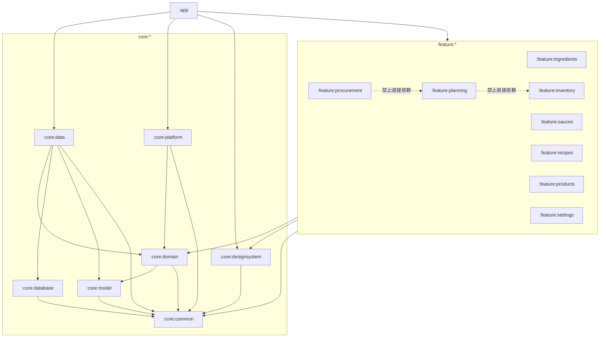

# CULINARY 模块职责与依赖关系说明

**文档编号**：A03
**版本**：`0.2.0`
**状态**：`Review`
**日期**：2026-11-04
**负责人**：首席架构师 / 技术负责人
**关联决策**：D-004（REVISION）、D-012

---

> **重要：本文的 16 模块是细粒度边界参考，不是已批准数量。**
> D-004 要求先审查模块清单/职责/依赖/拆分依据。推荐方案为 **15 模块**，见 [A03A 模块拆分审查提案](A03A-MODULE-DECOMPOSITION-REVIEW.md)。最终数量以负责人审查结论为准。

## 1. 模块化原则

1. **按业务能力分模块，不按页面分模块。** 一个 feature 可以包含列表、详情、编辑多个页面。
2. **模块边界按“谁会一起变化”划分。** 配方版本与组成一起变；库存余额与流水一起变。
3. **Gradle 模块是边界，包也是边界。** 不因为“只有几个类”就拆模块，也不因为“省事”就把所有代码塞进 app。
4. **16 是细粒度参考，不是上限，也不是目标。** 推荐默认 15（仅把 model 并入 domain）；只有满足拆分触发条件才回到 16。
5. **feature 之间零依赖。** 跨 feature 协作通过领域 Use Case 或 app 导航。

## 2. 模块清单

| 模块 | 类型 | 一句话职责 |
|---|---|---|
| `:app` | 组合根 | 应用入口、导航、Hilt 装配、启动诊断 |
| `:core:common` | 基础设施 | 结果、错误、日志、时钟、ID、调度器 |
| `:core:model` | 领域模型 | 纯 Kotlin 实体、值对象、单位、业务错误 |
| `:core:domain` | 应用/领域 | Repository 端口、Use Case、配方/单位/库存规则 |
| `:core:database` | 持久化 | Room Entity、DAO、Migration、SQL |
| `:core:data` | 数据访问 | Repository 实现、Mapper、事务、文件、备份 |
| `:core:designsystem` | 表现基础 | 主题、颜色、排版、通用 Compose 组件 |
| `:core:platform` | 设备能力 | 相机扫码、权限、SAF、WorkManager |
| `:feature:ingredients` | 表现 | 食材库界面与 ViewModel |
| `:feature:sauces` | 表现 | 酱汁库界面与 ViewModel |
| `:feature:recipes` | 表现 | 菜谱库界面与 ViewModel |
| `:feature:products` | 表现 | 商品与供应商界面 |
| `:feature:inventory` | 表现 | 库存、批次、位置、流水界面 |
| `:feature:planning` | 表现 | 制作计划与物料需求界面 |
| `:feature:procurement` | 表现 | 采购需求、采购单、收货界面 |
| `:feature:settings` | 表现 | 备份恢复、诊断、关于、偏好 |

## 3. 模块依赖图



实线是允许的编译依赖；虚线表示“业务上有关联，但禁止直接 import”，必须通过 domain 接口与 app 导航协作。

## 4. 各模块定义

### 4.1 `:app`

| 项 | 内容 |
|---|---|
| 职责 | Application/Activity；导航图；Hilt 入口；启动诊断；全局 Theme/Scaffold；数据库打开与迁移前备份编排；崩溃处理 |
| 数据归属 | 无业务表；只持有进程级状态 |
| 对外接口 | `CulinaryApplication`、`MainActivity`、`CulinaryNavHost`（仅系统入口，不被其他模块依赖） |
| 允许依赖 | 所有 feature、core:data、core:platform、core:designsystem、core:common |
| 禁止依赖 | 无（它是组合根），但禁止承载业务规则 |
| 独立测试 | 导航冒烟测试、启动恢复模式测试、Hilt 图编译测试 |
| 扩展 | 新增 feature 时只改导航注册与依赖；不在这里写业务 |

### 4.2 `:core:common`

| 项 | 内容 |
|---|---|
| 职责 | `Outcome`、错误基类/错误码、日志门面与脱敏、`Clock`、`IdGenerator`、`DispatcherProvider`、字符串/日期工具 |
| 数据归属 | 无 |
| 对外接口 | 稳定的纯 Kotlin API；不暴露第三方日志实现 |
| 允许依赖 | Kotlin 标准库、协程、时间 API；日志门面可依赖 Timber |
| 禁止依赖 | 任何 core/feature/app 业务模块；Android UI；Room |
| 独立测试 | 纯 JVM：错误映射、ID 格式、时间格式化、脱敏规则 |
| 扩展 | 新增通用能力必须至少两个使用方；否则放使用方本地 |

### 4.3 `:core:model`

| 项 | 内容 |
|---|---|
| 职责 | 领域实体与值对象：`Ingredient`、`Product`、`Recipe`、`RecipeVersion`、`FormulaLine`、`Sauce`、`Batch`、`Requirement`、`Shortage`、`Quantity`、`Unit`、`UnitDimension`、`PlanSnapshot` |
| 数据归属 | 无；只表达内存模型 |
| 对外接口 | 不可变 `data class`、密封类、值对象校验 |
| 允许依赖 | `core:common`、Kotlin 标准库、`java.time` |
| 禁止依赖 | Android、Room、Compose、Hilt、任何 feature |
| 独立测试 | 值对象不变量、单位维度、数量运算、序列化兼容（快照） |
| 扩展 | 新增字段必须考虑快照 JSON 兼容；破坏性变更需迁移/版本 |

### 4.4 `:core:domain`

| 项 | 内容 |
|---|---|
| 职责 | Repository 端口；Use Case；配方图校验/展开；单位换算；需求汇总；库存分配；计划快照；采购状态机 |
| 数据归属 | 无；只定义“需要什么数据”和“如何计算” |
| 对外接口 | 按业务分组的 Repository 接口 + Use Case 类；返回 `Outcome` |
| 允许依赖 | `core:model`、`core:common`、协程 |
| 禁止依赖 | Android、Room、Compose、Hilt、`core:data`、`core:database`、`core:platform` |
| 独立测试 | 纯 JVM；覆盖循环、单位、汇总、状态机；使用 fake repository |
| 扩展 | 新业务规则先加领域测试，再加 Use Case；不得在 UI 里补规则 |

### 4.5 `:core:database`

| 项 | 内容 |
|---|---|
| 职责 | Room `@Entity`/`@Dao`/`@Database`；Schema 导出；Migration；索引/约束/触发器/视图；SQL 查询 |
| 数据归属 | 所有表的物理结构与 SQL；但不决定业务语义 |
| 对外接口 | 仅 `internal` 的 DAO/Entity/Database；对 `core:data` 暴露 `CulinaryDatabase` 与受控 DAO |
| 允许依赖 | `core:common`、Room、AndroidX SQLite |
| 禁止依赖 | `core:domain`、`core:model`、`core:data`、任何 feature、Compose |
| 独立测试 | Room in-memory / Robolectric；MigrationTestHelper；约束与索引测试 |
| 扩展 | 新表/字段必须带 Migration 与测试；不允许破坏性迁移 |

### 4.6 `:core:data`

| 项 | 内容 |
|---|---|
| 职责 | Repository 实现；Entity↔Domain Mapper；`TransactionRunner`；写队列；文件/图片存储；备份/恢复引擎；数据导入预检；诊断导出 |
| 数据归属 | 逻辑上拥有所有业务数据的读写；物理表在 database |
| 对外接口 | 只通过 Hilt 绑定 domain 接口；不向 feature 暴露实现类型 |
| 允许依赖 | `core:domain`、`core:database`、`core:model`、`core:common`、平台文件 API（通过抽象） |
| 禁止依赖 | 任何 feature、`:app`、Compose |
| 独立测试 | 真 SQLite（Robolectric/instrumented）；事务回滚；并发；备份 round-trip；Mapper |
| 扩展 | 新 Repository 实现；备份格式升级；文件存储迁移；超过 ~3000 行再拆 `core:files`/`core:backup` |

### 4.7 `:core:designsystem`

| 项 | 内容 |
|---|---|
| 职责 | Material 3 主题、颜色、字体、间距、通用组件（空状态、错误、确认框、可选图片区） |
| 数据归属 | 无 |
| 对外接口 | `CulinaryTheme`、通用 Composable；不包含业务文案 |
| 允许依赖 | Compose、`core:common`（仅工具） |
| 禁止依赖 | domain/data/database/feature |
| 独立测试 | Compose 预览/截图（可选）、无障碍语义测试 |
| 扩展 | 新通用组件至少两个 feature 使用；业务组件留在 feature |

### 4.8 `:core:platform`

| 项 | 内容 |
|---|---|
| 职责 | `BarcodeScanner` 实现（CameraX + ML Kit）；权限；SAF 文件选择/保存；WorkManager 调度；系统分享；设备信息 |
| 数据归属 | 无 |
| 对外接口 | 实现 domain 定义的端口（扫码、文件选择、调度）；平台自身 API 只被 app/data 使用 |
| 允许依赖 | `core:domain`（仅实现端口）、`core:common`、AndroidX/CameraX/ML Kit |
| 禁止依赖 | `core:data`、`core:database`、任何 feature、Compose 页面 |
| 独立测试 | 权限状态机；扫码结果解析；SAF URI 处理；真机扫码 |
| 扩展 | 替换 ZXing 实现；新增 NFC/蓝牙等设备能力；在线查询适配器（未来） |

### 4.9 八个 feature 模块

所有 feature 共享以下规则：

- 只包含 `ui/`、`presentation/`、`navigation/`；不包含 Repository、DAO、Entity。
- ViewModel 只依赖 Use Case 与 `UiState` 模型。
- 对外只暴露 `Route` Composable 与导航回调；内部 Screen/Component 尽量 `internal`。
- 不直接依赖其他 feature；需要跳转时由 `:app` 注入回调。
- 图片区域按有无图片条件渲染，不在 feature 里造空占位。
- 每个 feature 至少覆盖：加载、空、错误、无图、保存中、保存失败、权限拒绝（如适用）。

| 模块 | 主要页面/能力 | 主要 Use Case | 主要数据（经 domain） |
|---|---|---|---|
| `:feature:ingredients` | 列表、详情、编辑、别名、换算 | `ListIngredients`、`GetIngredient`、`SaveIngredient`、`ArchiveIngredient`、`AddIngredientAlias`、`SetIngredientConversion` | ingredient, alias, conversion |
| `:feature:sauces` | 列表、详情、版本、组成编辑、发布 | `ListSauces`、`GetSauce`、`SaveSauceDraft`、`PublishSauceVersion`、`ValidateSauceFormula` | sauce, sauce_version, sauce_component |
| `:feature:recipes` | 列表、详情、版本、组成、步骤、发布 | `ListRecipes`、`GetRecipe`、`SaveRecipeDraft`、`PublishRecipeVersion`、`ValidateRecipeFormula` | recipe, recipe_version, recipe_component |
| `:feature:products` | 商品列表、编辑、条码、供应商 | `ListProducts`、`GetProduct`、`SaveProduct`、`ArchiveProduct`、`BindBarcode`、`LookupByBarcode` | product, barcode, supplier |
| `:feature:inventory` | 批次、位置、余额、流水、调整、出库 | `ListBatches`、`GetStockByProduct`、`AdjustStock`、`IssueStock`、`TransferStock`、`ListLedger`、`Reserve/Release` | batch, ledger, reservation, location |
| `:feature:planning` | 计划列表、编辑、确认、快照、缺口 | `CreatePlan`、`AddPlanItem`、`ConfirmPlan`、`RefreshPlanSnapshot`、`CancelPlan`、`GetPlanRequirements` | plan, item, snapshot, requirement |
| `:feature:procurement` | 采购需求、采购单、收货 | `CreatePurchaseOrderFromShortages`、`UpdatePurchaseOrder`、`PostGoodsReceipt`、`CancelPurchaseOrder` | procurement_requirement, PO, receipt |
| `:feature:settings` | 备份、恢复、诊断、偏好、关于 | `CreateBackup`、`RestoreBackup`、`ScheduleAutoBackup`、`ExportDiagnostics`、`GetBackupHistory` | backup_record, app_metadata |

> 表中的 Use Case 是接口清单，不是要求每个都做成独立类；简单 CRUD 可以由一个 Use Case 承担，但必须在领域层有明确入口，不能从 ViewModel 直接调 Repository。

## 5. 数据归属矩阵

`W` = 该业务上下文负责写入；`R` = 只读；空白 = 不应访问。

| 表/上下文 | 食材 | 酱汁 | 菜谱 | 商品 | 库存 | 计划 | 采购 | 备份 |
|---|---|---|---|---|---|---|---|---|
| ingredient / alias / conversion | W | R | R | R |  | R |  | R |
| sauce / version / component | R | W | R |  |  | R |  | R |
| recipe / version / component | R | R | W |  |  | R |  | R |
| product / barcode / supplier | R |  |  | W | R | R | R | R |
| storage_location |  |  |  | R | W |  | R | R |
| inventory_batch / ledger / reservation |  |  |  | R | W | R（只读可用量） | R（入库后） | R |
| production_plan / item / snapshot / requirement |  |  |  |  | R | W | R | R |
| procurement_requirement / PO / receipt |  |  |  | R | W（收货入库） | R | W | R |
| image_asset | W（食材图） | W（酱汁图） | W（菜谱图） | W（商品图） | W（库存图） | W（计划图） | W（收货图） | R |
| change_log | 由 `core:data` 统一写，业务模块不直接写 |
| backup_record / app_metadata | 由 `core:data/backup` 与 `:app` 写 |

**说明：** “W”不是指 feature 直接写表，而是该业务上下文的 Use Case 通过 Repository 写入。物理写入永远在 `core:data`。

## 6. 模块对外接口规范

### 6.1 Feature 接口

```kotlin
// 只暴露路由与导航回调；Screen/VM 不跨模块暴露
@Composable
fun IngredientListRoute(
    onBack: () -> Unit,
    onOpenIngredient: (IngredientId) -> Unit,
    onCreateIngredient: () -> Unit,
)
```

- 不暴露 ViewModel、UiState、Repository。
- 路由参数用领域 ID 值对象或字符串，不传 Entity。
- 导航回调由 `:app` 提供，feature 不知道其他页面。

### 6.2 Domain 接口

```kotlin
interface IngredientRepository {
    fun observeAll(): Flow<List<Ingredient>>
    suspend fun get(id: IngredientId): Ingredient?
    suspend fun save(ingredient: Ingredient): IngredientId
    suspend fun archive(id: IngredientId)
}

class SaveIngredientUseCase @Inject constructor(
    private val repository: IngredientRepository,
    private val clock: Clock,
    private val ids: IdGenerator,
) {
    suspend operator fun invoke(input: IngredientInput): Outcome<IngredientId>
}
```

- 接口按聚合划分，不按页面划分。
- 方法返回领域模型或 `Outcome`，不返回 Entity/DAO。
- 查询返回 `Flow` 用于观察；一次性读取用 `suspend`。

### 6.3 Database 接口

- 只对 `core:data` 暴露 `CulinaryDatabase` 与 `internal` DAO。
- DAO 方法名表达 SQL 意图：`observeActiveByNormalizedName`、`sumAvailableByProduct`。
- 不把 `@Transaction` 当业务事务；跨 DAO 事务由 `TransactionRunner` 控制。

### 6.4 Platform 接口

```kotlin
interface BarcodeScanner {
    suspend fun scan(): Outcome<BarcodeResult>
}

interface BackupFilePicker {
    suspend fun pickDirectory(): Outcome<Uri>
    suspend fun createDocument(fileName: String): Outcome<Uri>
}
```

- 平台实现不泄漏 `ActivityResultContract` 到 domain。
- 权限拒绝返回 `PlatformError.PermissionDenied`，由 UI 提示设置入口。

## 7. 禁止依赖清单（CI 必须检查）

| 检查 | 失败示例 |
|---|---|
| feature 间 import | `feature.recipes` import `feature.inventory` |
| feature 访问 DB | `feature.planning` import `androidx.room` |
| feature 访问 data 实现 | `feature.products` import `core.data.repository.ProductRepositoryImpl` |
| domain 访问 Android | `core.domain` import `android.content.Context` |
| database 访问 domain | `core.database` import `core.domain.model.Recipe` |
| model 访问框架 | `core.model` import `androidx.compose.*` |
| common 反向依赖 | `core.common` import `core.domain` |
| app 之外依赖 app | 任意模块 import `com.culinary.app` |

## 8. 模块独立测试范围

| 模块 | 必须能独立测试 | 不需要 |
|---|---|---|
| common | JVM 单测 | Android |
| model | JVM 单测 | DB/UI |
| domain | JVM 单测 + fake repo | 真 DB/UI |
| database | Robolectric/instrumented + 迁移 | UI |
| data | 真 SQLite/in-memory + 文件临时目录 | Compose |
| platform | 权限/结果映射；扫码真机 | 业务规则 |
| designsystem | Compose 组件测试 | 业务数据 |
| feature | ViewModel + fake use case + Compose UI test | 真 DB |
| app | 导航冒烟 + Hilt 图 | 业务细节 |

## 9. 新增模块的判定

满足以下任两条才拆新 Gradle 模块：

1. 有独立的数据归属与生命周期；
2. 有独立的对外接口，且被至少两个模块使用；
3. 需要独立测试边界（例如纯领域算法）；
4. 编译时间/团队并行有明显收益；
5. 未来可能被替换（例如扫码实现）。

不满足时，放现有模块的包内。**禁止**为了“看起来架构很专业”而创建空模块。

## 10. 未来扩展空间

| 扩展 | 落点 | 不需要改什么 |
|---|---|---|
| 新知识库（如设备/技法） | 新 feature + domain + 表；需 ADR | 不改库存/采购核心 |
| 在线商品查询 | `core:platform` 新 adapter + `core:domain` 端口；新增 `:core:network` | 不改离线路径 |
| 数据同步 | 新 `:core:sync`；利用 UUID/updated_at/软删除 | 不改现有 Repository 接口语义 |
| 报表/成本 | 新 feature + 只读查询 | 不改库存流水 |
| 多语言 | 资源文件 + 文案键 | 不改领域模型 |

## 11. 变更记录

| 版本 | 日期 | 变更 | 作者 |
|---|---|---|---|
| 0.1.0 | 2026-11-04 | 初稿；建立 16 模块、依赖矩阵、数据归属与测试边界 | 架构组 |
| 0.2.0 | 2026-11-04 | 明确 16 模块为细粒度参考；D-004 改为模块审查；推荐 15 模块见 A03A | 架构组 |
