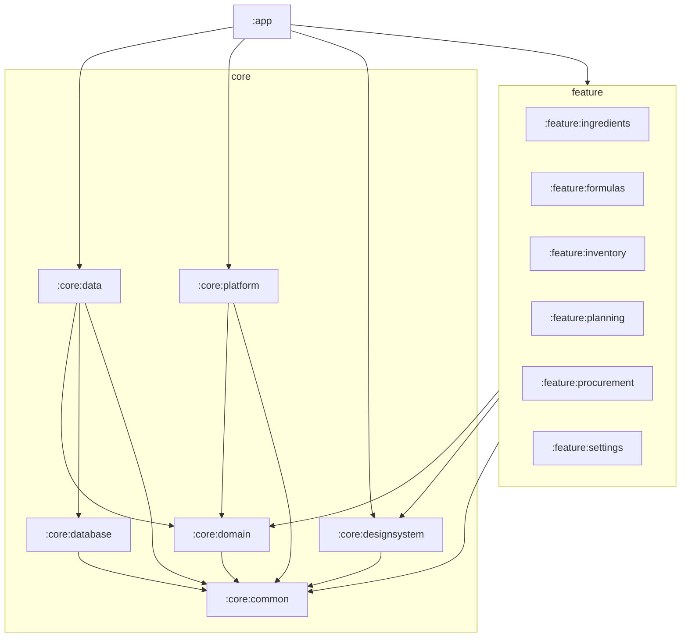

# CULINARY 模块拆分审查提案

**文档编号**：A03A
**版本**：`0.1.0`
**状态**：`Review`
**日期**：2026-11-04
**负责人**：首席架构师 / 技术负责人
**关联决策**：D-004（REVISION）
**配套文档**：[A03 模块职责与依赖关系](A03-MODULE-DEPENDENCIES.md)、[A02 整体架构](A02-SYSTEM-ARCHITECTURE.md)

---

## 1. 本文要解决的问题

D-004 原先把“16 个模块”写成已锁定结论。项目负责人要求：

> 不预先强制锁定 16 个模块。先提交完整模块清单、职责边界、依赖关系图和拆分依据，经审查后再确定模块数量，避免过度模块化和循环依赖。

本文就是这份审查材料。**本文不自行批准任何模块数量**；它给出 3 个方案、推荐 1 个，并列出审查问题，等待项目负责人选择。

## 2. 审查标准

模块数量不是目标。用以下标准判断“该不该拆”：

| 标准 | 说明 | 权重 |
|---|---|---:|
| 边界稳定性 | 模块内部是否因同一原因变化 | 30% |
| 依赖可控 | 是否能禁止 feature 互依赖、DB 泄漏到 UI | 25% |
| 独立测试 | 能否在没有 UI/真机的情况下测试核心 | 20% |
| 构建/维护成本 | 模块数、构建配置、认知负担 | 15% |
| 可替换/可扩展 | 能否替换扫码、备份、存储 | 10% |

**反例：** 按页面拆模块（列表一个、详情一个）只增加构建成本，不增加边界稳定性。本文不采用。

## 3. 逻辑模块 vs Gradle 模块

先把职责分清楚，再决定是否每个职责一个 Gradle 模块：

```text
知识档案（逻辑）
  ├─ 食材
  ├─ 酱汁
  └─ 菜谱

执行管理（逻辑）
  ├─ 商品
  ├─ 库存
  ├─ 制作计划
  └─ 采购

基础设施（逻辑）
  ├─ 数据库
  ├─ 数据访问/事务
  ├─ 图片与文件
  ├─ 扫码/设备能力
  ├─ 备份恢复
  ├─ 单位换算
  └─ 日志/错误
```

逻辑职责有 14 个左右，但**不需要 14 个 Gradle 模块**。Gradle 模块用于强制边界，不是给每个名词建一个工程。

## 4. 三种方案

### 方案 A：8 模块（粗粒度）

| 模块 | 内容 |
|---|---|
| `:app` | 组合根 |
| `:core` | common + domain + database + data + files + backup |
| `:core:ui` | 主题/组件 |
| `:core:platform` | 扫码/SAF/WorkManager |
| `:feature:knowledge` | 食材 + 酱汁 + 菜谱 |
| `:feature:operations` | 商品 + 库存 + 计划 + 采购 |
| `:feature:settings` | 备份/诊断/设置 |

- 优点：模块少，构建简单。
- 缺点：`:core` 成为单体，DB 与领域边界只能靠包约定；`operations` 过大，计划确认/收货/库存事务很难独立测试；违反“修改一个模块不被迫改大量无关模块”的风险高。
- 结论：**不推荐**。

### 方案 B：13 模块（平衡，推荐）

| # | 模块 | 类型 | 职责 |
|---:|---|---|---|
| 1 | `:app` | 组合根 | Application/Activity、导航、Hilt 入口、启动/恢复编排 |
| 2 | `:core:common` | 基础设施 | Outcome、错误码、日志门面、Clock、ID、Dispatcher |
| 3 | `:core:domain` | 领域/应用 | 领域模型 + 值对象 + Repository 端口 + Use Case + 配方图/单位/汇总/分配规则 |
| 4 | `:core:database` | 持久化 | Room Entity/DAO/Database/View、Migration、Schema |
| 5 | `:core:data` | 数据访问 | Repository 实现、Mapper、事务协调、图片/文件、备份恢复 |
| 6 | `:core:designsystem` | 表现基础 | 主题、颜色、字体、通用 Compose 组件 |
| 7 | `:core:platform` | 设备能力 | CameraX/ML Kit、权限、SAF、WorkManager 适配 |
| 8 | `:feature:ingredients` | 表现 | 食材库列表/详情/编辑/别名/换算 |
| 9 | `:feature:formulas` | 表现 | 酱汁库 + 菜谱库的列表/详情/版本/组成编辑/发布 |
| 10 | `:feature:inventory` | 表现 | 商品/供应商/条码 + 库存批次/位置/流水/预留/调整 |
| 11 | `:feature:planning` | 表现 | 制作计划、明细、确认、快照、需求/缺口 |
| 12 | `:feature:procurement` | 表现 | 采购需求、采购单、收货、批次入库 |
| 13 | `:feature:settings` | 表现 | 备份/恢复、诊断、偏好、关于 |

### 方案 C：16 模块（细粒度参考）

即 A03 当前的模块表：在方案 B 基础上再拆出：

- `:core:model` 独立；
- `:feature:sauces` 与 `:feature:recipes` 分开；
- `:feature:products` 与 `:feature:inventory` 分开。

- 优点：边界最细，单模块最小。
- 缺点：多 3 个 Gradle 模块的构建配置、依赖声明与导航装配；酱汁/菜谱共享的版本发布逻辑要在两个 feature 间重复或抽公共层；商品/库存的扫码入库流程跨两个 feature。
- 结论：**作为参考，不作为默认推荐**。

## 5. 推荐：方案 B（13 模块）

### 5.1 为什么合并这 3 处

| 合并 | 理由 | 边界如何保持 |
|---|---|---|
| `core:model` → `core:domain` | 模型与规则总是一起变化；16 模块方案中两者几乎总是一起改，拆开只增加依赖声明 | 包级分层：`domain/model`、`domain/rule`、`domain/usecase`、`domain/repository`；仍禁止 Android/Room |
| `feature:sauces` + `feature:recipes` → `feature:formulas` | 两者共享“不可变版本 → 组成编辑 → 发布 → 历史”交互；UI 组件与 ViewModel 模式高度重合 | 数据表仍分开（`sauce*` / `recipe*`）；领域 Use Case 仍按类型分组；UI 内分 `sauce/`、`recipe/` 包 |
| `feature:products` + `feature:inventory` → `feature:inventory` | 商品是库存的前提；扫码找商品→入库是同一操作链；拆开会造成跨 feature 导航与重复选择器 | 领域 Repository 仍分 `ProductRepository` / `InventoryRepository`；事务在 Use Case；UI 内分 `product/`、`stock/` 包 |

### 5.2 为什么这些必须保持独立

| 模块 | 不能合并的理由 |
|---|---|
| `core:database` | 必须强制“domain 不知道 Room、database 不知道 domain”；合并到 data 后迁移测试与 schema 边界会模糊 |
| `core:data` | 事务、文件、备份是跨 feature 的基础设施；合并到 domain 会污染纯 Kotlin |
| `core:platform` | 相机/SAF/WorkManager 是 Android 能力，必须可替换（ZXing/测试假实现） |
| `feature:planning` vs `feature:procurement` | 计划确认与采购收货是两套状态机、两套事务边界；合并会让“计划确认”被迫依赖采购 UI |
| `core:designsystem` | 通用组件必须被多个 feature 复用，不能放某一个 feature |

### 5.3 依赖关系图



### 5.4 依赖规则

| 规则 | 说明 |
|---|---|
| feature 之间零依赖 | 导航由 `:app` 注入回调；跨 feature 业务由 domain Use Case 编排 |
| feature 不依赖 data/database | UI 只依赖 domain 端口与 Use Case |
| domain 不依赖 Android/Room/Compose/Hilt | 纯 JVM 可测 |
| database 不依赖 domain | 由 data 做 Entity↔Domain 映射 |
| data 不依赖 feature | 数据层不知道页面 |
| platform 只实现 domain 端口 | 扫码/文件/调度不泄漏到 UI |
| app 不写业务规则 | 只做装配、导航、启动/恢复 |

### 5.5 数据归属

| 模块 | 主要数据（逻辑归属） |
|---|---|
| ingredients | ingredient、alias、ingredient_unit_conversion |
| formulas | sauce*、recipe*、sauce_component、recipe_component |
| inventory | supplier、product、barcode、storage_location、inventory_batch、inventory_ledger、inventory_reservation |
| planning | production_plan、plan_item、plan_snapshot、material_requirement、requirement_source |
| procurement | procurement_requirement、purchase_order、purchase_order_item、goods_receipt、goods_receipt_item |
| settings | backup_record、app_metadata、诊断导出 |
| 横切 | image_asset、change_log 由 `core:data` 统一写 |

> “归属”指该业务上下文负责写入；物理写入永远在 `core:data`，feature 不直接写表。

### 5.6 独立测试范围

| 模块 | 独立测试 |
|---|---|
| common | JVM：错误映射、ID、时间、脱敏 |
| domain | JVM：循环、单位、展开、汇总、缺口、状态机；fake repository |
| database | Robolectric/instrumented：DAO、约束、Migration、触发器 |
| data | 真 SQLite + 临时文件：事务、并发、备份 round-trip |
| platform | 权限状态机、扫码结果映射、SAF URI；真机扫码 |
| designsystem | Compose 组件/无障碍 |
| feature | ViewModel + fake Use Case + Compose UI Test |
| app | 导航冒烟、Hilt 图、启动恢复 |

## 6. 13 模块的代价与风险

| 风险 | 说明 | 缓解 |
|---|---|---|
| `feature:formulas` 变大 | 酱汁+菜谱两个库，页面多 | 包内按 `sauce/`/`recipe/` 分；共享组件抽 `formula/`；超过 ~3000 行再拆 |
| `feature:inventory` 变大 | 商品+库存两条链 | 包内分 `product/`/`stock/`；Repository 分开；超过阈值再拆 |
| `core:domain` 变大 | 模型+规则+用例 | 包按子域分；纯 JVM 测试；超过 ~5000 行再拆 |
| 合并后边界靠包约定 | 不如 Gradle 强制 | 依赖检查 + 包级架构测试（禁止 feature 内出现 Room/DAO） |
| 未来要拆 | 合并容易、拆分难 | 当前 13 是平衡点；保留 A03 的 16 细粒度边界作为拆分路线 |

**拆分触发条件（写入 ADR-003）：**

- 单模块 > 3000 行生产代码或 > 15 个页面；
- 两个子域由不同人/不同发布节奏维护；
- 构建时间明显受单模块影响；
- 需要独立替换（如扫码）。

## 7. 审查问题（请项目负责人确认）

1. 是否接受“逻辑职责 ≠ Gradle 模块”这一前提？
2. 是否接受 13 模块为默认方案？
3. 若希望酱汁/菜谱在 Gradle 层也完全分开，是否接受 14 模块（方案 B + `feature:sauces` / `feature:recipes`）？
4. 若希望商品与库存分开，是否接受 14/15 模块？
5. 是否接受“先 13，达到拆分触发条件再拆”的演进策略？
6. 是否要求 `core:domain` 再拆出 `core:model`（回到 14）？

**未确认前：** 不创建正式工程模块；A03 的 16 模块表只作为边界参考，不是开工清单。

## 8. 与 A03 的关系

- A03 保留 16 模块的**详细职责/接口/禁止依赖**，作为边界字典；
- 本文给出**数量决策**；
- D-004 审查通过后：
  - 若选 13：按本文第 5 节建模块，A03 的 16 表作为拆分参考；
  - 若选 16：按 A03 建模块；
  - 若选 8：按方案 A 建模块，但需接受 core 单体风险。

## 9. 变更记录

| 版本 | 日期 | 变更 | 作者 |
|---|---|---|---|
| 0.1.0 | 2026-11-04 | 初稿；三方案对比，推荐 13 模块，附拆分依据与审查问题 | 架构组 |
