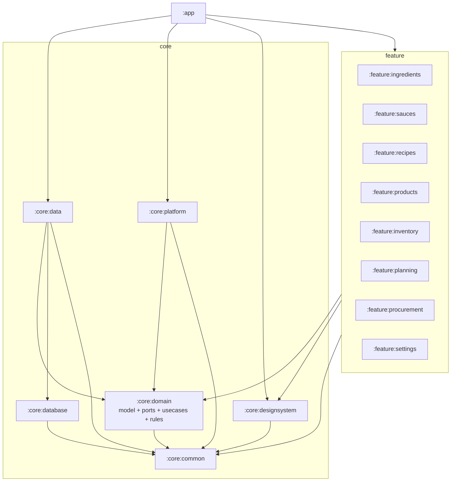

# CULINARY 模块拆分审查提案（15 模块）

**文档编号**：A03A
**版本**：`0.3.2`
**状态**：`Approved`（G2 历史结论）；**MISEBASE Stage 1–4 为 13 模块，Stage 5 起为 14 模块**
**日期**：2026-11-05
**负责人**：首席架构师 / 技术负责人
**关联决策**：D-004（ACCEPTED，G2）；MB-D-003（ACCEPTED，Stage 1–4 的 13 模块）；MB-D-004（ACCEPTED，Stage 5 起新增 `feature:scan`）
**配套文档**：[A03 模块职责与依赖关系](A03-MODULE-DEPENDENCIES.md)、[A02 整体架构](A02-SYSTEM-ARCHITECTURE.md)

---

> **MISEBASE 修订说明（2026-11-04；MB-D-003 / MB-D-018 已接受）**
>
> 本文的「15 模块」是 G2 阶段的历史事实（D-004 ACCEPTED，基线 `framework-0.1.0` / `2b523de`），
> 按 MB-D-018 **保留正文不改**。MISEBASE **Stage 1–4** 的目标模块集是 **13 模块**，由 MB-D-003 修订：
>
> | 变更 | 模块 | 说明 |
> |---|---|---|
> | 删除 | `feature:planning` | 不建独立制作计划；需求/缺口归 Inventory 计算 |
> | 删除 | `feature:procurement` | 不建采购/到货/供应商；缺料清单归 Inventory |
> | 缩减 | `feature:products` | 仅商品 / 包装规格 / 条码 / 食材映射；不含供应商管理、不含扫码 UI |
> | 保留 | `app` + 6 core + 5 feature | `ingredients`、`sauces`、`recipes`、`inventory`、`settings` |
> | 不新建 | `feature:scan` | **Stage 1–4** 不新建、不实现；MB-D-004 已于 2026-11-05 签收，**Stage 5 起新增** |
>
> 13 = 15 − 2；这是 **Stage 1–4 的目标**，不是对 G2 历史的改写，也不是“13 是历史错误”。
> Stage 5 起目标为 **14 = 13 + `feature:scan`**，见下方补充说明。
> §4 表中第 11/13/14 行的职责描述按上表理解；其余职责、依赖方向与 §8.1 备份边界继续有效。实际落地与前后对照见
> [MB-S1-02](../06-stage1/MB-S1-02-MODULE-ADJUSTMENT.md)。

---

> **MB-D-004 补充说明（2026-11-05，负责人签收）**
>
> - MB-D-003 的 **13 模块是 Stage 1–4 目标**，Stage 4 及之前实际为 13；不得把 13 写成历史错误；
> - MB-D-004 签收后，**Stage 5 起模块集为 14**，新增独立 `feature:scan`；
> - `feature:scan` 职责：扫码 UI、CameraX 生命周期、ML Kit 识别、去抖/一次性消费、识别结果展示；
> - 识别结果通过**明确接口**交给业务模块；`feature:scan` 不直接依赖其他 feature；
> - 食材创建/导入归 `feature:products`；库存操作归 `feature:inventory`；N1 五入口不变；
> - 本次签收不创建目录、不改 `settings.gradle.kts`、不改依赖检查当前期望值，**不构成 Stage 5 开发授权**。

---

## 1. 本文要解决的问题

D-004 要求：不预先强制锁定模块数量，先提交完整模块清单、职责边界、依赖关系图和拆分依据，经审查后再确定模块数量，避免过度模块化和循环依赖。

项目负责人已给出修订方向：

- `core:model` 合并到 `core:domain`；
- 酱汁（sauces）与菜谱（recipes）**保持独立模块**；
- 商品（products）与库存（inventory）**保持独立模块**；
- 两个业务模块之间通过明确接口/数据关系交互，不混用内部实现；
- 公共能力统一归属，避免重复实现。

因此本修订把推荐方案从 13 模块改为 **15 模块**，并给出完整职责表、依赖图与无环检查结果。

## 2. 审查标准

| 标准 | 说明 | 权重 |
|---|---|---:|
| 边界稳定性 | 模块内部是否因同一原因变化 | 30% |
| 依赖可控 | 是否能禁止 feature 互依赖、DB 泄漏到 UI | 25% |
| 独立测试 | 能否在没有 UI/真机的情况下测试核心 | 20% |
| 构建/维护成本 | 模块数、构建配置、认知负担 | 15% |
| 可替换/可扩展 | 能否替换扫码、备份、存储 | 10% |

## 3. 三种方案

| 方案 | 模块数 | 说明 | 结论 |
|---|---:|---|---|
| A 粗粒度 | 8 | app + 大 core + knowledge/operations/settings | 不推荐：core 单体、事务边界弱 |
| **B 平衡** | **15** | model 并入 domain；sauces/recipes、products/inventory 分开 | **推荐** |
| C 细粒度 | 16 | 在 B 基础上再拆出 `core:model` | 可选；仅当需要独立模型模块 |

> 15 = 16 − `core:model`。酱汁/菜谱、商品/库存均保持独立，满足负责人要求。

## 4. 推荐：15 模块职责表（G2 历史；MISEBASE 见顶部修订）

> 下表是 G2 的 15 模块职责。MISEBASE 目标为 13：第 11 行 `products` 去掉供应商、扫码 UI 待定；
> 第 13 行 `planning`、第 14 行 `procurement` 已删除；第 15 行 `settings` 保留。历史正文不改。

| # | 模块 | 类型 | 职责 | 数据归属（逻辑） | 允许依赖 | 禁止依赖 |
|---:|---|---|---|---|---|---|
| 1 | `:app` | 组合根 | Application/Activity；导航；Hilt 入口；启动/恢复编排；全局主题装配 | 无业务表 | 全部 feature、data、platform、designsystem | 不写业务规则；不直接写 DAO |
| 2 | `:core:common` | 基础设施 | Outcome、错误码、日志门面、Clock、ID、Dispatcher、通用脱敏 | 无 | Kotlin/协程/Timber | 任何业务模块、Android UI、Room |
| 3 | `:core:domain` | 领域/应用 | **领域模型 + 值对象**、Repository 端口、Use Case、配方图/单位/汇总/分配规则 | 无；只定义端口 | common、协程、java.time | Android、Room、Compose、Hilt、data、database、platform |
| 4 | `:core:database` | 持久化 | Room Entity/DAO/Database/View、Migration、Schema、索引/约束/触发器 | 物理表结构 | common、Room、AndroidX SQLite | domain、data、feature、Compose |
| 5 | `:core:data` | 数据访问 | Repository 实现、Mapper、事务协调、图片/文件、备份恢复、导入预检 | 所有业务数据读写 | domain、database、common | feature、app、Compose |
| 6 | `:core:designsystem` | 表现基础 | 主题、颜色、字体、间距、通用 Compose 组件、无图状态组件 | 无 | Compose、common | domain/data/database/feature |
| 7 | `:core:platform` | 设备能力 | CameraX/ML Kit、权限、SAF、WorkManager、分享/设备信息 | 无 | domain（仅端口实现）、common | data/database/feature、Compose 页面 |
| 8 | `:feature:ingredients` | 表现 | 食材列表/详情/编辑、别名、食材级换算 | 经 domain 端口操作 ingredient* | domain、designsystem、common | database、data 实现、其他 feature |
| 9 | `:feature:sauces` | 表现 | 酱汁列表/详情、版本、组成编辑、发布、历史 | 经 domain 端口操作 sauce* | domain、designsystem、common | database、data 实现、其他 feature |
| 10 | `:feature:recipes` | 表现 | 菜谱列表/详情、分类、版本、组成编辑、发布、历史 | 经 domain 端口操作 recipe* | domain、designsystem、common | database、data 实现、其他 feature |
| 11 | `:feature:products` | 表现 | 商品/品牌/包装规格、条码、供应商、商品归档 | 经 domain 端口操作 product/barcode/supplier | domain、designsystem、common | database、data 实现、其他 feature |
| 12 | `:feature:inventory` | 表现 | 批次、位置、在手/预留/可用、流水、调整、出库、调拨 | 经 domain 端口操作 batch/ledger/reservation/location | domain、designsystem、common | database、data 实现、其他 feature |
| 13 | `:feature:planning` | 表现 | 制作计划、明细、确认、快照、需求/缺口 | 经 domain 端口操作 plan/snapshot/requirement | domain、designsystem、common | database、data 实现、其他 feature |
| 14 | `:feature:procurement` | 表现 | 采购需求、采购单、收货、批次入库、作废/取消 | 经 domain 端口操作 procurement/PO/receipt | domain、designsystem、common | database、data 实现、其他 feature |
| 15 | `:feature:settings` | 表现 | 备份/恢复、诊断、偏好、关于、发布门禁提示 | 经 domain 端口操作 backup_record/app_metadata | domain、designsystem、common | database、data 实现、其他 feature |

## 5. 依赖关系图



## 6. 依赖边与无环检查

### 6.1 允许的边

```text
app -> ingredients, sauces, recipes, products, inventory, planning, procurement, settings
app -> data, platform, designsystem

ingredients, sauces, recipes, products, inventory, planning, procurement, settings
  -> domain, designsystem, common

domain -> common
data -> domain, database, common
database -> common
platform -> domain, common
designsystem -> common
```

### 6.2 禁止的边

```text
feature -> feature
feature -> data
feature -> database
domain -> data/database/platform/Android/Room/Compose
database -> domain
database -> data
platform -> data/database/feature
common -> 任何业务模块
任意模块 -> app
```

### 6.3 循环依赖检查结果

对上述有向图做拓扑排序：

```text
common
domain
database
designsystem
data
platform
ingredients
sauces
recipes
products
inventory
planning
procurement
settings
app
```

**结果：无环（DAG）。** 完整节点/边/拓扑序检查结果见 [module-dependency-check.txt](module-dependency-check.txt)。理由：

- 所有 feature 只指向 domain/designsystem/common，彼此没有边；
- domain 只指向 common；
- data 指向 domain/database/common，database 不反向依赖 domain/data；
- app 只作为终点，没有模块指向 app；
- platform 只指向 domain/common，不被 data/feature 反向依赖。

> CI 将在正式工程中加入依赖检查：feature 间 import、feature→Room、domain→Android、database→domain 均使构建失败。

## 7. 为什么只合并 `core:model`

| 合并 | 理由 | 边界保持 |
|---|---|---|
| `core:model` → `core:domain` | 模型与规则总是一起变化；拆开只增加模块声明与依赖，不增加边界 | 包级 `domain/model`、`domain/rule`、`domain/usecase`、`domain/repository`；仍禁止 Android/Room/Compose |

**不合并酱汁/菜谱：** 两者有独立的数据结构与业务职责，负责人明确要求独立；允许通过 domain 端口/版本引用互相引用，不直接依赖 feature。

**不合并商品/库存：** 商品档案与批次/流水/预留职责不同；库存需要独立的并发/事务测试；两者通过 `product_id` 数据关系与 domain 端口交互，不混用内部实现。

## 8. 模块间交互规则

| 场景 | 允许方式 | 禁止方式 |
|---|---|---|
| 菜谱引用酱汁 | `RecipeComponent` 保存 `referenced_sauce_id/version`；Use Case 校验；通过 `SauceRepository` 端口读取 | `feature:recipes` import `feature:sauces` 的 ViewModel/内部类 |
| 库存选择商品 | `InventoryRepository` 接收 `ProductId`；商品由 `ProductRepository` 提供 | 库存直接改 `product` 表/复用商品 UI 状态 |
| 计划生成采购需求 | `ConfirmPlanUseCase` 产出需求；`CreatePurchaseOrderUseCase` 读取需求 | 计划模块直接写采购单表 |
| 收货建批次 | `PostGoodsReceiptUseCase` 同事务写 receipt + batch + ledger | 采购模块直接改库存余额 |
| 备份读取 DB/图片 | `core:data/backup` 通过 database/files 端口 | feature 直接复制数据库文件 |

### 8.1 备份能力的 platform/data 边界（D-004 补充）

| 模块 | 负责 | 不负责 |
|---|---|---|
| `core:platform` | SAF、系统文件选择器、`Uri` 权限、相机权限、WorkManager 等 Android 平台能力；把 `Uri` 转换为不泄漏 Android 类型的句柄 | 备份格式、manifest、校验、打包/解包、恢复编排 |
| `core:data` | 备份格式、manifest、SHA-256、打包/解包、预检、恢复编排、journal/rollback | 直接 import `android.net.Uri`；直接调用 SAF；在领域接口暴露 `Intent`/`ActivityResult` |

桥接方式：

```kotlin
// core:domain（无 Android 类型）
@JvmInline
value class StorageHandle(val value: String)

interface BackupStoragePort {
    suspend fun createDocument(displayName: String, mimeType: String): Outcome<StorageHandle>
    suspend fun openInput(handle: StorageHandle): Outcome<InputStream>
    suspend fun openOutput(handle: StorageHandle): Outcome<OutputStream>
}
```

- `core:platform` 用 SAF 实现 `BackupStoragePort`，`StorageHandle` 内部保存 `Uri` 字符串，但接口不暴露 `Uri`。
- `core:data` 只依赖 `BackupStoragePort` 与 Java IO 流，不依赖 Android SAF。
- `:app` 负责把 platform 的实现注入 data；如需要，可加一层 app 适配，但不改变依赖方向。
- CI 检查：`core:data` 不得出现 `android.net.Uri`、`android.content.Intent`、`ActivityResult`；`core:platform` 不得包含备份格式/校验逻辑。

> 该边界是 D-004 的附加要求；不得为实现备份破坏既有模块依赖与 DAG。

## 9. 独立测试范围

| 模块 | 测试 |
|---|---|
| common | JVM：错误映射、ID、时间、脱敏 |
| domain | JVM：循环、单位、展开、汇总、缺口、状态机；fake repo |
| database | Robolectric/instrumented：DAO、约束、Migration、触发器 |
| data | 真 SQLite + 临时文件：事务、并发、备份 round-trip |
| platform | 权限状态机、扫码结果映射、SAF URI；真机扫码 |
| designsystem | Compose 组件/无障碍 |
| feature | ViewModel + fake Use Case + Compose UI Test |
| app | 导航冒烟、Hilt 图、启动恢复 |

## 10. 代价与风险

| 风险 | 说明 | 缓解 |
|---|---|---|
| 15 模块构建配置多 | 每模块 build.gradle + convention | 约定插件统一；只保留必要模块 |
| 酱汁/菜谱共享逻辑重复 | 版本/发布/组成交互相似 | 共享代码放 domain 与 designsystem；不复制业务规则 |
| 商品/库存跨模块流程 | 扫码→商品→入库 | domain Use Case 编排；app 导航；不直接 feature 依赖 |
| `core:domain` 变大 | 模型+规则+用例 | 包按子域分；纯 JVM 测试；超过阈值再拆 `core:model` |
| 合并 model 后边界弱 | 需包级约束 | 架构测试禁止 domain 内出现 Room/Android |

**拆分触发条件：**

- 单模块 > 3000 行生产代码或 > 15 个页面；
- 两个子域由不同人/不同发布节奏维护；
- 构建时间明显受单模块影响；
- 需要独立替换（如扫码）。

## 11. 审查结论（2026-11-04）

项目负责人已接受：

1. 15 模块为默认方案；
2. `core:model` 并入 `core:domain`，用包级边界保持模型独立；
3. 酱汁/菜谱、商品/库存保持独立，通过 domain 端口交互，feature 间零依赖；
4. 保持现有依赖方向与 DAG；
5. 接受“达到拆分触发条件再拆”的演进策略；
6. 接受第 8.1 节备份能力边界：platform 管 SAF/权限，data 管格式/校验/恢复编排，data 不依赖 Android SAF/Uri。

**D-004 = ACCEPTED。** 该结论不改变 G1：D-011 仍在修订，G1 继续保持 PENDING。

## 12. 与 A03 的关系

- A03 保留 16 模块的详细职责/接口/禁止依赖，作为边界字典；
- 本文给出 **15 模块**数量决策与依赖检查；
- D-004 审查通过后，按本文第 4 节建模块；A03 的 `core:model` 部分作为拆分参考。

## 13. MISEBASE 13 模块目标（2026-11-04）

| # | 模块 | 相对 G2 | MISEBASE 职责 |
|---:|---|---|---|
| 1 | `:app` | 保留 | 组合根、导航、Hilt 入口、启动/恢复编排 |
| 2 | `:core:common` | 保留 | Outcome/错误码/Clock/ID/日志门面 |
| 3 | `:core:domain` | 保留并扩展 | 领域模型、端口、Use Case、配方/单位/库存规则（纯 JVM） |
| 4 | `:core:database` | 保留，冻结 v1 | Room 实体/DAO/Schema；11 张休眠表只保留结构 |
| 5 | `:core:data` | 保留并扩展 | Repository 实现、事务、文件、备份编排 |
| 6 | `:core:designsystem` | 保留 | 主题与通用组件（Stage 1 不做视觉定稿） |
| 7 | `:core:platform` | 保留 | SAF、权限、CameraX、WorkManager |
| 8 | `:feature:ingredients` | 保留 | 食材库 |
| 9 | `:feature:sauces` | 保留 | 酱汁库 |
| 10 | `:feature:recipes` | 保留 | 菜谱库 |
| 11 | `:feature:products` | **缩减** | 商品 / 包装规格 / 条码 / 食材映射；无供应商管理；Stage 1–4 无扫码 UI，Stage 5 起扫码归 `feature:scan` |
| 12 | `:feature:inventory` | 保留 | 库存、需求计算、缺料/采购清单（内部能力） |
| 13 | `:feature:settings` | 保留 | 备份/恢复/诊断入口（后续阶段接线） |

**依赖边**：`app` → 6 feature + `core:data`/`core:platform`/`core:designsystem`；
feature → `core:domain`/`core:designsystem`/`core:common`；core 内部保持单向。
实测 13 节点 / 35 条声明边，拓扑排序无环（见 [MB-S1-02](../06-stage1/MB-S1-02-MODULE-ADJUSTMENT.md)）。

**Stage 5 目标模块集（14）**：在 Stage 1–4 的 13 模块之上新增
`:feature:scan`（扫码 UI/CameraX/识别），依赖 `core:domain`/`core:designsystem`/`core:common`；
识别结果经 app 导航或 domain 端口交给 `feature:products`（食材创建/导入）与
`feature:inventory`（库存操作）。Stage 5 前仍为 13，未创建目录、未改构建脚本。

**Stage 1–4 不新建**：`feature:scan`、`core:model`；Stage 5 起按 MB-D-004 新增 `feature:scan`。
**不实现**：独立计划/采购/供应商页面与模块；采购清单不落 `purchase_order*` 表。

## 14. 变更记录

| 版本 | 日期 | 变更 | 作者 |
|---|---|---|---|
| 0.1.0 | 2026-11-04 | 初稿；三方案对比，推荐 13 模块 | 架构组 |
| 0.2.0 | 2026-11-04 | 按负责人意见改为 15 模块：model 并入 domain；sauces/recipes、products/inventory 保持独立；补完整职责表、依赖图与无环检查 | 架构组 |
| 0.3.0 | 2026-11-04 | D-004 接受；补 platform/data 备份边界与 `BackupStoragePort`；状态改为 Approved | 架构组 |
| 0.3.1 | 2026-11-04 | MISEBASE：顶部加 13 模块修订说明；§4 标注历史；新增 §13 目标模块集；保留 G2 正文 | 接管工程组 |
| 0.3.2 | 2026-11-05 | MB-D-004 签收：明确 13 为 Stage 1–4 目标、Stage 5 起 14（新增 `feature:scan`）；补职责/接口原则与当前不创建边界 | 接管工程组 |
