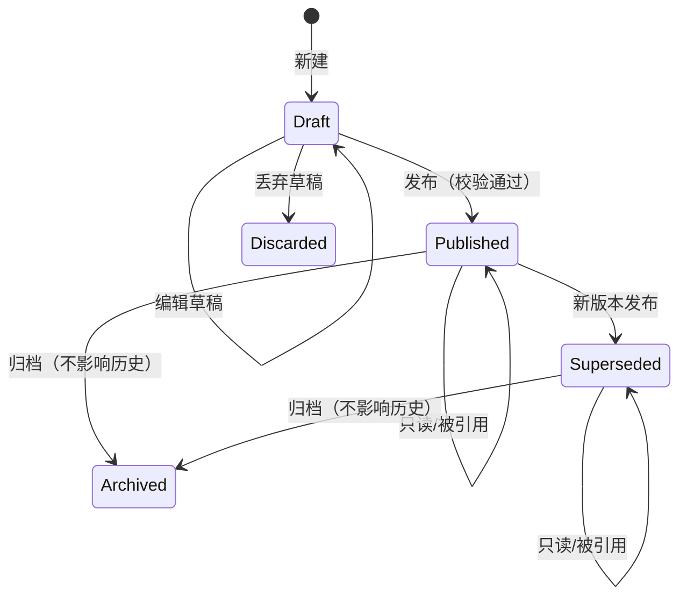
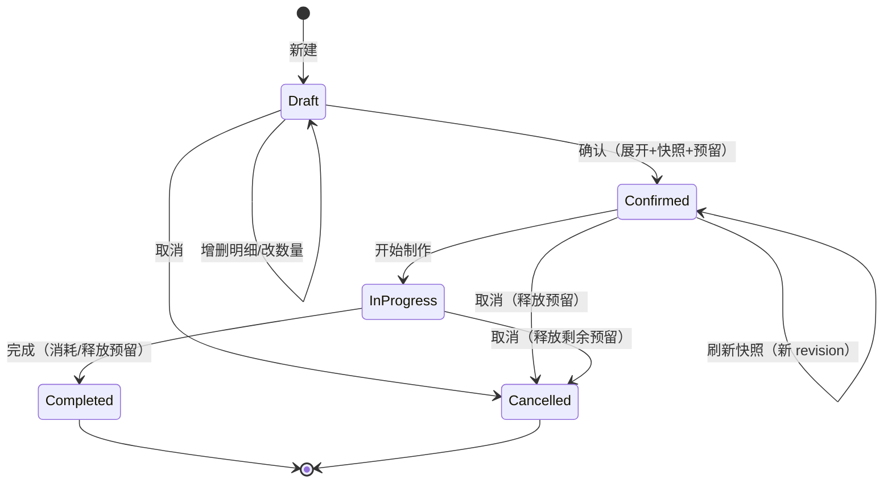
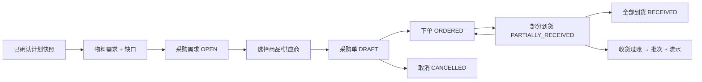
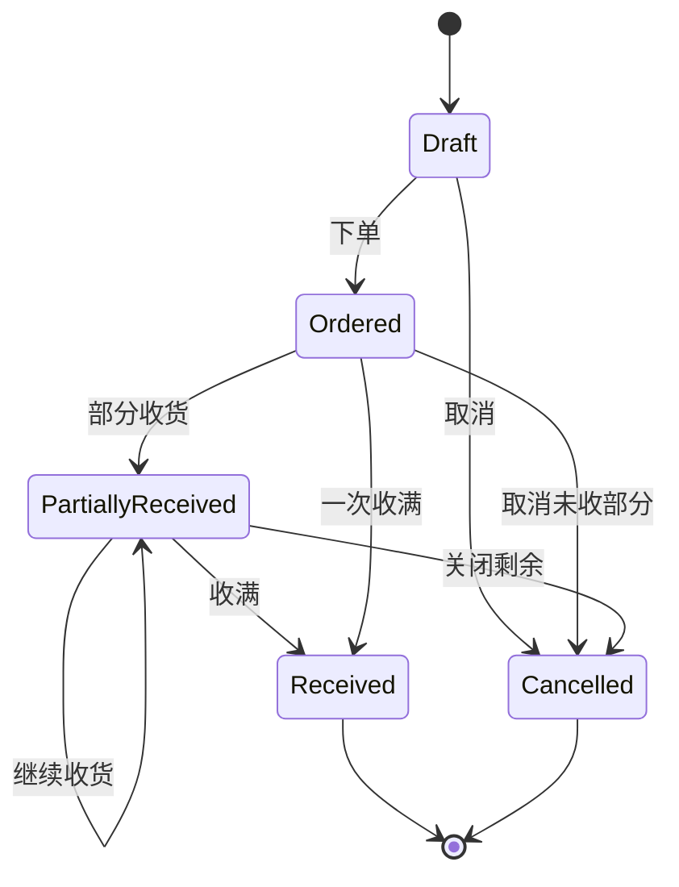

# CULINARY 核心业务流程设计

**文档编号**：A04
**版本**：`0.1.0`
**状态**：`Review`
**日期**：2026-11-04
**负责人**：首席架构师 / 技术负责人
**关联决策**：D-006、D-007、D-008、D-009、D-010、D-018、D-019、D-021、D-025

---

## 1. 流程设计原则

1. **先校验，后写入。** 任何会改变库存、版本、计划状态的写操作，先在内存中完成结构校验，再进入事务。
2. **一次业务动作一个事务。** 计划确认、收货过账、库存调整、发布配方都必须原子。
3. **历史不可变。** 已发布配方版本、已确认计划快照、库存流水不可原地修改。
4. **不可换算不猜。** 单位无依据时返回明确错误或分行，不自动“近似”。
5. **预留与实扣分离。** 预留只改变可用量，出库才改变在手量。
6. **所有缺口可追溯。** 每个需求行都能追到计划项、配方版本、组成行。

## 2. 配方与配方版本流程

### 2.1 生命周期



- 每个菜谱/酱汁最多一个 `Draft` 版本。
- `Published` 版本不可编辑；修改必须“复制为新草稿”。
- `Superseded` 仍可被旧计划引用；不可作为新计划的默认版本。
- 归档只影响新建引用，不影响已有快照。

### 2.2 创建配方

1. 输入名称、分类、产量、产量单位、基础信息。
2. 创建 `recipe` + 第一个 `recipe_version`（Draft）。
3. 添加组成行：
   - 食材：选择食材、数量、单位、备注。
   - 酱汁：选择酱汁、数量、单位；保存时记录目标酱汁的当前已发布版本（Draft 阶段可为空，发布时必须固定）。
   - 菜谱：选择菜谱、数量、单位；同上。
4. 可选：步骤、图片、标签。
5. 保存草稿：只校验字段格式与基本不变量，不要求所有子引用已发布。

### 2.3 发布配方

发布是原子操作，按以下顺序：

1. 校验名称、产量 > 0、产量单位合法。
2. 校验每条组成行：数量 > 0；类型与引用字段恰好匹配；单位存在。
3. 解析所有子引用：
   - 若 `child_version_id` 为空，取子实体的当前 `Published` 版本；
   - 若子实体没有已发布版本，拒绝发布，提示“先发布子配方”。
4. 固定 `child_version_id` 到组成行，形成不可变引用。
5. 构建版本图并做循环检测（见 2.4）。
6. 校验总节点数/深度未超限（D-025）。
7. 分配 `version_no = 当前最大 + 1`。
8. 将旧 `Published` 标记 `Superseded`，新版本标记 `Published`，并设为当前版本。
9. 写 `change_log`。
10. 提交事务。

失败时整个事务回滚，不产生“半个已发布版本”。

### 2.4 循环引用检测

**图定义：**

- 节点：一个具体的配方版本或酱汁版本（`recipe_version` / `sauce_version`）。
- 有向边：组成行 `RECIPE` / `SAUCE` 指向被引用的具体版本。
- 食材是叶子，不产生边。

**算法：** DFS 三色标记。

```text
state[node] = WHITE
stack = []
visit(node):
  if state[node] == GRAY:
     cycle = stack from node + node
     return RecipeCycleError(cycle)
  if state[node] == BLACK: return OK
  if stack.size >= MAX_DEPTH: return DepthExceeded
  state[node] = GRAY; stack.push(node)
  for line in node.lines where line is recipe/sauce:
     visit(line.childVersion)
  stack.pop(); state[node] = BLACK
  return OK
```

**要求：**

- 自引用（A → A）必须被检测。
- 多层循环（A → B → C → A）必须被检测。
- 跨类型循环（菜谱 → 酱汁 → 菜谱）必须被检测。
- 错误消息必须包含完整路径（名称 + 版本号），不能只说“存在循环”。
- 发布、计划确认、导入后完整性检查都要执行。

### 2.5 展开算法

输入：一组 `(recipeVersionId, targetQuantity, targetUnit)`。

```text
expand(version, requestedYieldQty, requestedUnit, path, optional):
  if depth > MAX_DEPTH or nodes > MAX_NODES: fail
  factor = convert(requestedYieldQty, requestedUnit, version.yieldUnit) / version.yieldQty
  for line in version.lines:
     qty = line.quantity * factor
     if line.type == INGREDIENT:
        emit(qty, line.unit, ingredient, path, optional || line.optional)
     else:
        child = line.childVersion
        childQtyInChildYieldUnit = convert(qty, line.unit, child.yieldUnit)
        childFactor = childQtyInChildYieldUnit / child.yieldQty
        expand(child, child.yieldQty * childFactor, child.yieldUnit,
               path + line, optional || line.optional)
```

关键点：

- **引用的数量是“要使用多少子配方成品”**，不是“做几批”。通过 `child.yieldQty` 换算成倍率。
- 若 `line.unit` 与 `child.yieldUnit` 不同维度且没有食材级换算，拒绝展开，返回 `UnitIncompatible`。
- 中间计算不四舍五入；只在显示层按单位精度格式化。
- 同一个子配方在不同分支出现时，分别展开，最后按食材汇总；不能因为“已经展开过”就跳过。
- 可选配料沿路径传播 `is_optional`；一个非可选行引用了一个含可选行的子配方时，子配方中的可选行仍为可选。

### 2.6 重复物料合并

1. 为每个食材选择“汇总单位”：
   - 食材 `default_unit_id`，前提是与该行单位可换算；
   - 否则使用该行单位；
   - 同一食材出现多种不可互转单位时，分别成行。
2. 对每一行，尝试换算到汇总单位。
3. 成功：合并数量，保留来源列表。
4. 失败：保留原单位单独成行，标记 `conversion_status = UNCONVERTIBLE`，不参与跨单位缺口比较。
5. 可选行单独标记，默认不计入缺口（O-02）。

**示例：**

- 菜谱 A 需要 100 g 黄油；菜谱 B 需要 0.2 kg 黄油；库存按 g。合并为 300 g。
- 菜谱 A 需要 1 杯面粉；没有面粉密度换算；库存按 g。保留“1 杯”行，标记不可换算，不猜测为 120 g。

### 2.7 配方修改对历史的影响

| 动作 | 对已发布版本 | 对旧计划 |
|---|---|---|
| 编辑草稿 | 无 | 无 |
| 发布新版本 | 旧版本变 Superseded，仍只读 | 无；计划仍引用旧版本 |
| 归档配方 | 不删除任何版本 | 无 |
| 删除草稿 | 只删草稿 | 无 |
| 刷新计划快照 | 生成新快照 | 旧快照保留，可对比 |

## 3. 制作计划流程

### 3.1 生命周期



- 日期可选；无日期计划仍可确认。
- 已确认计划的明细不可直接编辑；要改数量/菜品，需取消后新建，或走“刷新”流程（O-05）。
- 刷新会生成新快照，保留旧快照；预留按新需求重算。

### 3.2 创建计划

1. 输入标题、可选日期、备注。
2. 添加菜谱明细：选择菜谱、当前已发布版本、数量、单位。
3. 系统校验：
   - 版本已发布；
   - 数量 > 0；
   - 单位与配方产量单位可换算。
4. 保存为 Draft。

### 3.3 确认计划（核心事务）

```mermaid
sequenceDiagram
  participant UI
  participant UC as ConfirmPlanUseCase
  participant Graph as RecipeExploder
  participant Conv as UnitConverter
  participant Inv as InventoryRepository
  participant Repo as PlanRepository
  participant DB as SQLite

  UI->>UC: confirm(planId, reservationPolicy)
  UC->>Repo: load plan + items (write tx)
  UC->>UC: validate status = DRAFT, items not empty
  loop each item
    UC->>Graph: explode(version, qty, unit)
    Graph->>Conv: convert units
    Graph-->>UC: ingredient requirements + sources
  end
  UC->>UC: aggregate by ingredient + unit + optional
  UC->>Inv: snapshot available by ingredient/product/batch
  UC->>UC: shortage = max(0, required - available)
  alt reservationPolicy = RESERVE_AVAILABLE
    UC->>Inv: reserve FEFO up to required
  else reservationPolicy = REQUIRE_FULL_STOCK
    UC->>Inv: reserve; if insufficient -> fail
  end
  UC->>Repo: insert snapshot + requirements + sources
  UC->>Repo: set plan CONFIRMED, snapshot_id, confirmed_at
  Repo->>DB: COMMIT
  UC-->>UI: PlanConfirmed(snapshotId, shortageSummary)
```

**事务内必须完成：**

- 重新读取计划状态（防止并发重复确认）。
- 展开与汇总（可在事务前预计算，但事务内必须用同一版本/库存快照复核）。
- 写 `production_plan_snapshot`、`material_requirement`、`material_requirement_source`。
- 按策略写 `inventory_reservation` 与预留流水。
- 更新计划状态与 `current_snapshot_id`。
- 写变更日志。

**事务内禁止：**

- 用户交互、图片解码、网络、长文件复制。
- 逐条远程查询商品信息。

### 3.4 可用库存与缺口

对每个需求行：

```text
available = Σ over batches of products mapped to ingredient:
              convert(batch.on_hand - batch.reserved, batch.unit, requirement.unit)
shortage = max(0, required - available)
```

规则：

- 只统计 `ACTIVE` 且未过期的批次（过期是否自动排除待确认，默认排除并标记）。
- 商品必须映射到该食材；没有映射时 `available = 0`，并标记 `PRODUCT_MAPPING_MISSING`。
- 不可换算的库存不计入可用量；标记 `UNIT_MISMATCH`，不猜测。
- 可选行默认不计入缺口，但在界面单独显示。
- 缺口是“确认时快照”，后续库存变化不会自动改写；需要重新确认/刷新。

### 3.5 预留

| 策略 | 行为 | 适用 |
|---|---|---|
| `RESERVE_AVAILABLE`（默认） | 预留可用部分，剩余形成缺口，计划仍可确认 | 允许缺货先做计划 |
| `REQUIRE_FULL_STOCK` | 可用不足则整个确认失败，不写任何数据 | 必须备齐才开工 |
| `NO_RESERVATION` | 只计算缺口，不占用库存 | 仅做需求规划 |

- 预留按 FEFO（先到期先出）建议批次；用户可以手工调整（O-08）。
- 预留流水 `RESERVE`：`on_hand_delta=0`，`reserved_delta=+qty`。
- 释放：`reserved_delta=-qty`。
- 出库消耗：`on_hand_delta=-qty`，`reserved_delta=-qty`。
- 预留不得超过批次在手量；并发失败则重试整个确认事务。

### 3.6 计划执行与完成

- `IN_PROGRESS`：允许按明细/需求出库；每次出库关联计划与预留。
- `COMPLETED`：所有预留要么消耗、要么释放；不允许有 `ACTIVE` 预留残留。
- `CANCELLED`：释放所有 `ACTIVE` 预留；已发生的出库不回滚，需走退货/调整。

## 4. 库存流程

### 4.1 库存模型

```text
批次余额（on_hand）  — 实际在仓库的数量
预留（reserved）     — 已承诺给计划、尚未出库的数量
可用（available）    — on_hand - reserved
```

- 库存数量以商品的 `stock_unit_id` 记账。
- 商品定义 `content_qty` 与 `content_unit_id`，以及 `stock_to_content_factor`，用于与食材需求换算。
- 所有余额变化必须写 `inventory_ledger`，流水只追加。
- 余额更新使用条件 SQL，禁止负库存。

### 4.2 操作与流水

| 操作 | `on_hand_delta` | `reserved_delta` | 其他 |
|---|---:|---:|---|
| 采购入库 | +qty | 0 | 新建批次；关联收货明细 |
| 制作出库（已预留） | -qty | -qty | 关联计划/预留 |
| 制作出库（未预留） | -qty | 0 | 需明确原因 |
| 预留 | 0 | +qty | 关联计划/需求 |
| 释放预留 | 0 | -qty | 关联预留 |
| 盘点调增 | +qty | 0 | 必填原因 |
| 盘点调减 | -qty | 0 | 必填原因；不得使 on_hand < reserved |
| 报损 | -qty | 0 | 必填原因 |
| 调拨 | -qty / +qty | 0 | 两条流水，记录源/目标位置 |
| 退货入库 | +qty | 0 | 关联采购/供应商 |
| 收货作废冲正 | -qty | 0 | 仅未被动用的批次 |

### 4.3 入库

1. 选择采购单/明细（或手工入库）。
2. 输入实收数量、批次号、到期日、储存位置、单价。
3. 校验：数量 > 0；位置有效；不允许超过采购量（除非显式超收，O-09）。
4. 事务：
   - 创建 `inventory_batch`（若同批次同位置可合并？默认每次收货新建批次，保留收货追溯）；
   - 写 `PURCHASE_RECEIPT` 流水；
   - 更新采购明细 `received_qty`；
   - 更新采购单状态；
   - 关联 `procurement_requirement`。
5. 提交后刷新库存与采购状态。

### 4.4 出库

1. 选择计划/需求（或手工出库）。
2. 系统按 FEFO 建议批次与数量；用户可改。
3. 校验：批次可用量足够；若关联预留，预留量足够。
4. 事务：
   - 条件更新批次 `on_hand` 与 `reserved`；
   - 写 `PRODUCTION_ISSUE` 流水；
   - 更新预留状态；
   - 更新计划明细执行状态（可选）。
5. 失败：余额不足/并发冲突 -> 返回 `InsufficientStock` 或 `ConcurrentModification`，不写半条流水。

### 4.5 调整、报损、调拨

- 调整必须填写原因；调整前后余额写流水。
- 报损必须有原因；不影响预留，除非同时释放预留。
- 调拨必须是同一商品/批次，源与目标位置不同；两条流水在同一事务。
- 任何操作都不能直接 `UPDATE inventory_batch SET quantity_on_hand = ...` 而不写流水。

### 4.6 批次与位置

- 批次是最小追溯单元；同一商品可有多个批次。
- 批次有位置、到期日、收货来源、单价。
- 批次状态：`ACTIVE`、`DEPLETED`、`EXPIRED`、`DISCARDED`。
- 位置可层级化（厨房/冰箱/冷冻/储物架），但 v1 只要求一级或简单父子。
- 批次不允许硬删；耗尽后状态置 `DEPLETED`。

## 5. 采购流程

### 5.1 端到端



### 5.2 从缺口生成采购需求

1. 读取已确认计划快照的 `material_requirement`，筛选 `shortage_qty > 0` 且非可选。
2. 为每个缺口创建 `procurement_requirement`（OPEN）。
3. 用户为缺口选择商品（可能多个商品共同满足）与供应商。
4. 生成采购单草稿；采购数量默认 = 缺口，可调整。
5. 采购需求状态随采购单变化：`OPEN → ORDERED → PARTIAL → RECEIVED/CANCELLED`。

### 5.3 采购单状态



规则：

- `received_qty` 由过账的收货明细累加，不由用户手填。
- `cancelled_qty` 记录取消数量；`received + cancelled <= ordered`。
- 部分到货不改变采购单明细的 `ordered_qty`，只改 `received_qty`。
- 超收默认禁止；需要显式开关与原因（O-09）。

### 5.4 收货过账

**Draft 收货单可编辑；Posted 不可编辑；Void 只能冲正未动用批次。**

过账事务：

1. 锁定/读取收货单，状态必须 `DRAFT`。
2. 逐行校验：数量 > 0；采购明细存在；商品一致；不超过可收数量（除非允许超收）。
3. 创建批次（`batch_code`、到期日、位置、单价）。
4. 写 `PURCHASE_RECEIPT` 流水（+on_hand）。
5. 更新采购明细 `received_qty`。
6. 重新计算采购单状态。
7. 标记收货单 `POSTED`、`posted_at`。
8. 更新关联采购需求状态。
9. 提交。

**失败：** 整单回滚；不产生任何批次或流水。

### 5.5 部分到货、取消、差异

| 情况 | 处理 |
|---|---|
| 实收 < 订购 | 允许；采购单 `PARTIALLY_RECEIVED`；剩余可继续收或取消 |
| 实收 > 订购 | 默认拒绝；允许超收时记录原因与超出数量 |
| 到货商品与采购商品不符 | 拒绝过账；需改采购单或新建 |
| 采购取消 | 未收数量置 `cancelled_qty`；已收部分保留库存 |
| 收货单作废 | 仅批次未被出库/预留/调整时可冲正；否则走退货/报损 |
| 供应商少发 | 记录差异；剩余关闭或补发 |

## 6. 数据追溯链

```text
production_plan
  └─ production_plan_item (recipe_version_id)
       └─ plan_snapshot (payload, engine_version)
            └─ material_requirement
                 ├─ material_requirement_source
                 │    └─ recipe_component / sauce_component
                 └─ procurement_requirement
                      └─ purchase_order_item
                           └─ goods_receipt_item
                                └─ inventory_batch
                                     └─ inventory_ledger
```

任何一条库存流水都能回答：**哪次收货/哪个计划/哪条配方行导致了它**。任何一条需求都能回答：**它来自哪个计划的哪道菜、哪一版配方、哪一行组成**。

## 7. 边界与异常场景

| 场景 | 期望行为 | 错误码（示例） |
|---|---|---|
| 菜谱引用自身 | 发布/确认被拒绝，显示路径 | `CUL-REP-001` |
| A→B→C→A | 同上 | `CUL-REP-001` |
| 子配方未发布 | 拒绝发布父配方 | `CUL-REP-002` |
| 配方产量为 0 | 拒绝保存/发布 | `CUL-REP-003` |
| 组成行数量 ≤ 0 | 拒绝保存 | `CUL-VAL-001` |
| 单位不可换算 | 汇总分行并标记；需要时拒绝确认 | `CUL-UNIT-001` |
| 商品未映射食材 | 缺口可用量为 0，标记 | `CUL-INV-003` |
| 库存不足 | 按策略形成缺口或拒绝确认 | `CUL-INV-001` |
| 并发写同一批次 | 条件更新失败，重试/提示 | `CUL-CON-001` |
| 计划无明细 | 拒绝确认 | `CUL-PLAN-001` |
| 计划已确认再次确认 | 拒绝；提示刷新/新建 | `CUL-PLAN-002` |
| 采购超收 | 默认拒绝 | `CUL-PO-001` |
| 收货单重复过账 | 拒绝 | `CUL-PO-002` |
| 图片文件缺失 | 按无图显示，记录诊断 | `CUL-FILE-002` |

## 8. 待确认的业务细节

以下内容在 P02 中有正式编号；本节只标注流程影响：

- 预留策略默认值（O-01）。
- 可选配料是否计入缺口（O-02）。
- 损耗/得率（O-03）。
- 刷新计划是否允许改数量（O-05）。
- 批次选择策略（O-08）。
- 超收与作废规则（O-09/O-10）。
- 过期批次是否自动排除（建议：是，但需确认）。

在确认前，代码按“默认值 + 可配置策略”实现，不把默认值写死到领域规则里。

## 9. 变更记录

| 版本 | 日期 | 变更 | 作者 |
|---|---|---|---|
| 0.1.0 | 2026-11-04 | 初稿；覆盖配方、计划、库存、采购主流程与异常 | 架构组 |
