# CULINARY 数据库 ER 图与数据模型说明

**文档编号**：A05
**版本**：`0.1.1`
**状态**：`Review`
**日期**：2026-11-04
**负责人**：首席架构师 / 技术负责人
**配套文档**：[A06 数据字典](A06-DATA-DICTIONARY.md)

---

## 1. 建模原则

| 原则 | 说明 |
|---|---|
| 单一事实来源 | 库存余额在批次；变化在流水；配方结构在版本；计划历史在快照 |
| 版本不可变 | 已发布配方版本、已确认计划快照、库存流水只追加 |
| 引用固定 | 计划项固定 `recipe_version_id`；组成行固定子版本 |
| 单位显式 | 所有数量带 `unit_id`；不存“无单位数字” |
| 金额整数 | 价格用最小货币单位整数，避免浮点金额 |
| 时间分离 | 审计时间 UTC epoch millis；业务日期 `YYYY-MM-DD`；计划带时区 |
| 软删除 | 聚合根带 `deleted_at`；库存/流水/已发布版本不硬删 |
| 外键真实 | 除图片、变更日志等多态表外，不使用“字符串随便指” |
| 索引跟随查询 | 每个外键列建索引；状态/日期组合索引；不过度索引 |

## 2. 聚合边界

| 聚合根 | 内部实体 | 事务边界 |
|---|---|---|
| 食材 | 别名、食材级单位换算 | 保存食材时一并写 |
| 商品 | 条码 | 保存商品时一并写 |
| 酱汁 | 酱汁版本、组成行 | 发布版本时原子写 |
| 菜谱 | 菜谱版本、组成行 | 发布版本时原子写 |
| 库存批次 | 流水、预留 | 每次库存操作一个事务 |
| 制作计划 | 明细、快照、需求、来源 | 确认计划一个事务 |
| 采购单 | 明细 | 保存/下单一个事务 |
| 收货单 | 收货明细、批次、流水 | 过账一个事务 |
| 备份记录 | 无 | 备份完成后写一条 |

## 3. ER 图

> 图中只列关键字段；完整字段、类型、约束、索引见 [A06 数据字典](A06-DATA-DICTIONARY.md)。

```mermaid
erDiagram
  UNIT {
    string id PK
    string code UK
    string dimension
    real base_factor
  }

  INGREDIENT {
    string id PK
    string name
    string normalized_name
    string status
    string default_unit_id FK
    int deleted_at
  }

  INGREDIENT_ALIAS {
    string id PK
    string ingredient_id FK
    string alias
  }

  INGREDIENT_UNIT_CONVERSION {
    string id PK
    string ingredient_id FK
    string from_unit_id FK
    string to_unit_id FK
    real factor
  }

  SAUCE {
    string id PK
    string name
    string status
    int deleted_at
  }

  SAUCE_VERSION {
    string id PK
    string sauce_id FK
    int version_no
    string status
    real yield_qty
    string yield_unit_id FK
    int is_current
  }

  SAUCE_COMPONENT {
    string id PK
    string sauce_version_id FK
    int line_no
    string component_type
    string ingredient_id FK
    string referenced_sauce_id FK
    string referenced_sauce_version_id FK
    string referenced_recipe_id FK
    string referenced_recipe_version_id FK
    real quantity
    string unit_id FK
    int is_optional
  }

  RECIPE {
    string id PK
    string name
    string category
    string status
    int deleted_at
  }

  RECIPE_VERSION {
    string id PK
    string recipe_id FK
    int version_no
    string status
    real yield_qty
    string yield_unit_id FK
    int is_current
  }

  RECIPE_COMPONENT {
    string id PK
    string recipe_version_id FK
    int line_no
    string component_type
    string ingredient_id FK
    string referenced_sauce_id FK
    string referenced_sauce_version_id FK
    string referenced_recipe_id FK
    string referenced_recipe_version_id FK
    real quantity
    string unit_id FK
    int is_optional
  }

  SUPPLIER {
    string id PK
    string name
    string status
  }

  PRODUCT {
    string id PK
    string ingredient_id FK
    string supplier_id FK
    string name
    string brand
    real content_qty
    string content_unit_id FK
    string stock_unit_id FK
    real stock_to_content_factor
    string status
  }

  BARCODE {
    string id PK
    string product_id FK
    string code UK
    int is_primary
  }

  STORAGE_LOCATION {
    string id PK
    string parent_id FK
    string name
    string kind
  }

  INVENTORY_BATCH {
    string id PK
    string product_id FK
    string location_id FK
    string batch_code
    real quantity_on_hand
    real quantity_reserved
    string stock_unit_id FK
    string status
  }

  INVENTORY_LEDGER {
    string id PK
    string batch_id FK
    string type
    real on_hand_delta
    real reserved_delta
    real on_hand_after
    real reserved_after
    string idempotency_key UK
  }

  INVENTORY_RESERVATION {
    string id PK
    string plan_id FK
    string plan_item_id FK
    string requirement_id FK
    string batch_id FK
    real quantity
    string status
  }

  PRODUCTION_PLAN {
    string id PK
    string title
    string planned_date
    string status
    string current_snapshot_id FK
    int revision
  }

  PRODUCTION_PLAN_ITEM {
    string id PK
    string plan_id FK
    string recipe_id FK
    string recipe_version_id FK
    real quantity
    string unit_id FK
  }

  PRODUCTION_PLAN_SNAPSHOT {
    string id PK
    string plan_id FK
    int revision_no
    string engine_version
    string payload_json
    string payload_hash
  }

  MATERIAL_REQUIREMENT {
    string id PK
    string snapshot_id FK
    string ingredient_id FK
    real required_qty
    string unit_id FK
    real shortage_qty
    int is_optional
  }

  MATERIAL_REQUIREMENT_SOURCE {
    string id PK
    string requirement_id FK
    string plan_item_id FK
    string source_path
    real quantity
    string unit_id FK
  }

  PROCUREMENT_REQUIREMENT {
    string id PK
    string plan_id FK
    string requirement_id FK
    string ingredient_id FK
    string product_id FK
    real requested_qty
    string status
  }

  PURCHASE_ORDER {
    string id PK
    string code UK
    string supplier_id FK
    string status
    string source_plan_id FK
  }

  PURCHASE_ORDER_ITEM {
    string id PK
    string purchase_order_id FK
    string product_id FK
    real ordered_qty
    real received_qty
    real cancelled_qty
  }

  GOODS_RECEIPT {
    string id PK
    string purchase_order_id FK
    string location_id FK
    string status
  }

  GOODS_RECEIPT_ITEM {
    string id PK
    string goods_receipt_id FK
    string purchase_order_item_id FK
    string product_id FK
    real quantity
    string created_batch_id FK
  }

  IMAGE_ASSET {
    string id PK
    string owner_type
    string owner_id
    string role
    string relative_path UK
    string sha256
  }

  CHANGE_LOG {
    string id PK
    string entity_type
    string entity_id
    string action
    int created_at
  }

  BACKUP_RECORD {
    string id PK
    string kind
    string file_name
    string sha256
    string status
  }

  APP_METADATA {
    string key PK
    string value
  }

  UNIT ||--o{ INGREDIENT : "default_unit"
  UNIT ||--o{ INGREDIENT_UNIT_CONVERSION : "from"
  UNIT ||--o{ INGREDIENT_UNIT_CONVERSION : "to"
  INGREDIENT ||--o{ INGREDIENT_ALIAS : "has"
  INGREDIENT ||--o{ INGREDIENT_UNIT_CONVERSION : "defines"
  INGREDIENT ||--o{ PRODUCT : "has products"
  INGREDIENT ||--o{ RECIPE_COMPONENT : "used in"
  INGREDIENT ||--o{ SAUCE_COMPONENT : "used in"
  INGREDIENT ||--o{ MATERIAL_REQUIREMENT : "required as"

  SAUCE ||--o{ SAUCE_VERSION : "has versions"
  SAUCE_VERSION ||--o{ SAUCE_COMPONENT : "owns lines"
  SAUCE ||--o{ SAUCE_COMPONENT : "referenced by"
  SAUCE_VERSION ||--o{ SAUCE_COMPONENT : "referenced version"
  RECIPE ||--o{ SAUCE_COMPONENT : "referenced by"
  RECIPE_VERSION ||--o{ SAUCE_COMPONENT : "referenced version"

  RECIPE ||--o{ RECIPE_VERSION : "has versions"
  RECIPE_VERSION ||--o{ RECIPE_COMPONENT : "owns lines"
  RECIPE ||--o{ RECIPE_COMPONENT : "referenced by"
  RECIPE_VERSION ||--o{ RECIPE_COMPONENT : "referenced version"
  SAUCE ||--o{ RECIPE_COMPONENT : "referenced by"
  SAUCE_VERSION ||--o{ RECIPE_COMPONENT : "referenced version"

  SUPPLIER ||--o{ PRODUCT : "supplies"
  SUPPLIER ||--o{ PURCHASE_ORDER : "receives"
  PRODUCT ||--o{ BARCODE : "has"
  PRODUCT ||--o{ INVENTORY_BATCH : "stocked as"
  PRODUCT ||--o{ PURCHASE_ORDER_ITEM : "ordered as"
  PRODUCT ||--o{ GOODS_RECEIPT_ITEM : "received as"
  PRODUCT ||--o{ PROCUREMENT_REQUIREMENT : "satisfies"

  STORAGE_LOCATION ||--o{ STORAGE_LOCATION : "parent"
  STORAGE_LOCATION ||--o{ INVENTORY_BATCH : "holds"
  STORAGE_LOCATION ||--o{ GOODS_RECEIPT : "receives at"

  INVENTORY_BATCH ||--o{ INVENTORY_LEDGER : "records"
  INVENTORY_BATCH ||--o{ INVENTORY_RESERVATION : "reserved in"
  INVENTORY_BATCH ||--o| GOODS_RECEIPT_ITEM : "created from"

  PRODUCTION_PLAN ||--o{ PRODUCTION_PLAN_ITEM : "contains"
  PRODUCTION_PLAN ||--o{ PRODUCTION_PLAN_SNAPSHOT : "snapshots"
  PRODUCTION_PLAN ||--o{ INVENTORY_RESERVATION : "reserves"
  PRODUCTION_PLAN ||--o{ PROCUREMENT_REQUIREMENT : "generates"
  RECIPE ||--o{ PRODUCTION_PLAN_ITEM : "planned as"
  RECIPE_VERSION ||--o{ PRODUCTION_PLAN_ITEM : "pinned version"

  PRODUCTION_PLAN_SNAPSHOT ||--o{ MATERIAL_REQUIREMENT : "aggregates"
  MATERIAL_REQUIREMENT ||--o{ MATERIAL_REQUIREMENT_SOURCE : "traces"
  PRODUCTION_PLAN_ITEM ||--o{ MATERIAL_REQUIREMENT_SOURCE : "contributes"
  MATERIAL_REQUIREMENT ||--o{ PROCUREMENT_REQUIREMENT : "shortage becomes"
  MATERIAL_REQUIREMENT ||--o{ INVENTORY_RESERVATION : "covered by"

  PURCHASE_ORDER ||--o{ PURCHASE_ORDER_ITEM : "contains"
  PURCHASE_ORDER ||--o{ GOODS_RECEIPT : "receives"
  GOODS_RECEIPT ||--o{ GOODS_RECEIPT_ITEM : "contains"
  PURCHASE_ORDER_ITEM ||--o{ GOODS_RECEIPT_ITEM : "fulfilled by"
```

## 4. 关系说明

### 4.1 知识档案

- `ingredient` 是抽象食材；`product` 是实际采购 SKU；一个食材对多个商品。
- `recipe` / `sauce` 是身份与元数据；`*_version` 是不可变配方版本；`*_component` 是版本内组成行。
- 组成行通过 `component_type` + 可空外键表达三选一：
  - `INGREDIENT` → `ingredient_id`
  - `SAUCE` → `referenced_sauce_id` + `referenced_sauce_version_id`
  - `RECIPE` → `referenced_recipe_id` + `referenced_recipe_version_id`
- 数据库用 `CHECK` 保证“类型与引用字段一致”；跨表状态（子版本必须已发布）由 Use Case 校验。
- 没有第四个知识库；高汤/预制件通过 `recipe.category` 表达。

### 4.2 商品与库存

- 商品必须属于一个食材；`content_qty/content_unit` 表示包装内容量；`stock_unit` 是库存记账单位；`stock_to_content_factor` 把 1 个库存单位换算为内容单位。
- 例：Président 黄油 200 g，库存单位“包”，内容 200 g，因子 200；库存 3 包 = 600 g。
- 散装商品可令 `stock_unit = content_unit`，因子 1。
- 批次属于商品与位置；批次余额是物化值，流水是事实。
- `inventory_reservation` 关联计划/需求/批次；预留量计入批次的 `quantity_reserved`，不改变 `quantity_on_hand`。

### 4.3 计划与需求

> **DORMANT（MB-D-005 ACCEPTED）**：`production_plan`、`production_plan_item`、
> `production_plan_snapshot`、`material_requirement`、`material_requirement_source`
> 保留 schema v1 结构，不删除/不迁移/不改造；禁止新代码引用。MISEBASE 不建独立计划模块。

- `production_plan_item.recipe_version_id` 固定版本；`quantity/unit` 是目标产量。
- `production_plan_snapshot` 保存完整展开 JSON + 引擎版本 + hash；每次刷新生成新 revision。
- `material_requirement` 是按食材 + 单位 + 可选标记汇总后的需求；`shortage_qty` 是确认时快照。
- `material_requirement_source` 保存每条来源路径与数量，用于“为什么需要它”。
- `procurement_requirement` 把缺口转成可采购项，可关联商品与采购单。

### 4.4 采购与收货

> **DORMANT（MB-D-005 ACCEPTED）**：`procurement_requirement`、`purchase_order`、
> `purchase_order_item`、`goods_receipt`、`goods_receipt_item` 保留结构、禁止新代码引用。
> MISEBASE 不做采购单/到货/供应商；缺料清单归 Inventory。

- 采购单可有多次收货；`purchase_order_item.received_qty` 由过账累加。
- 收货明细过账后创建批次，形成 `PURCHASE_RECEIPT` 流水。
- 收货单 `VOID` 不是删除，而是冲正；是否允许取决于批次是否已被使用。

### 4.5 多态表

只有两类表使用多态引用：

- `image_asset`：`owner_type` + `owner_id`，无外键；由应用校验。
- `change_log`：`entity_type` + `entity_id`，无外键；只追加。

其余关系全部使用真实外键，禁止“字符串随便指”。

## 5. 主键、外键与唯一性

### 5.1 主键

- 所有业务表：`id TEXT PRIMARY KEY`，小写 UUID v4。
- 不使用自增整数作为业务主键：备份合并、未来同步、离线创建都更安全。
- `unit.code`、`barcode.code`、`purchase_order.code`、`goods_receipt.receipt_no` 是业务唯一键。

### 5.2 外键行为

| 关系 | 行为 | 理由 |
|---|---|---|
| 版本 → 配方/酱汁 | `ON DELETE CASCADE` | 删除草稿配方时清理其版本；已发布版本由应用禁止删除 |
| 组成行 → 版本 | `ON DELETE CASCADE` | 版本内部实体 |
| 商品 → 食材 | `RESTRICT` | 有商品的食材不能硬删 |
| 批次 → 商品 | `RESTRICT` | 有库存的商品不能硬删 |
| 流水 → 批次 | `RESTRICT` | 流水不可因批次删除而丢 |
| 预留 → 批次/计划 | `RESTRICT` | 预留必须显式释放 |
| 采购明细 → 采购单 | `CASCADE` | 草稿采购单可整体删除 |
| 收货明细 → 收货单 | `CASCADE` | 草稿收货单可整体删除 |
| 收货明细 → 批次 | `SET NULL` | 批次保留，来源可空 |
| 计划明细 → 计划 | `CASCADE` | 草稿计划可删 |
| 快照 → 计划 | `CASCADE` | 计划删除时快照随删（仅草稿可删） |

**原则：** 历史数据用 `RESTRICT`；只有“聚合内部、尚未成为历史”的子行才 `CASCADE`。

### 5.3 唯一性

| 约束 | 说明 |
|---|---|
| `unit.code` | 全局唯一 |
| `ingredient.normalized_name`（未删除） | 防止重复食材；规范化后唯一 |
| `ingredient_alias.normalized_alias` | 全局唯一，避免别名歧义 |
| `sauce/recipe.normalized_name`（未删除） | 同类档案内唯一 |
| `*_version(entity_id, version_no)` | 版本号唯一 |
| `*_version(entity_id) WHERE is_current=1` | 每个实体至多一个当前版本 |
| `barcode.code` | 全局唯一；一个条码只对应一个商品（O-15） |
| `purchase_order.code` | 全局唯一 |
| `goods_receipt.receipt_no` | 全局唯一 |
| `inventory_ledger.idempotency_key` | 防止重复过账 |
| `image_asset.relative_path` | 文件路径唯一 |
| `image_asset(owner_type, owner_id) WHERE role='PRIMARY' AND deleted_at IS NULL` | 每个对象至多一张主图 |

## 6. 索引策略

### 6.1 必建索引

- 所有外键列（SQLite 不会自动为子表外键建索引）。
- 所有 `normalized_name` / `code` 查询列。
- 状态 + 日期组合：`production_plan(status, planned_date)`、`purchase_order(status, ordered_at)`、`inventory_batch(status, expiry_date)`。
- 流水：`inventory_ledger(batch_id, occurred_at)`、`(reference_type, reference_id)`。
- 计划：`production_plan_item(plan_id, sort_order)`、`material_requirement(snapshot_id)`。
- 变化日志：`change_log(entity_type, entity_id, created_at)`。

### 6.2 不建索引

- 低选择性布尔列单独索引。
- 大文本列（`instructions_md`、`payload_json`）不做普通索引。
- 频繁写入的流水表不建过多二级索引；只保留查询必需的。

### 6.3 查询原则

- 列表分页，不一次性加载全部。
- 避免 N+1：列表查询用投影/`@Relation`，详情按需加载。
- `LIKE '%q%'` 在 2 万级数据可接受；超过阈值再评估 FTS（O-25）。
- 聚合查询在 SQL 做，单位换算在领域层做；不把不可换算的数量硬加。

## 7. 删除与关联数据策略

| 对象 | 策略 |
|---|---|
| 食材 | 有商品/配方引用时只能归档；无引用且无历史时可硬删（默认不提供 UI 硬删） |
| 商品 | 有库存/流水/采购历史时只能归档；归档后不可用于新计划/采购，历史可查 |
| 酱汁/菜谱 | 已发布版本不可删；草稿可删；归档不影响历史引用 |
| 配方版本 | 已发布/被引用不可删；草稿可删 |
| 批次 | 不硬删；耗尽置 `DEPLETED`，报损置 `DISCARDED` |
| 流水 | 永不删除、永不更新 |
| 计划 | 仅草稿可删；已确认/完成不可删，只能取消 |
| 采购单 | 仅草稿可删；已下单只能取消/关闭 |
| 收货单 | 草稿可删；已过账只能作废冲正 |
| 图片 | 标记 `deleted_at`，延迟清理文件；被引用时先解绑 |
| 备份记录 | 可删记录，但文件由保留策略清理 |

**禁止：** 用 `ON DELETE CASCADE` 删除库存、流水、已确认计划、已发布版本。

## 8. 数据量与分区

目标规模（O-21）：

| 表 | 预估行数 | 说明 |
|---|---:|---|
| ingredient | 2,000 | 个人长期积累 |
| recipe/sauce | 3,000 | 含版本 |
| product | 5,000 | 含归档 |
| inventory_batch | 20,000 | 多年收货 |
| inventory_ledger | 200,000 | 每次库存动作 |
| production_plan | 5,000 | 多年 |
| material_requirement | 100,000 | 每计划数十行 |

此规模下无需分区。超过 100 万流水再考虑归档表/冷热分离；本阶段不预建。

## 9. 视图

| 视图 | 作用 |
|---|---|
| `v_batch_available` | `quantity_on_hand - quantity_reserved`，统一可用量口径 |
| `v_product_stock` | 按商品汇总在手/预留/可用（库存单位） |
| `v_plan_shortage` | 计划快照的缺口汇总（只读） |

视图不承担单位换算；跨单位汇总在领域层。

## 10. 与业务流程的对应

| 流程 | 主要表 |
|---|---|
| 发布配方 | recipe/sauce + version + component + change_log |
| 确认计划 | plan + item + snapshot + requirement + source + reservation + ledger |
| 采购入库 | PO + receipt + receipt_item + batch + ledger |
| 制作出库 | batch + ledger + reservation + plan_item |
| 盘点调整 | batch + ledger |
| 备份恢复 | backup_record + app_metadata（+ 文件系统） |

## 11. 变更记录

| 版本 | 日期 | 变更 | 作者 |
|---|---|---|---|
| 0.1.0 | 2026-11-04 | 初稿；建立 31 个实体、关系、约束与删除策略；统一 `referenced_*` 外键命名 | 架构组 |
| 0.1.1 | 2026-11-04 | MB-D-005：§4.3/§4.4 标注 11 张 DORMANT 表；未改 schema/ER 结构 | 接管工程组 |
