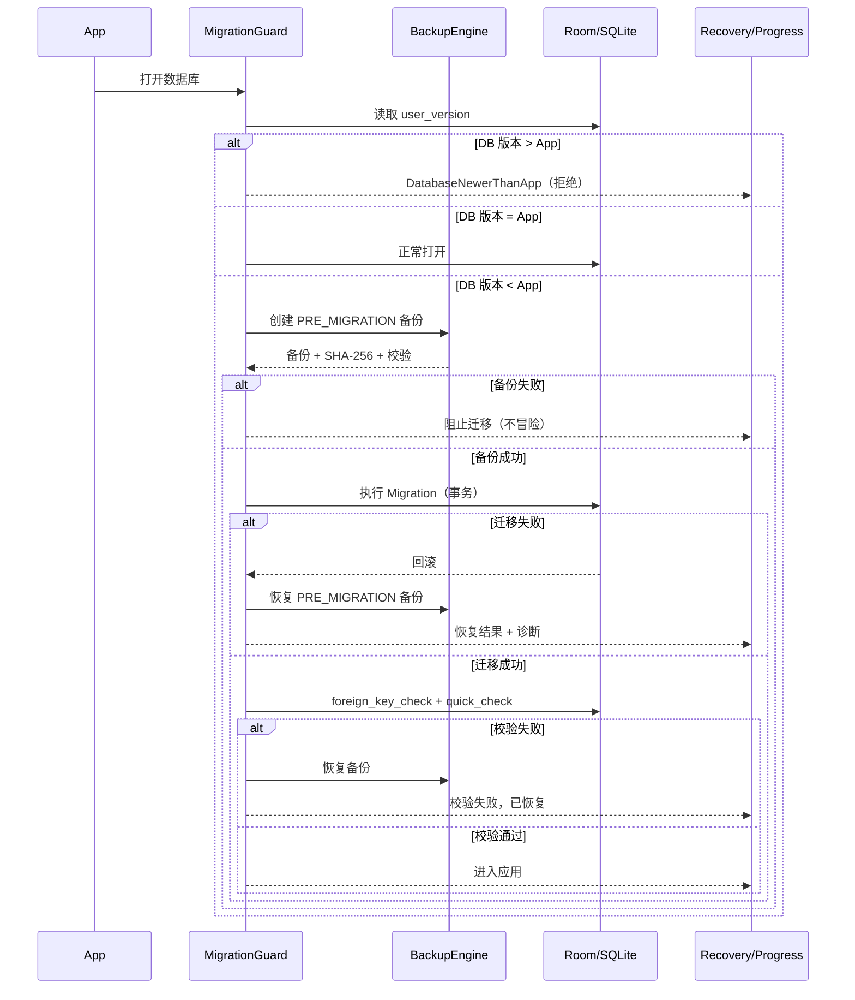

# CULINARY 数据版本与迁移设计

**文档编号**：A07
**版本**：`0.1.0`
**状态**：`Review`
**日期**：2026-11-04
**负责人**：首席架构师 / 技术负责人
**关联决策**：D-006、D-007、D-011

---

## 1. 六类“版本”必须分开

CULINARY 中同时存在六种版本号，任何一个都不能替代另一个。

| 版本 | 载体 | 示例 | 作用 |
|---|---|---|---|
| App 版本 | `versionName` / `versionCode` | `1.4.2` / `10402` | 发布与回滚 |
| 数据库 Schema 版本 | Room `@Database(version=)` / `PRAGMA user_version` | `7` | 表结构迁移 |
| 备份格式版本 | `manifest.format_version` | `1` | 备份/恢复兼容 |
| 配方版本 | `recipe_version.version_no` / `sauce_version.version_no` | `3` | 配方内容演进 |
| 计划快照版本 | `production_plan_snapshot.revision_no` + `engine_version` | `2` / `1.0.0` | 历史物料计算回放 |
| 文档/架构版本 | 文档头 | `0.1.0` | 工程治理 |

**规则：** 数据库 schema 版本与 App 版本**不绑定**。App 从 1.0 到 1.1 可能没有数据库变更；一次数据库迁移也可能跨多个 App 小版本。

## 2. 兼容性总策略

### 2.1 App 与数据库

| 情况 | 行为 |
|---|---|
| App 的 schema 版本 = DB 版本 | 正常打开 |
| App 的 schema 版本 > DB 版本 | 执行迁移；迁移前自动备份；失败则恢复 |
| App 的 schema 版本 < DB 版本 | **拒绝打开**；提示“数据由更新版本创建”，提供导出/安装新版本指引；禁止降级/破坏 |
| DB 损坏 | 进入恢复模式；不自动删除；从最近验证备份恢复需用户确认 |

### 2.2 App 与备份

| 备份 schema | 当前 App schema | 行为 |
|---|---|---|
| ≤ | 支持 | 允许恢复；恢复后由当前 App 执行迁移 |
| > | 任意 | 拒绝；提示升级 App |
| 备份格式版本 < 当前支持 | 支持 | 由 importer 升级 |
| 备份格式版本 > 当前支持 | 任意 | 拒绝 |

### 2.3 代码回档与数据回档

**代码回档不等于数据库回档。**

- `git revert` / 安装旧 APK 只改变代码，不改变设备上的数据库。
- 如果旧代码的 schema 版本低于当前 DB，旧代码**不能**直接打开；必须：
  1. 保持新版本运行；或
  2. 从升级前备份恢复数据库（会丢失升级后数据）；或
  3. 提供一次性导出/降级工具（本阶段不做）。
- 不允许通过“删除数据库/清空数据”让旧代码启动。这是数据丢失，不是回滚。

### 2.4 迁移方向

- **只允许前向迁移**（旧 schema → 新 schema）。
- 不提供自动降级迁移。
- 不提供 `fallbackToDestructiveMigration`。
- 迁移脚本必须幂等？Room 迁移只执行一次；但数据修复语句应可安全重跑（使用 `IF NOT EXISTS`/条件更新）。

## 3. 数据库迁移原则

1. **先备份，后迁移。** 备份必须校验通过；备份失败则阻止迁移并提示用户处理存储。
2. **迁移在事务内。** SQLite DDL 可事务化；失败整体回滚。
3. **不丢列、不丢历史。** 删除列前先确认无引用；历史表只增不改。
4. **先加后删。** 重命名/重构采用“新增列/表 → 回填 → 切换读写 → 旧列保留一个版本 → 后续删除”。
5. **迁移不依赖网络、图片解码、UI。**
6. **迁移后校验。** `PRAGMA foreign_key_check`、关键表计数、`quick_check`；不一致则回滚。
7. **迁移版本号只增不减。** 每个迁移对应唯一 `oldVersion → newVersion`。
8. **迁移测试必须覆盖真实旧数据。** 不只用空库。

## 4. 迁移执行流程



### 4.1 迁移前置条件

- 电量/存储足够（备份 + 迁移临时空间）。
- 无正在进行的备份/恢复/导入。
- 数据库未被其他进程打开（单进程约束）。
- 用户可见“正在升级数据，请勿关闭应用”。

### 4.2 迁移中

- 显示不可取消的进度（Room 迁移是阻塞的，不能真正取消；UI 只展示阶段）。
- 禁止后台备份同时运行。
- 记录 `migration_start` / `migration_end` 日志（含 from/to、耗时、行数）。
- 不执行用户交互。

### 4.3 迁移后校验

| 检查 | 失败处理 |
|---|---|
| `PRAGMA foreign_key_check` 为空 | 回滚并恢复 |
| `PRAGMA quick_check` = `ok` | 回滚并恢复 |
| 关键表计数不为负/不异常 | 回滚并恢复 |
| 新列默认值/回填完整 | 回滚并恢复 |
| 版本号已更新 | 回滚并恢复 |

## 5. 迁移失败与恢复

### 5.1 迁移异常分类

| 异常 | 处理 |
|---|---|
| SQL 语法/约束错误 | 迁移事务回滚；恢复预迁移备份；记录诊断 |
| 磁盘满 | 回滚；提示清理空间；保留备份 |
| 进程被杀 | SQLite 事务回滚；下次启动重新检测版本；若 DB 损坏则恢复 |
| 迁移后校验失败 | 恢复预迁移备份；进入恢复模式 |
| 备份本身失败 | 不迁移；提示用户先解决存储/权限 |

### 5.2 恢复模式

当数据库无法打开或迁移失败且自动恢复失败：

- 不自动清空数据库。
- 显示 Recovery 页面：
  - 重试打开；
  - 从最近备份恢复；
  - 导出当前数据库/诊断包（即使损坏也尽量保留）；
  - 查看错误码与日志摘要。
- 任何“清空数据”操作必须二次确认，并明确不可逆。

## 6. 迁移实现规范

### 6.1 目录与命名

```text
core/database/src/main/java/com/culinary/core/database/
  CulinaryDatabase.kt
  migration/
    M001_002_AddProductPackage.kt
    M002_003_AddPlanSnapshot.kt
    M003_004_AddInventoryLedgerTrigger.kt
```

- 类名：`M<old>_<new>_<Verb><Subject>`。
- 每个迁移一个类，禁止一个类处理多个不相关变更。
- 迁移只依赖 SQL 与旧 schema，不依赖当前 Entity 类（避免 Entity 改动导致旧迁移编译失败）。
- 使用 `SupportSQLiteDatabase.execSQL`，不调用 Repository。

### 6.2 Room 配置

```kotlin
@Database(
    entities = [/* ... */],
    views = [/* ... */],
    version = 7,
    exportSchema = true,
)
abstract class CulinaryDatabase : RoomDatabase()

Room.databaseBuilder(context, CulinaryDatabase::class.java, "culinary.db")
    .addMigrations(M001_002, M002_003, /* ... */)
    .fallbackToDestructiveMigrationOnDowngrade(false)
    .build()
```

- **禁止** `fallbackToDestructiveMigration()`。
- **禁止** 在 downgrade 时删除重建。
- Schema JSON 提交到 `core/database/schemas/`，随代码评审。
- `exportSchema = true` 是强制项。

### 6.3 加列/建表

- 加列必须有默认值或可空，避免旧行不兼容。
- 大表回填分批（每批 1000 行），避免长事务；但个人数据量下可单事务，需在迁移中测量。
- 新表必须同时建索引与外键。
- 新约束若旧数据可能违反，先清洗再添加；SQLite 添加 CHECK 需要重建表，按“新表 → 复制 → 校验 → 替换”流程。

### 6.4 重命名/拆表

- 不直接 `ALTER TABLE RENAME` 后假设 Room 映射正确；需要同步更新 Entity 与索引。
- 采用“双写/双读”过渡会增加复杂度；个人离线应用优先一次性迁移，但必须先备份。
- 删除旧列放到后续版本，至少保留一个发布周期。

### 6.5 种子数据

- 单位种子在 `onCreate` 与迁移中都要保证存在（`INSERT OR IGNORE`）。
- 种子数据有 `seed_version` 记录在 `app_metadata`；新增单位用迁移插入，不删除用户自定义单位。

## 7. 配方版本与计划快照

### 7.1 配方版本

- 每个菜谱/酱汁的 `version_no` 从 1 递增，不复用。
- 已发布版本不可变；修改 = 复制草稿 → 发布新版本。
- 旧版本状态 `SUPERSEDED`，仍可被旧计划引用。
- 迁移不得改写已发布版本的组成/产量；如必须修复数据错误，需：
  - 记录 `change_log`；
  - 生成数据修复迁移；
  - 保留修复前快照；
  - 在发布说明中标注。

### 7.2 计划快照

- 确认计划时写入 `engine_version`（展开/换算引擎版本）与 `payload_hash`。
- 后续引擎升级**不得**重算旧快照；旧快照按旧引擎语义解释。
- 刷新计划生成新的 `revision_no`，旧快照保留；UI 可对比差异。
- 快照 JSON 必须有 `schema_version` 字段；读取时按版本升级器解析，不直接反序列化为最新类。

### 7.3 备份格式

- `format_version` 独立递增；manifest 必须能被旧 importer 识别并给出明确拒绝/升级路径。
- 备份内的 DB schema 版本与 App 版本写入 manifest，用于恢复预检。
- 备份格式变更必须新增 ADR 与兼容测试。

## 8. 代码回滚运行手册

### 8.1 只回滚代码（数据库未升级）

1. 确认当前 DB schema 与目标代码兼容（目标代码 schema ≥ DB 版本）。
2. `git revert` 或安装目标 APK。
3. 启动后检查 DB 版本；若目标代码更旧且 DB 已升级，停止。
4. 保留当前 APK 与构建产物，便于再次前进。

### 8.2 代码回滚且数据库已升级

1. **不要**清空数据库。
2. 保留新版本 APK/数据。
3. 若必须使用旧代码：
   - 从“升级前自动备份”恢复数据库；
   - 明确告知会丢失升级后产生的数据；
   - 恢复前再做一次当前数据备份。
4. 记录事故与恢复步骤。

### 8.3 构建产物留档

- 每个发布 tag 对应一个签名 APK/AAB 与 SHA-256。
- 保留最近 N 个版本（至少 5 个）与对应 schema。
- 构建产物不提交 Git；放本地/私有归档目录，记录校验和。

## 9. 迁移测试矩阵

| 测试 | 方法 | 必须 |
|---|---|---|
| v1 → 当前 | `MigrationTestHelper` 创建 v1，插入样本，迁移，断言 | 是 |
| 每个相邻版本 | 逐版本迁移 | 是 |
| 跨多版本 | v1 → vN 一次打开 | 是 |
| 空库迁移 | 新安装 vs 升级 | 是 |
| 大数据迁移 | 1 万行级样本，测量耗时 | 是 |
| 失败回滚 | 注入错误 SQL，验证事务回滚 | 是 |
| 外键完整性 | `foreign_key_check` | 是 |
| 已发布版本不变 | 迁移前后 hash 对比 | 是 |
| 快照可读 | 旧 payload 反序列化 | 是 |
| 降级拒绝 | 高版本 DB + 低版本 App | 是 |

## 10. 版本兼容表示例

| App | DB schema | 备份格式 | 可打开 DB | 可恢复备份 |
|---|---:|---:|---|---|
| 1.0.x | 1 | 1 | 1 | 格式 1，schema ≤1 |
| 1.1.x | 2 | 1 | 1–2 | 格式 1，schema ≤2 |
| 1.2.x | 3 | 2 | 1–3 | 格式 1–2，schema ≤3 |
| 2.0.x | 4 | 2 | 1–4 | 格式 1–2，schema ≤4 |

> 旧 App 打开新 DB 一律拒绝；新 App 打开旧 DB 走迁移。

## 11. 迁移检查清单

- [ ] 迁移前自动备份成功且校验通过。
- [ ] `exportSchema` 已开启，schema JSON 已提交。
- [ ] 迁移类只依赖旧 schema SQL。
- [ ] 所有新表有主键、外键、索引。
- [ ] 旧数据回填完整。
- [ ] `foreign_key_check` / `quick_check` 通过。
- [ ] 已发布配方版本内容未被改写。
- [ ] 旧计划快照仍可读。
- [ ] 降级路径明确（拒绝 + 指引）。
- [ ] 迁移测试覆盖 v1→当前。
- [ ] 发布说明包含 schema 变更与备份提醒。

## 12. 变更记录

| 版本 | 日期 | 变更 | 作者 |
|---|---|---|---|
| 0.1.0 | 2026-11-04 | 初稿；定义五类版本、兼容矩阵、迁移流程与回滚手册 | 架构组 |
