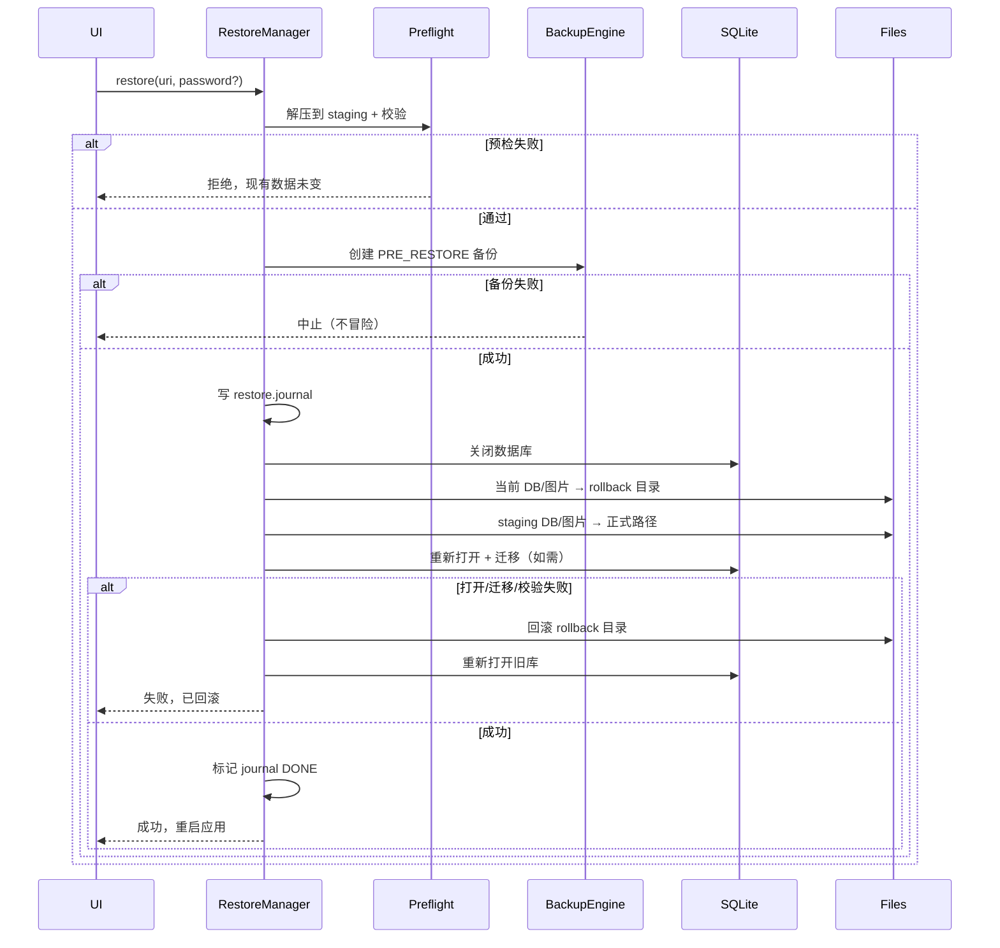

# CULINARY 数据备份与恢复方案

**文档编号**：E05
**版本**：`0.3.0`
**状态**：`Review`
**日期**：2026-11-04
**负责人**：首席架构师 / 技术负责人
**关联决策**：D-011、O-17、O-18

---

## 1. 目标与非目标

### 1.1 目标

- 一次备份包含**完整业务数据**：数据库、被引用图片/附件、版本/校验信息。
- 备份可验证：能发现截断、篡改、缺文件、版本不兼容。
- 恢复可回滚：恢复失败不破坏当前数据。
- 自动备份不阻塞前台；手动备份可导出到用户选择的位置。
- 备份格式可演进，旧备份在新 App 上可恢复。

### 1.2 非目标

- 不做云同步/多设备合并。
- 不做 CSV/PDF 报表导出。
- 不做“只恢复某几张表”的部分恢复。
- 不备份日志、缓存、APK、签名密钥。
- 不把 Android Auto Backup 作为主方案。

### 1.3 D-011 合规矩阵（负责人补充要求）

| 要求 | 本方案落点 | 状态 |
|---|---|---|
| 数据库一致性快照 | 第 6 节：优先 Online Backup API；否则写屏障 + checkpoint + 复制 + 可打开性校验 | 已设计 |
| 图片及附件完整性 | 第 7 节：引用清单 + 逐文件 SHA-256；v1 附件=图片，未来文件复用同机制 | 已设计 |
| 备份清单（manifest） | 第 4 节：必填字段、计数、版本、文件列表 | 已设计 |
| manifest 自身完整性 | 第 4.3 节：`manifest.sha256` + `checksums_sha256`；加密时 GCM tag | 已设计 |
| 版本兼容 | 第 4.3 节 + 第 12 节：format/schema 双向规则 | 已设计 |
| 校验机制 | 第 5 节：每文件 SHA-256 + manifest 校验 | 已设计 |
| 恢复前验证 | 第 12 节：结构/路径/大小/版本/哈希/DB 完整性/空间 | 已设计 |
| 失败回滚 | 第 13 节：预恢复备份 + staging + journal + rollback 目录 | 已设计 |

**结论：** 7 项要求均有明确落点；仍需在框架阶段实现并用 E06 的备份/恢复测试验证，当前不标记“已实现”。

## 2. 备份内容

| 内容 | 是否包含 | 说明 |
|---|---|---|
| SQLite 数据库 | 是 | 一致性快照 |
| 被引用图片/附件 | 是 | v1 附件=图片；仅 `image_asset.deleted_at IS NULL` 且文件存在；未来文件复用同一清单 |
| 图片元数据 | 是 | 在 DB 中 |
| `app_metadata` | 是 | 在 DB 中 |
| 用户偏好 | 是 | 放 `app_metadata`；若未来用 DataStore，需加入备份 |
| 日志 | 否 | 诊断单独导出 |
| 缓存/缩略图 | 否 | 可重建 |
| APK/签名 | 否 | 不属于数据 |
| 备份密码 | 否 | 绝不存储 |

## 3. 备份文件格式

### 3.1 未加密（`.zip`）

```text
culinary-backup-20261104-0030-manual.zip
├─ manifest.json
├─ database/
│  └─ culinary.db
├─ images/
│  ├─ 0a/
│  │  └─ <uuid>.webp
│  └─ ...
├─ checksums.sha256
└─ manifest.sha256          # manifest 自身的 SHA-256（防误改/损坏）
```

### 3.2 加密（`.culinary`）

```text
magic       8 bytes   "CULBAK01"
header_len  4 bytes   big-endian
header      JSON      {format_version, kdf, salt, iterations, nonce, created_at}
ciphertext  ...       AES-256-GCM(inner ZIP)
tag         16 bytes
```

- 加密的是**整个内层 ZIP**（含 manifest 与数据库），避免文件名/内容泄露。
- header 只含恢复所需的最小信息，不含名称、路径、业务数据。
- 密码不存储；忘记密码无法恢复，必须在 UI 明确警告。

### 3.3 文件命名

```text
culinary-backup-<yyyyMMdd-HHmmss>-<kind>.<ext>
kind: auto | manual | pre-migration | pre-restore
ext:  zip（无密码） | culinary（有密码）
```

- 时间使用本地时间，文件名排序友好；manifest 内仍存 UTC。
- 同名冲突加 `-1`、`-2`，不覆盖。

## 4. Manifest

### 4.1 示例

```json
{
  "format_version": 1,
  "backup_id": "5f0c2f7e-7d1a-4a6e-9c2b-2f6a9d0e1b34",
  "created_at": "2026-11-04T00:30:00Z",
  "app": {
    "version_name": "0.1.0",
    "version_code": 100,
    "schema_version": 3,
    "install_id": "b1e2..."
  },
  "device": {
    "manufacturer": "Google",
    "model": "Pixel",
    "api_level": 36
  },
  "database": [
    {
      "path": "database/culinary.db",
      "size_bytes": 10485760,
      "sha256": "..."
    }
  ],
  "attachments": [
    {
      "kind": "image",
      "path": "images/0a/<uuid>.webp",
      "size_bytes": 123456,
      "mime_type": "image/webp",
      "sha256": "..."
    }
  ],
  "counts": {
    "ingredient": 120,
    "recipe": 80,
    "product": 60,
    "inventory_ledger": 4200
  },
  "totals": {
    "file_count": 121,
    "total_bytes": 10519216
  },
  "integrity": {
    "status": "VERIFIED",
    "manifest_sha256": "...",
    "manifest_size_bytes": 4096,
    "checksums_sha256": "..."
  },
  "warnings": [],
  "encryption": {
    "algorithm": "AES-256-GCM",
    "kdf": "PBKDF2-HMAC-SHA256",
    "iterations": 210000,
    "salt_b64": "...",
    "nonce_b64": "..."
  }
}
```

### 4.2 必填字段

| 字段 | 说明 |
|---|---|
| `format_version` | 备份容器格式版本；从 1 开始 |
| `backup_id` | UUID；用于重复导入检测 |
| `created_at` | UTC ISO-8601 |
| `app.version_name` / `version_code` | 备份时 App |
| `app.schema_version` | 备份时 DB schema |
| `app.install_id` | 安装实例 ID |
| `database[]` | DB 文件相对路径、大小、SHA-256（v1 单文件） |
| `attachments[]` | 图片/附件：kind、相对路径、大小、MIME、SHA-256 |
| `counts` | 关键表行数，用于恢复后校验 |
| `totals.file_count` / `total_bytes` | 文件数量与总大小 |
| `integrity.status` | `VERIFIED` / `PARTIAL` / `FAILED` |
| `integrity.manifest_sha256` / `manifest_size_bytes` | manifest 自身校验 |
| `integrity.checksums_sha256` | 校验清单自身的 SHA-256 |
| `encryption` | 算法、KDF、迭代次数、salt/nonce（加密时） |
| `warnings` | 非致命异常；不得静默跳过 |

### 4.3 Manifest 完整性保护

- manifest 生成后计算 SHA-256，写入 `manifest.sha256` 与 `integrity.manifest_sha256`；`checksums.sha256` 本身也计算 SHA-256。
- 恢复时先校验 `manifest.sha256`，再校验 `checksums.sha256`，最后逐文件校验。
- 加密备份：整个内层 ZIP（含 manifest）由 AES-GCM 认证，GCM tag 提供密码学完整性。
- 未加密 ZIP：SHA-256 可发现**意外损坏/截断**，但无法防止恶意同时改写 manifest 与 hash；如需防篡改，必须使用加密备份。此限制必须在 UI/文档中说明。

### 4.4 兼容规则

- `format_version > 当前支持`：拒绝恢复，提示升级 App。
- `format_version < 当前支持`：由 importer 升级；必须测试并记录迁移路径。
- `app.schema_version > 当前 App schema`：拒绝恢复。
- `app.schema_version < 当前 App schema`：允许，但恢复前必须通过迁移兼容性检查；不得跳过未验证的迁移。
- manifest 缺必填字段、`integrity.status != VERIFIED`（除用户明确接受 PARTIAL）：拒绝。
- **备份格式版本与 DB schema 版本独立**；不得用一个版本号推断另一个。

## 5. 校验机制

- 每个文件单独 SHA-256，写入 `manifest.json` 与 `checksums.sha256`。
- `checksums.sha256` 格式：

```text
<sha256>  database/culinary.db
<sha256>  images/0a/<uuid>.webp
```

- `manifest.sha256` 保存 manifest 自身的 SHA-256；`integrity.checksums_sha256` 保存校验清单自身的 SHA-256。
- 校验顺序：
  1. 容器结构/magic/header；
  2. 加密时先验证 GCM tag；
  3. manifest 自身 hash；
  4. `checksums.sha256` 自身 hash；
  5. 逐文件 SHA-256；
  6. DB 可打开性与完整性；
  7. 附件引用一致性。
- 恢复时**逐文件**校验；不信任 manifest 内的 hash 本身，需与实际文件匹配。
- 任一必需文件校验失败：拒绝恢复，不触碰现有数据。
- 加密文件：先验证 GCM tag，再解压；tag 失败统一提示“密码错误或文件损坏”。
- 未加密 ZIP 的 SHA-256 只保证完整性（意外损坏），不提供密码学真实性；需要抗篡改时使用加密备份。

## 6. 数据库一致性快照

### 6.1 策略选择

定义 `DatabaseSnapshotter` 接口，优先在线备份，必须有受控回退：

| 策略 | 使用条件 | 说明 |
|---|---|---|
| `ONLINE_BACKUP`（首选） | 所选 SQLite 驱动暴露 SQLite Online Backup API（`sqlite3_backup_*` 或等价能力） | 不阻塞普通读取；由 SQLite 保证页级一致性；写入可继续但可能延长备份 |
| `QUIESCED_CHECKPOINT_COPY`（回退） | 驱动不暴露在线备份 API | 获取写屏障，等待活动写事务结束，checkpoint 后复制；期间读取继续、写入排队 |

**重要：** Android 平台 `SupportSQLiteDatabase` 并不直接暴露 `sqlite3_backup_*`。框架阶段必须验证所选驱动是否提供在线备份能力；**未验证前不得声称使用 Online Backup API**。无论哪种策略，都**不允许在写入进行中直接复制数据库文件并宣称备份成功**。

### 6.2 `ONLINE_BACKUP` 顺序

1. 打开源数据库连接（只读或正常连接均可）。
2. 创建临时目标数据库。
3. 调用在线备份 API，分步复制直到完成。
4. 关闭目标连接，确保所有页落盘。
5. 用独立只读连接打开目标文件，执行：
   - `PRAGMA quick_check`（失败再 `integrity_check`）；
   - 读取 `PRAGMA user_version`；
   - 查询关键表计数。
6. 计算 SHA-256，写入 manifest。
7. 将目标文件放入 ZIP。

- 备份期间允许正常读取。
- 写入可继续；若备份因持续写入反复重启，记录耗时并提示“备份在写入活跃时可能变慢”。
- 备份完成后必须验证“可正常打开”，不能只检查文件存在。

### 6.3 `QUIESCED_CHECKPOINT_COPY` 顺序

1. 获取全局写屏障（`writeMutex`）：新写请求排队，等待当前写事务结束。
2. 确认没有活动写事务（事务协调器计数器为 0）。
3. 执行 `PRAGMA wal_checkpoint(TRUNCATE)`；确认 WAL 已截断。
4. 复制主数据库文件到临时文件；**不复制正在变化的 `-wal`/`-shm`**。
5. 用独立只读连接打开临时文件：`quick_check`、`user_version`、关键表计数。
6. 计算 SHA-256。
7. 释放写屏障（排队的写继续）。
8. 将临时文件放入 ZIP。

- 复制期间读取继续；写入等待，不丢写。
- 写屏障持有时间必须覆盖“checkpoint + 复制”；大库可能数秒，UI 显示“正在创建一致性备份”。
- 复制完成后不得再把临时文件与活动 DB 混用。

### 6.4 WAL 规则

- WAL 模式下，主 DB 文件可能不包含最新已提交页；必须先 checkpoint，再复制。
- 不允许只复制主文件而忽略 WAL，也不允许把活动 `-wal` 与主文件拼装后宣称一致。
- 复制后验证目标文件 `journal_mode` 与 `user_version`；必要时对目标执行一次 checkpoint。
- 备份期间不删除/重命名活动 `-wal`/`-shm`。

### 6.5 失败处理

- 任一阶段失败：删除临时文件；不覆盖旧备份；记录 `backup_record.status=FAILED`。
- 磁盘空间不足：提前检查 `database.size * 3 + attachments.size`，不足则拒绝开始。
- 目标文件打不开/完整性检查失败：备份标记 `FAILED`，不得写入 manifest 的 `VERIFIED`。
- 备份完成后源数据库必须保持可读写；备份流程不得锁死源库。

## 7. 图片与附件备份

### 7.1 清单

- v1 的“附件”仅指图片；未来若增加文件附件，复用同一 `files/` 清单与 SHA-256 机制，不另建第二套。
- 逐文件记录：相对路径、文件大小、MIME 类型、SHA-256、所属 `image_asset`/未来附件记录 ID。
- 只备份 `image_asset` 中未删除的记录；文件路径必须位于 `filesDir/images/` 下，拒绝绝对路径/`..`。

### 7.2 引用一致性检查

在打包前执行：

1. 数据库引用 → 实际文件：每条未删除 `image_asset` 必须有对应文件。
2. 实际文件 → 数据库引用：`images/` 下的文件是否被引用（孤立文件）。
3. 文件大小、MIME、SHA-256 与数据库记录是否一致。

### 7.3 异常分类

| 异常 | 处理 | 备份状态 |
|---|---|---|
| 缺失文件（DB 有记录，文件不存在） | 记录具体 `image_asset.id`/路径；默认**使备份失败**，用户可选择“保留异常继续” | `FAILED` 或显式 `PARTIAL` |
| 损坏文件（hash 不匹配） | 记录文件与期望/实际 hash；默认失败，用户可选择继续 | `FAILED` 或显式 `PARTIAL` |
| 孤立文件（文件存在，DB 无引用） | 报告数量/路径；**不静默删除**；默认不纳入备份，记录 warning | `VERIFIED` + warning 或 `PARTIAL` |
| MIME/大小不一致 | 以实际文件为准并记录差异；不静默修正 DB | `PARTIAL` |

- **不允许静默跳过**：manifest 的 `warnings` 与 `integrity.status` 必须反映异常。
- `PARTIAL` 备份在恢复前必须提示“包含 N 个异常附件”，由用户明确确认。
- 备份不包含缩略图缓存；恢复后由 Coil 重建。

## 8. 可选加密

### 8.1 密钥派生

- `PBKDF2-HMAC-SHA256`，16 字节随机 salt，210,000 次迭代（可在 header 中调整）。
- 密码最少 8 字符；UI 显示强度提示；不存储密码。
- 派生 256-bit key。

### 8.2 加密

- `AES/GCM/NoPadding`，12 字节随机 nonce，128-bit tag。
- AAD = header JSON 字节；防止 header 被篡改。
- 加密内层 ZIP 的字节流；输出 magic + header + ciphertext + tag。
- 解密时先验证 tag，再解压；失败不写入任何文件。

### 8.3 风险

- 忘记密码 = 永久无法恢复；必须在创建时二次确认。
- 加密增加 CPU 时间；大备份在后台执行。
- 不提供“密码提示”字段（会泄露）。
- 不把密码写入日志/崩溃报告。

## 9. 自动备份

### 9.1 调度

- WorkManager 唯一任务 `auto-backup`。
- 周期：每日一次（可配置）；使用 `ExistingPeriodicWorkPolicy.KEEP` 或 `UPDATE`。
- 约束：电量不低、存储不低；**不要求网络**。
- 不精确保证时刻；系统可能延迟。
- 首次启用时立即跑一次，之后每日。

### 9.2 目标位置

优先级：

1. 用户通过 SAF 选择的目录（持久化 URI 权限）。
2. 应用外部私有目录 `getExternalFilesDir(DIRECTORY_DOCUMENTS)/CULINARY/Backups`（卸载时可能删除，不作为唯一）。
3. 内部私有目录（空间有限，仅应急）。

- 未配置目标时，自动备份关闭，设置页提示。
- SAF URI 失效（用户删除目录/卸载 SD 卡）：记录错误，提示重新选择。

### 9.3 保留策略

| 类型 | 保留 |
|---|---|
| 自动每日 | 最近 7 个 |
| 自动每周 | 最近 4 个（周日） |
| 手动 | 不自动删除 |
| 迁移前 | 最近 3 个 |
| 恢复前 | 最近 3 个 |

- 只删除 `VERIFIED` 的旧备份；不删最后一个成功备份。
- 删除失败不阻塞新备份，记录 WARN。

## 10. 手动备份

1. 用户点击“立即备份”。
2. 选择是否加密；输入密码并确认。
3. 选择保存位置（SAF `ACTION_CREATE_DOCUMENT`）或分享。
4. 生成临时文件 → 校验 → 写入目标 → 再次校验大小/hash（若可读）。
5. 记录 `backup_record`。
6. 显示文件路径/大小/校验和。

- 手动备份在后台线程执行；大文件显示进度。
- 用户取消：删除临时文件，不记录成功。
- 目标不可写：保留临时文件？不，删除并提示。

## 11. 备份验证

### 11.1 创建后验证

- manifest 可解析、必填字段齐全。
- `manifest.sha256` 与 `checksums.sha256` 自身 hash 校验通过。
- 每个文件存在且 SHA-256 匹配；附件数量/大小/MIME 与 manifest 一致。
- DB 能在只读连接中打开，`quick_check` = ok。
- 关键表计数与 manifest 一致（允许 WAL 快照差异为 0）。
- 附件引用一致性检查结果已写入 `warnings`/`integrity.status`。
- ZIP 无路径穿越、无超限条目。
- 全部通过：`status=VERIFIED`；存在异常：`PARTIAL`（需用户确认）或 `FAILED`，不得静默降级。

### 11.2 定期复验

- 每月对最近一个自动备份做抽样校验（读 manifest + hash）。
- 复验失败：标记 `CORRUPT`，提示用户创建新备份；不自动删除。

## 12. 恢复前预检

**预检不通过，绝不触碰现有数据。**

| 检查 | 失败处理 |
|---|---|
| 文件存在、可读 | 拒绝 |
| ZIP/容器结构合法 | 拒绝 |
| 解压后总大小/条目数在限制内 | 拒绝（防 zip bomb） |
| 路径无 `..`/绝对路径/符号链接 | 拒绝 |
| manifest 必填字段齐全 | 拒绝 |
| `manifest.sha256` 与实际 manifest 一致 | 拒绝 |
| `checksums.sha256` 自身 hash 一致 | 拒绝 |
| `integrity.status` 为 `VERIFIED`（或用户明确接受 `PARTIAL`） | 拒绝/需确认 |
| `format_version` 受支持 | 拒绝 |
| `schema_version <= 当前 App` | 拒绝（提示升级） |
| **版本迁移路径存在且经过验证** | 拒绝（不得跳过未验证迁移） |
| 每个文件 SHA-256 匹配 | 拒绝 |
| 附件引用一致性通过（缺失/损坏/孤立已报告） | 拒绝/需确认 |
| DB `integrity_check`/`quick_check` | 拒绝 |
| `foreign_key_check` 为空 | 拒绝 |
| 关键表存在、计数合理 | 拒绝 |
| 备份 DB 能在只读连接中打开 | 拒绝 |
| 磁盘空间 ≥ 解压大小 × 2 + 当前数据 | 拒绝 |
| 电量/存储约束 | 警告/阻止 |
| 密码正确（加密，GCM tag） | 拒绝（提示密码错误/损坏） |

### 12.1 版本迁移预检

恢复前必须根据“备份 schema → 当前 schema”查找已登记的迁移路径：

- 路径存在且所有中间版本有测试：允许；恢复后执行迁移。
- 路径缺失/未测试：拒绝；不得跳过中间迁移。
- 迁移执行前创建预恢复备份；迁移失败必须回滚，当前数据库不得被破坏。
- 备份格式版本与 DB schema 版本分别判断；不得用一个推断另一个。

### 12.2 预检结果展示

- 备份时间、App/DB 版本、格式版本、大小、附件数、关键表计数、`integrity.status`。
- 显示迁移路径与预计影响；显示异常附件（若有）。
- 将替换当前数据（全量恢复），并自动创建“恢复前备份”。
- 需要用户输入确认词（如“恢复”）以防误操作。

## 13. 恢复流程



### 13.1 关键规则

- 先解压到 `cache/restore-staging/`，绝不直接解压到正式目录。
- 预检全部通过后，才创建 `PRE_RESTORE` 备份。
- 关闭数据库前，等待所有写事务完成（获取写锁并保持）。
- 当前 DB/图片移动到 `filesDir/rollback/<restoreId>/`，不是删除。
- 恢复后打开 Room，执行迁移（若备份 schema 较旧）；迁移前已有预恢复备份。
- 迁移失败：关闭 DB，回滚 rollback 目录与预恢复备份；当前数据库保持恢复前状态。
- 校验通过才删除 rollback；失败立即回滚。
- 恢复完成后建议重启进程，避免旧连接/缓存。

### 13.2 进程被杀的处理

- 操作前写 `filesDir/restore.journal`：

```json
{
  "restore_id": "...",
  "phase": "PREPARED | DB_MOVED | DB_SWAPPED | IMAGES_SWAPPED | DONE",
  "rollback_dir": "rollback/<id>",
  "started_at": "..."
}
```

- 启动时检测 journal：
  - `DONE`：清理 staging/rollback，删除 journal。
  - 未完成：根据 phase 回滚到 rollback 目录；若 rollback 不完整，进入 Recovery，不自动删除。
- journal 写入需 fsync；phase 更新原子替换。

## 14. 导入策略

- v1 **只支持整库恢复**，不做合并导入。
- “导入”在 UI 上与“恢复”是同一流程；文案说明会替换全部数据。
- CSV/Excel 导入不在本阶段；未来若做，必须：
  - staging 表；
  - 字段映射与预检；
  - 重复检测；
  - 失败回滚；
  - 单独 ADR。

## 15. 重复导入防护

- `backup_id` 全局唯一；`restore_history.json`（应用私有，位于 DB 外）记录最近恢复的 `backup_id`、时间、来源。
- 同一备份再次恢复：允许，但提示“该备份已恢复过，将再次覆盖当前数据”。
- 不同备份但 `install_id` 相同：提示可能来自同一设备。
- 恢复前备份也记录 `backup_id`，避免链式混乱。
- 不用文件名判重（可被改名）。

## 16. 失败模式与处理

| 失败 | 处理 |
|---|---|
| ZIP 截断 | 预检失败；现有数据不变 |
| SHA-256 不匹配 | 拒绝；提示备份损坏 |
| 密码错误 | GCM 验证失败；提示密码错误或损坏 |
| schema 更新 | 拒绝；提示升级 App |
| DB 损坏 | 拒绝；不触碰现有数据 |
| 迁移失败 | 回滚到 PRE_RESTORE；报告 |
| 磁盘满 | 预检/恢复中止；清理 staging；现有数据不变 |
| 恢复中进程被杀 | journal 回滚；下次启动处理 |
| 图片缺失 | 恢复继续；记录 warning；UI 无图 |
| SAF URI 失效 | 提示重新选择；不删除旧备份 |
| 备份目标不可写 | 失败；保留临时文件？删除；提示换位置 |
| 自动备份连续失败 | 通知；保留旧备份；不静默 |

## 17. 安全与隐私

- 备份含个人配方、库存、采购数据；默认保存在应用私有/用户选择位置。
- 不自动上传云端。
- 可选加密；密码不存储、不上传、不写日志。
- 备份文件可被用户分享；分享前提示包含隐私数据。
- 恢复前备份可能含敏感数据；保留策略与普通备份一致。
- 不在通知中显示配方名称/库存数量。

## 18. 测试计划

| 测试 | 通过标准 |
|---|---|
| 空库备份/恢复 | 成功；表为空但结构正确 |
| 全量 round-trip | 数据、图片、元数据一致 |
| 无图片 | 备份成功；无 images 目录 |
| 图片缺失 | 备份成功 + warning；恢复后无图可打开 |
| 损坏一个字节 | 校验失败；现有数据不变 |
| 截断文件 | 预检失败 |
| 错误密码 | 拒绝；现有数据不变 |
| schema 更新 | 拒绝 |
| schema 较旧 | 恢复 + 迁移成功 |
| 迁移失败 | 回滚到恢复前状态 |
| 恢复中强杀 | 下次启动回滚/完成，数据一致 |
| 磁盘满 | 中止；无部分写入 |
| zip bomb | 拒绝 |
| 路径穿越 | 拒绝 |
| 重复恢复 | 提示；可继续 |
| 大备份（>1GB） | 后台完成；内存稳定 |
| 自动备份调度 | 每日一次；失败重试；不阻塞前台 |

## 19. 运行手册

### 19.1 手动备份

1. 设置 → 备份与恢复 → 立即备份。
2. 选择是否加密；输入并确认密码（如加密）。
3. 选择保存位置。
4. 等待校验完成；记录显示的 SHA-256 前 8 位。
5. 将文件复制到至少一个离线位置。

### 19.2 恢复

1. 确认当前数据已另行备份（或接受自动 PRE_RESTORE）。
2. 设置 → 备份与恢复 → 从文件恢复。
3. 选择文件；输入密码（如加密）。
4. 查看预检摘要；确认“全量替换”。
5. 等待完成；按提示重启。
6. 验证关键数据与图片；检查诊断页无错误。

### 19.3 恢复失败

1. 不要卸载/清空应用。
2. 记录错误码与时间。
3. 检查 rollback 目录与恢复前备份。
4. 导出诊断；按 E04 事故流程处理。

## 20. 变更记录

| 版本 | 日期 | 变更 | 作者 |
|---|---|---|---|
| 0.1.0 | 2026-11-04 | 初稿；格式、manifest、加密、自动/手动、恢复与测试 | 架构组 |
| 0.2.0 | 2026-11-04 | 按 D-011 补充 7 项合规矩阵；明确图片/附件完整性 | 架构组 |
| 0.3.0 | 2026-11-04 | 按负责人标准补：在线备份优先、WAL/写入协调、manifest 自校验、附件异常分类、迁移路径预检 | 架构组 |
