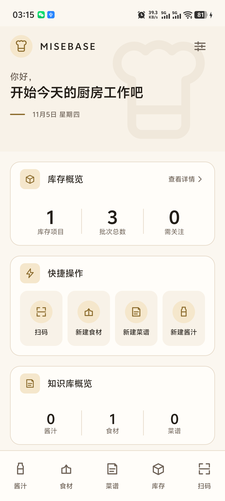

# MB-HOME-001 独立首页执行与验收报告

**任务编号**：MB-HOME-001  
**任务名称**：独立首页 UI 与功能实现  
**项目**：MISEBASE  
**文档状态**：`Review`（实现与测试完成，等待项目负责人验收）  
**日期**：2026-11-05  
**依据**：MB-HOME-001 任务书；MB-D-008（视觉方向 A）；MB-D-009（N1 导航）；UI-07；MB-D-004  
**真机**：vivo V2429A，Android API 36，1080×2400，density 480  
**数据库**：Room schema v2（33 表），验证时未改 Schema、未写入测试数据

> **后续状态（2026-11-05）**：本报告的视觉与数据结论已被项目负责人验收；其 N1 底部导航描述已被
> [MB-HOME-002](MB-HOME-002-EXECUTION-REPORT.md) 的 **N3**（首页/知识库/扫码凸起/库存/设置）取代。
> 本报告保留为 MB-HOME-001 历史证据；首页数据、隐藏模块和香槟金 token 仍然有效。

---

## 1. 结论

1. 独立首页（Kitchen Dashboard）已实现并接入冷启动，路由为 `home`。
2. 底部导航严格保持 N1 五项：酱汁、食材、菜谱、库存、扫码；**没有“首页”第六入口**。
3. 库存概览、知识库概览全部来自真实 SQLite 数据；无静态假数字。
4. 四个快捷操作全部连到真实路由；设置、库存详情、知识库入口、品牌返回首页均已真机验证。
5. “最近工作”和“低库存预警”栏因缺少可靠数据源/字段而隐藏；“计算记录”因缺少首页读取端口而隐藏。没有用演示数据填充。
6. 全量 `test ktlintCheck detekt` 通过：**847 次执行 / 533 唯一 JVM 用例 / 0 失败**；模块依赖检查 14 模块 / 39 条声明边 / 861 条源码 import 边，PASS。
7. 未新增模块、未改 Schema/Entity/DAO、未改五个业务模块归属；首页代码位于 `app` 组合根。

真机截图（真实数据库，未造数）：



---

## 2. 关键决策与冲突记录

| # | 事项 | 处理 | 依据/风险 |
|---|---|---|---|
| 1 | 首页放在哪个模块 | 放在 `app` 组合根，不新建 `feature:home` | 已批准模块集为 14；新建第 15 个模块需要 ADR 与负责人签收，本次未获授权 |
| 2 | 首页如何读数据 | 在 `core:data` 新增只读 `HomeSummaryReader`，内部复用既有 Use Case / Repository | `app` 依赖白名单不含 `core:domain`；直接 import 会触发依赖检查违规。该实现不新增模块边、不改依赖配置 |
| 3 | 参考图底部有“首页”第六入口 | **不实现**，底部只保留 N1 五项 | 任务书 §4 核心防呆警告；已用 UI 测试与 uiautomator 双重验证 |
| 4 | 参考图的低库存预警栏 | **隐藏** | 当前 Schema 无预警字段/阈值；不能按演示数据或自造阈值生成预警 |
| 5 | “需关注”数字 | 展示，但定义固定为既有领域规则 `InventoryOverviewRow.isLow`：可用量 ≤ 0 | 不是新增阈值，也不是“低库存预警”；验收报告与代码均注明 |
| 6 | “最近工作” | **隐藏** | `change_log` 表存在但生产代码没有任何写入；`updated_at` 不能可靠区分“新增/编辑”，且酱汁/菜谱编辑不必然更新父档案行；无可靠操作记录 |
| 7 | “计算记录” | **隐藏** | 计算记录已有持久化（`calculation_record`），但 Repository 只支持按 ID/菜谱版本/哈希查询，没有全量列表/计数读取端口；本次不擅自扩接口 |
| 8 | Orange → Champagne Gold | 已按任务书 §6 迁移全局设计 token | MB-D-008 原文为 Orange 强调；本次为任务书指定的视觉修订，**需负责人在验收时确认是否补签 ADR** |
| 9 | 冷启动路由 | 新进程第一次进入时强制回首页；同进程旋转/重建保留当前路由 | 系统恢复任务可能停在业务页；真机验证 force-stop 后重新启动进入首页，横屏后库存页保持 |

---

## 3. 实际修改文件清单

### 3.1 新增文件

| 文件 | 作用 |
|---|---|
| `app/src/main/java/com/culinary/home/HomeScreen.kt` | 首页路由、Hero、页面骨架与纯展示编排 |
| `app/src/main/java/com/culinary/home/HomeSections.kt` | 库存概览、快捷操作、知识库概览、加载/空/错误状态 |
| `app/src/main/java/com/culinary/home/HomeUiState.kt` | 单模块状态、首页状态、错误文案 |
| `app/src/main/java/com/culinary/home/HomeViewModel.kt` | 两个模块独立加载、刷新、重试、异常降级 |
| `app/src/test/java/com/culinary/home/HomeViewModelTest.kt` | 首页状态与局部失败测试（4 例） |
| `app/src/testDebug/java/com/culinary/home/HomeScreenTest.kt` | 首页 Compose UI 测试（6 例，Robolectric） |
| `core/data/src/main/java/com/culinary/core/data/home/HomeSummaryReader.kt` | 首页只读端口与两个汇总数据类 |
| `core/data/src/main/java/com/culinary/core/data/home/DefaultHomeSummaryReader.kt` | 基于既有 Use Case 的真实汇总实现（IO 调度） |
| `core/data/src/main/java/com/culinary/core/data/di/HomeModule.kt` | 端口绑定 |
| `core/data/src/test/java/com/culinary/core/data/home/DefaultHomeSummaryReaderTest.kt` | 汇总计数、空数据、失败隔离测试（5 例） |
| `docs/13-home/MB-HOME-001-device-home.png` | 真机首页截图 |
| `docs/13-home/MB-HOME-001-uiautomator.xml` | 真机 UI 层级导出（用于核对五入口/文本） |
| `docs/13-home/MB-HOME-001-EXECUTION-REPORT.md` | 本报告 |

### 3.2 修改文件

| 文件 | 修改内容 |
|---|---|
| `app/build.gradle.kts` | 增加 `kotlinx-coroutines-test`（首页 ViewModel 测试） |
| `app/src/main/java/com/culinary/navigation/CulinaryDestination.kt` | 新增 `HOME_ROUTE`、`APP_START_ROUTE`；N1 五项保持不变 |
| `app/src/main/java/com/culinary/navigation/CulinaryNavHost.kt` | 首页路由、冷启动回首页、顶部品牌返回、底部五入口常驻、首页不显示顶栏 |
| `app/src/main/res/values/strings.xml` | 首页文案 |
| `app/src/test/java/com/culinary/navigation/CulinaryDestinationTest.kt` | 首页不是底部入口、冷启动路由等契约 |
| `app/src/testDebug/java/com/culinary/navigation/NavigationShellTest.kt` | 底部五项/无首页、品牌返回、设置等 UI 测试 |
| `core/designsystem/src/main/java/com/culinary/core/designsystem/theme/Color.kt` | Orange → Champagne Gold；暖中性色微调 |
| `core/designsystem/src/main/java/com/culinary/core/designsystem/theme/Theme.kt` | 亮/暗色板装配新 token |
| `core/designsystem/src/main/java/com/culinary/core/designsystem/icon/CulinaryIcons.kt` | 新增 `ChefHat`、`Bolt` 线性图标 |
| `core/designsystem/src/test/java/com/culinary/core/designsystem/theme/DesignSystemTokensTest.kt` | 新色值、对比度、浅金禁用正文约束 |
| `README.md` | 首页状态、测试口径、文档链接 |
| `docs/design/MISEBASE-UI-DESIGN-SPEC.md` | 升 1.3.0；香槟金 token 对照、对比度规则、首页实现记录 |
| `docs/00-governance/DOCUMENT-INDEX.md` | 新增首页文档组、更新设计书版本 |

### 3.3 明确未修改

- 未修改 `core/database` 的任何 Entity、DAO、Schema、迁移、导出 JSON。
- 未修改五个 feature 的业务逻辑、路由字符串、页面行为。
- 未新增模块、未修改 `settings.gradle.kts`、未修改 `config/module-dependencies.json`。
- 未写入任何演示数据；真机数据库保持验证前状态。

---

## 4. 导航与路由修改说明

### 4.1 路由

| 路由 | 说明 |
|---|---|
| `home` | 新增独立首页，应用冷启动目的地 |
| `sauces` / `ingredients` / `recipes` / `inventory` / `scan` | N1 五个底部入口，字符串与顺序未变 |
| `settings` | 顶栏设置入口，未变 |
| `inventory/movement/receipt` | 首页空库存 CTA“去入库”直达 |
| `ingredients/new/edit`、`recipes/new/edit`、`sauces/new/edit` | 三个快捷操作直达 |
| `inventory`、`sauces`、`ingredients`、`recipes` | 库存卡片与知识库数字的进入目标 |

### 4.2 导航行为

- **冷启动**：`startDestination = APP_START_ROUTE = "home"`。新进程第一次进入时，如果系统恢复了旧任务，会在首个组合帧后回到 `home`；同一进程内旋转/重建不重置。
- **底部栏**：首页显示底部栏，但五项均不选中；进入任一业务模块后底部栏常驻。详情/编辑页仍按既有规则隐藏底部栏。
- **顶栏**：首页不显示 Material `TopAppBar`，由 Hero 品牌区承担；其他一级页顶栏左侧为厨师帽品牌标识（`contentDescription = "返回首页"`），点击回首页；详情/编辑页仍为返回箭头；右上角设置不变。
- **品牌返回**：`openHome()` 使用 `popUpTo(home) + launchSingleTop`，不会产生重复首页。
- **首页内部入口**：库存卡片/“查看详情” → 库存；三个知识库数字 → 对应列表；四个快捷操作 → 对应真实路由；空库存 CTA → 入库页。
- **返回键**：详情页回上一级；一级页无栈时回首页（`backOrStart(APP_START_ROUTE)`）。

### 4.3 N1 防呆验证

- `CulinaryDestination.entries` 仍只有 5 项，`HOME_ROUTE` 不在其中。
- `CulinaryBottomBar` 的 Compose 测试断言 `isSelectable()` 节点数 = 5，且不存在文本“首页”。
- 真机 uiautomator 文本树中底部只有“酱汁/食材/菜谱/库存/扫码”，无“首页”。

---

## 5. 首页数据来源映射表

| UI 展示 | 数据来源 | 计算/查询 | 验证时真实值 |
|---|---|---|---|
| 库存项目 | `ListInventoryOverviewUseCase` → `inventory_batch`（`status = ACTIVE`）按 `product_id` 聚合 | `rows.size`（有启用批次的商品数） | **1** |
| 批次总数 | 同上 | `rows.sumOf { it.batchCount }`（启用批次数） | **3** |
| 需关注 | 同上，复用 `InventoryOverviewRow.isLow` | `rows.count { it.available <= 0.0 }` | **0** |
| 酱汁 | `ListSaucesUseCase` → `sauce` | `observeActive().first().size`（`deleted_at IS NULL AND status='ACTIVE'`） | **0** |
| 食材 | `ListIngredientsUseCase` → `ingredient` | 同上 | **1** |
| 菜谱 | `ListRecipesUseCase` → `recipe` | 同上 | **0** |
| 日期 | `Clock`（`SystemClock`） | `Clock.now()` → 系统时区 `M月d日 EEEE` | **11月5日 星期四** |

SQLite 对账命令与结果：

```text
active_batches|3
active_products|1
zero_available_products|0
active_sauces|0
active_ingredients|1
active_recipes|0
```

> “需关注”不是低库存预警：它只统计现有领域规则下可用量为 0 的库存商品；没有新增阈值字段，
> 也没有渲染参考图中的“低库存预警：2 项商品需要补货”横幅。

---

## 6. 页面状态

| 状态 | 实现 |
|---|---|
| 正常 | 库存与知识库卡片显示真实数字；见真机截图 |
| 空 | 库存无启用批次 → “还没有库存批次” + “去入库”；知识库三类均为 0 → “档案库还是空的” |
| 加载 | 各卡片独立骨架块（标题 + 数字/标签占位），不用全屏 spinner |
| 异常 | 单卡片错误文案 + 稳定错误码 + “重试”；另一个卡片继续显示 |
| 局部降级 | 库存失败不影响知识库，知识库失败不影响库存；快捷操作/品牌/设置始终可用 |

Compose 测试覆盖：正常数字、空状态、库存失败但知识库可见、重试回调、加载态无错误条。

---

## 7. Orange → Champagne Gold Token 迁移与对比度

### 7.1 Token 对照

| 旧 Token | 旧值 | 新 Token | 新值 |
|---|---|---|---|
| `primary` | `#B4551F` | `primary` | `#8A6A2B` |
| `onPrimary` | `#FFFFFF` | `onPrimary` | `#FFFFFF` |
| `primaryContainer` | `#FFDBC8` | `primaryContainer` | `#F5E7CC` |
| `onPrimaryContainer` | `#3A1100` | `onPrimaryContainer` | `#2A2117` |
| `inversePrimary` | `#FFB68C` | `inversePrimary` | `#E8CD97` |
| `background` | `#FFFBF8` | `background` | `#FBF7F0` |
| `surface` | `#FFFFFF` | `surface` | `#FFFDF9` |
| `secondary` | `#6F5B4E` | `secondary` | `#6E6257` |
| `outline` | `#8A7263` | `outline` | `#8C7E6D` |
| `outlineVariant` | `#E4D3C7` | `outlineVariant` | `#E6DAC9` |

暗色主题同步迁移：`primary #E8CD97`、`onPrimary #2A2117`、`primaryContainer #5C4517`、
`background #171310`、`surface #201B16`、`onSurface #F8F2E8`、`onSurfaceVariant #D6C7B4`。

### 7.2 WCAG AA 对比度实测

| 组合 | 对比度 | 要求 |
|---|---|---|
| 亮色 `onSurface / surface` | 16.09:1 | ≥4.5 |
| 亮色 `onSurface / background` | 15.30:1 | ≥4.5 |
| 亮色 `onSurfaceVariant / surface` | 5.83:1 | ≥4.5 |
| 亮色 `onSurfaceVariant / background` | 5.54:1 | ≥4.5 |
| 亮色 `onPrimary / primary` | 5.03:1 | ≥4.5 |
| 亮色 `onPrimaryContainer / primaryContainer` | 12.94:1 | ≥4.5 |
| 亮色 `onSecondary / secondary` | 5.92:1 | ≥4.5 |
| 亮色 `onSecondaryContainer / secondaryContainer` | 13.36:1 | ≥4.5 |
| 暗色 `onSurface / surface` | 14.82:1 | ≥4.5 |
| 暗色 `onSurfaceVariant / surface` | 9.76:1 | ≥4.5 |
| 暗色 `onPrimary / primary` | 10.25:1 | ≥4.5 |
| 暗色 `onPrimaryContainer / primaryContainer` | 7.41:1 | ≥4.5 |
| 暗色 `onSecondaryContainer / secondaryContainer` | 4.84:1 | ≥4.5 |
| 语义 `onWarning / warning`（亮） | 5.93:1 | ≥4.5 |
| 语义 `onDanger / danger`（亮） | 7.54:1 | ≥4.5 |
| 语义 `onInfo / info`（亮） | 6.88:1 | ≥4.5 |
| 语义 `onSuccess / success`（亮） | 6.30:1 | ≥4.5 |

约束：

- 浅香槟金 `#F5E7CC` / `#E8CD97` **只做容器/反相强调**，不作为亮色正文；
- 正文使用暖炭灰 `#241F19` 或深香槟金 `#8A6A2B`；
- 主色亮度 `luminance(#8A6A2B) < 0.2`，有自动化测试断言；
- `DesignSystemTokensTest` 对正文、主色、容器、语义色与暗色主题逐项断言 ≥4.5:1。

---

## 8. 未实现或暂时隐藏的模块

| 模块 | 状态 | 原因 | 后续条件 |
|---|---|---|---|
| 最近工作 | **隐藏** | 生产代码没有写 `change_log`；`updated_at` 不能可靠表示“新增/编辑”，酱汁/菜谱版本编辑不一定更新父档案时间 | 引入可靠操作日志（写入 `change_log` 或等价表）并通过 ADR 后展示 |
| 低库存预警栏 | **隐藏** | Schema 无预警字段/可配置阈值；禁止用演示数据或自造阈值 | 新增库存阈值字段/规则并经 Schema 变更授权 |
| 计算记录 | **隐藏** | 计算记录持久化已存在，但首页无全量列表/计数读取端口；现有端口只能按菜谱版本查 | 增加全局计算记录读取端口（需评估归属模块） |
| 参考图“低筋面粉/黑椒汁/宫保鸡丁” | **未使用** | 仅用于说明布局，不是数据库真实记录 | 不适用 |

> 首页没有用静态数据、假时间、假记录或假库存填充这些区域。

---

## 9. 测试用例及实际结果

### 9.1 自动化

| 检查 | 结果 |
|---|---|
| `:core:designsystem:testDebugUnitTest` / `:core:data:testDebugUnitTest` | PASS |
| `:app:testDebugUnitTest`（含 Robolectric Compose UI） | PASS |
| `:app:testReleaseUnitTest` | PASS（Compose UI 测试已放在 `testDebug`，release 只跑纯 JVM） |
| 全量 `test ktlintCheck detekt` | **PASS**，847 executions / 533 unique / 0 failures |
| `check-module-deps.ps1` | **PASS**：14 模块、39 条声明边、861 条 import 边、无环 |
| 首页新增用例 | `DesignSystemTokensTest` 10、`DefaultHomeSummaryReaderTest` 5、`HomeViewModelTest` 4、`HomeScreenTest` 6、导航相关 13 |

### 9.2 真机 / 手工

| # | 用例 | 操作 | 结果 |
|---|---|---|---|
| T1 | 冷启动进入首页 | force-stop 后 `am start -W` | **PASS**，进入 `home` |
| T2 | 品牌标识返回首页 | 库存页点顶栏“返回首页” | **PASS**，回到首页 |
| T3 | 底部只有五个业务入口 | uiautomator 文本树 + Compose 测试 | **PASS**，无“首页”；5 个可选项 |
| T4 | 快捷操作路由 | 依次点扫码/新建食材/新建菜谱/新建酱汁 | **PASS**，分别进入扫码页、食材编辑器、菜谱编辑器、酱汁编辑器 |
| T5 | 库存概览与 SQLite 一致 | 对比 UI 1/3/0 与 SQL `active_products/active_batches/zero_available_products` | **PASS** |
| T6 | 知识库数量与 SQLite 一致 | 对比 UI 0/1/0 与 SQL `active_sauces/active_ingredients/active_recipes` | **PASS** |
| T7 | 空/加载/异常状态 | Robolectric Compose 测试覆盖首页空/加载/异常；真机查看了酱汁库空态（0 酱汁） | **PASS** |
| T8 | 应用重启/旋转 | force-stop 重启；进入库存后横屏 | **PASS**，重启回首页，横屏保留库存 |
| T9 | 设置入口 | 首页 Hero 设置、业务页顶栏设置 | **PASS**，进入设置页 |
| T10 | 无崩溃/卡顿 | 操作后检查 `logcat -b crash` 与 `AndroidRuntime` | **PASS**，无 FATAL |
| T11 | 模块边界 | `check-module-deps.ps1` | **PASS**，仍 14 模块 / 39 声明边 |
| T12 | 暗色主题冒烟 | `cmd uimode night yes` 后冷启动首页并截图 | **PASS**，卡片/文字/图标可读；非正式暗色验收 |

### 9.3 已知限制

- 真机只验证了竖屏手机（V2429A，1080×2400）；平板/折叠屏/超大字体未做视觉验收。
- “需关注”当前定义为可用量 ≤ 0；如果产品需要“低于安全库存”的预警，需要新增阈值字段与规则。
- 首页卡片在较小高度设备上需要滚动；真机 800dp 高度可一屏看到三个核心卡片（截图）。

---

## 10. 真机证据

- 截图：`docs/13-home/MB-HOME-001-device-home.png`（1080×2400，真实 SQLite v2）。
- 暗色冒烟截图：`docs/13-home/MB-HOME-001-device-home-dark.png`（同一真实数据；非正式暗色验收）。
- UI 层级：`docs/13-home/MB-HOME-001-uiautomator.xml`。
- 截图时真实数据：库存项目 1、批次 3、需关注 0；酱汁 0、食材 1、菜谱 0。
- 截图时底部导航：酱汁 / 食材 / 菜谱 / 库存 / 扫码（无首页）。
- 未写入/删除任何业务数据；验证前后 DB 计数一致。

---

## 11. 回滚方法

1. 回滚代码：对“修改文件”执行 `git restore -- <file>`；删除“新增文件”中的首页、`core:data/home`、`HomeModule`、测试和 `docs/13-home`。
2. 回滚视觉：恢复 `Color.kt`、`Theme.kt`、`CulinaryIcons` 与设计书；`DesignSystemTokensTest` 一并恢复。
3. 无数据库回滚需求：未执行迁移、未改 Schema、未写业务数据。
4. 回滚后重新 `:app:assembleDebug` 并覆盖安装即可；已安装应用的数据不会被清除。

---

## 12. 待负责人确认

1. **视觉方向**：是否批准 MB-HOME-001 §6 的 Champagne Gold 替换 MB-D-008 的 Orange；如批准，建议补 ADR/决策记录。
2. **数据端口位置**：`core:data` 的 `HomeSummaryReader` 是本次为遵守 14 模块/依赖白名单的折中；如更希望使用 `feature:home` 或 `core:domain` 端口，需要另立模块/边界任务。
3. **需关注口径**：当前是可用量 ≤ 0；若需要低库存阈值，请批准字段/规则变更。
4. **隐藏模块**：最近工作、低库存预警、计算记录是否需要在后续任务中补齐数据源与入口。

---

## 13. 变更记录

| 版本 | 日期 | 变更 | 作者 |
|---|---|---|---|
| 1.0.0 | 2026-11-05 | 首页实现、导航接入、数据映射、Token 迁移、测试与真机验证首版报告；状态 `Review` | 开发 AI |
