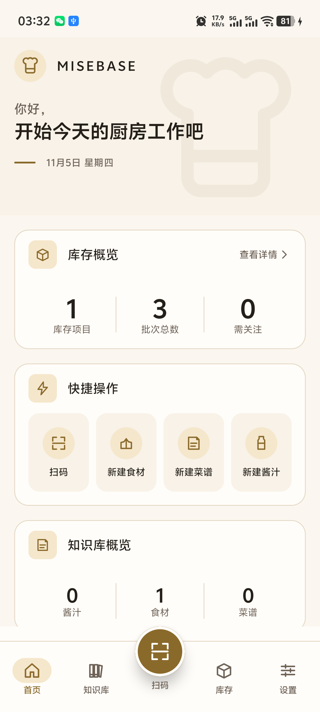
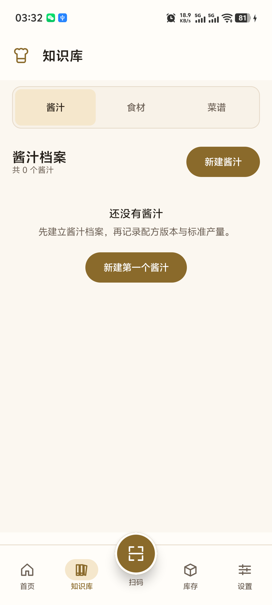
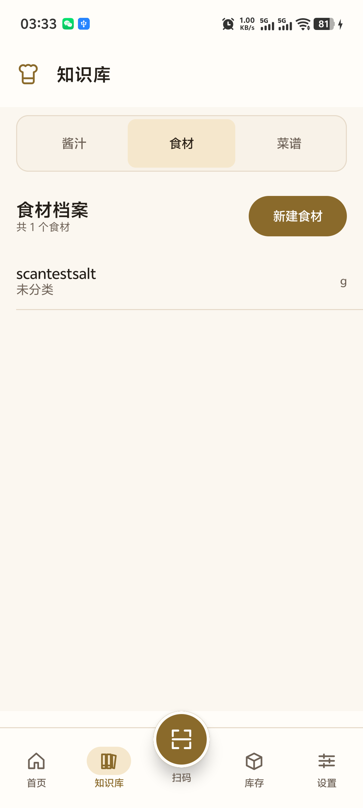
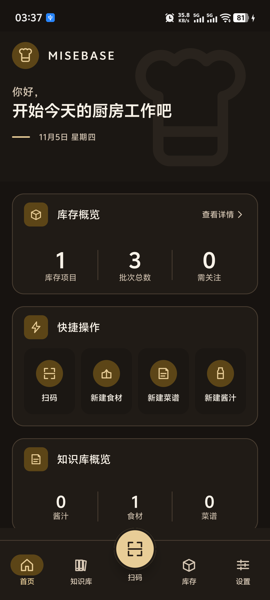

# MB-HOME-002 首页验收与导航架构重构执行报告

**任务编号**：MB-HOME-002  
**任务名称**：首页验收与导航架构重构（N3）  
**项目**：MISEBASE  
**文档状态**：`CLOSED`（2026-11-05 审查通过；关闭记录见 [MB-HOME-CLOSE-001](MB-HOME-CLOSE-RECORD.md)）  
**日期**：2026-11-05  
**依据**：MB-HOME-002 任务书；MB-HOME-001 验收报告；MB-D-008 Rev.1；MB-D-009 Rev.2  
**真机**：vivo V2429A，Android API 36，1080×2400，density 480  
**数据库**：Room schema v2（33 表）；验证期间未改 Schema、未写入业务数据

---

## 1. 结论

1. **香槟金正式验收**：Champagne Gold 已作为正式主强调色，MB-D-008 更新为 Rev.1，决策记录落库。
2. **N3 导航已落地**：底部严格五项——首页 / 知识库 / 扫码（中央凸起）/ 库存 / 设置。
3. **知识库聚合页已实现**：`library` + `library/{tab}`，顶部 Segment 切换酱汁 / 食材 / 菜谱；三个 feature 模块与详情/编辑路由未合并、未改动。
4. **设置已移到底部第 5 项**：首页 Hero 与所有业务页顶栏都不再显示设置图标。
5. **扫码为中央凸起圆形按钮**：56dp 金色圆形 + 8dp 阴影 + 表面色描边，底栏高 96dp、上凸 16dp；点击进入原 `feature:scan`。
6. **原有验收要求保持**：首页真实数据、隐藏模块、需关注口径、冷启动默认首页均未改变。
7. **质量门禁通过**：全量测试、ktlint、detekt、模块依赖检查均通过；测试数较 MB-HOME-001 基线不下降。
8. 未新增模块、未改 Schema/Entity/DAO/备份，未改五个 feature 的业务逻辑与内部路由。

首页截图（真实数据）：



知识库聚合页（酱汁 Tab）：



知识库切到食材 Tab（真实数据）：



暗色主题冒烟（非正式暗色验收）：



---

## 2. 验收决定落库

| 决定 | 处理 | 证据 |
|---|---|---|
| 正式批准 Champagne Gold 替换 Orange | MB-D-008 Rev.1；全局 token 已迁移 | `Color.kt` / `Theme.kt`；`DesignSystemTokensTest`；[决策记录](MB-HOME-002-DECISIONS.md) |
| 最近工作、低库存预警、计算记录保持隐藏 | 未新增假数据、未新增读取端口 | 首页仍不展示这些模块 |
| “需关注”保持可用量 ≤ 0 | 继续复用 `InventoryOverviewRow.isLow` | 首页显示 0，SQL 对账一致 |
| N1 推翻，采用 N3 | MB-D-009 Rev.2；底栏与路由重构 | 本报告 §3；[决策记录](MB-HOME-002-DECISIONS.md) |

> 决策登记册同步更新：`docs/05-handover/MB-S0-07-DECISION-REGISTER.md` 0.8.0。  
> 设计书同步更新：`docs/design/MISEBASE-UI-DESIGN-SPEC.md` 1.4.0。

---

## 3. 导航与路由

### 3.1 新底栏

```text
[首页]   [知识库]   ( 扫码 · 凸起圆形 )   [库存]   [设置]
```

| 顺序 | 入口 | 路由 | 说明 |
|---|---|---|---|
| 1 | 首页 | `home` | 冷启动默认；Kitchen Dashboard |
| 2 | 知识库 | `library` / `library/{tab}` | 聚合页；Tab 切换三个档案库 |
| 3 | 扫码 | `scan` | 中央凸起圆形主按钮；原 `feature:scan` |
| 4 | 库存 | `inventory` | 原 `feature:inventory` |
| 5 | 设置 | `settings` | 从顶栏移入；原占位页 |

### 3.2 路由变化

| 路由 | 变化 |
|---|---|
| `home` | 保留；N3 中为底部第 1 项，仍为冷启动目的地 |
| `library` | **新增**；知识库聚合页，默认酱汁 Tab |
| `library/{tab}` | **新增**；`tab` ∈ `sauces` / `ingredients` / `recipes`；首页数字直达 |
| `scan` | 保留；从底部第 5 项变为中央凸起按钮 |
| `inventory` | 保留；从底部第 4 项位置不变 |
| `settings` | 保留；从顶栏移到底部第 5 项 |
| `sauces` / `ingredients` / `recipes` | **保留为独立 feature 列表路由**，但不再占底部入口；详情/编辑仍为 `.../{id}`、`.../{id}/edit` |

### 3.3 知识库聚合实现

选择**外层容器 + 原 feature 列表 Route**，而不是嵌套 NavHost 或复制列表：

```text
app: library / library/{tab}
  └─ LibraryScreen（仅 Tab 容器）
       ├─ SaucesRoute        → sauces/{id}, sauces/{id}/edit
       ├─ IngredientsRoute   → ingredients/{id}, ...
       └─ RecipesRoute       → recipes/{id}, ...
```

理由：

- 不修改 feature 的 ViewModel、Repository、列表 UI 与内部路由；
- Tab 切换只替换外层内容，不产生第二套数据逻辑；
- 详情/编辑仍由 app 的既有 nav graph 管理，返回栈自然；
- Tab 选中项用 `rememberSaveable` 保存，详情返回时保持原 Tab。

### 3.4 设置与顶栏

- 删除 `AppTopBar` 的 `actions` 设置按钮与 `onOpenSettings` 参数；
- 删除 Home Hero `BrandRow` 的设置图标与 `onOpenSettings` 参数；
- 设置成为 `CulinaryDestination.SETTINGS`，与其他一级入口一样显示底部栏、无返回箭头；
- 顶栏保留品牌标识（返回首页）与标题，不再有设置图标。

### 3.5 底栏实现细节

- `CulinaryBottomBar` 自定义布局，不使用 Material `NavigationBar`；
- 总高 96dp；底栏主体 80dp；中央按钮 56dp，上凸 16dp；
- 中央按钮：`primary` 圆形、`onPrimary` 图标、8dp 阴影、3dp `surface` 描边；
- 五项均使用 `selectable`（`Role.Tab`），保持 ≥48dp 命中区；测试断言 5 个可选中项；
- 使用 `navigationBarsPadding()` 处理系统导航栏 inset；
- 4 个普通入口选中时显示 `primaryContainer` 胶囊 + 金色图标/文字；
- 中央扫码同样有 selected 语义，选中时标签使用主色。

---

## 4. 实际修改文件清单

### 4.1 新增

| 文件 | 作用 |
|---|---|
| `app/src/main/java/com/culinary/library/LibraryTab.kt` | 三个 Tab 的枚举与路由值 |
| `app/src/main/java/com/culinary/library/LibraryScreen.kt` | Segment 容器；只做 UI 外壳 |
| `app/src/main/java/com/culinary/library/LibraryRoute.kt` | 容器路由；复用三个 feature 列表 Route |
| `app/src/main/java/com/culinary/navigation/CulinaryBottomBar.kt` | N3 自定义底栏与凸起扫码按钮 |
| `app/src/test/java/com/culinary/library/LibraryTabTest.kt` | Tab 契约（3 例） |
| `app/src/testDebug/java/com/culinary/library/LibraryScreenTest.kt` | Tab 渲染/切换（2 例） |
| `docs/13-home/MB-HOME-002-DECISIONS.md` | 香槟金批准与 N3 决策记录 |
| `docs/13-home/MB-HOME-002-EXECUTION-REPORT.md` | 本报告 |
| `docs/13-home/MB-HOME-002-device-home.png` | 真机首页（凸起扫码） |
| `docs/13-home/MB-HOME-002-device-library.png` | 知识库酱汁 Tab |
| `docs/13-home/MB-HOME-002-device-library-ingredients.png` | 知识库食材 Tab + 真实数据 |
| `docs/13-home/MB-HOME-002-device-home-dark.png` | 暗色主题冒烟 |
| `docs/13-home/MB-HOME-002-uiautomator.xml` | N3 知识库页 UI 层级 |

### 4.2 修改

| 文件 | 修改 |
|---|---|
| `app/src/main/java/com/culinary/navigation/CulinaryDestination.kt` | N3 五项枚举；`library`/`library/{tab}` 路由；`HOME`/`SETTINGS` 入底栏 |
| `app/src/main/java/com/culinary/navigation/CulinaryNavHost.kt` | 新导航图；library 聚合；移除顶栏设置；settings 顶栏行为 |
| `app/src/main/java/com/culinary/home/HomeScreen.kt` | 移除 Hero 设置图标与参数 |
| `app/src/main/res/values/strings.xml` | `destination_home` / `destination_library` |
| `app/src/test/java/com/culinary/navigation/CulinaryDestinationTest.kt` | N3 五项契约 |
| `app/src/testDebug/java/com/culinary/navigation/NavigationShellTest.kt` | 五项底栏/强制扫码/设置不在顶栏 |
| `app/src/testDebug/java/com/culinary/home/HomeScreenTest.kt` | 移除设置断言，保留品牌断言 |
| `core/designsystem/src/main/java/com/culinary/core/designsystem/icon/CulinaryIcons.kt` | 新增 `Home`、`Library` 图标 |
| `README.md` | N3/香槟金状态、测试与文档链接 |
| `docs/05-handover/MB-S0-07-DECISION-REGISTER.md` | MB-D-008 Rev.1 / MB-D-009 Rev.2；签收记录 |
| `docs/design/MISEBASE-UI-DESIGN-SPEC.md` | 1.4.0；N3；设置入底栏；知识库聚合 |
| `docs/00-governance/DOCUMENT-INDEX.md` | 新增 MB-HOME-002 文档组 |
| `docs/13-home/MB-HOME-001-EXECUTION-REPORT.md` | 增加“导航已被 N3 取代”的历史说明 |

### 4.3 明确未修改

- `feature:sauces`、`feature:ingredients`、`feature:recipes`、`feature:inventory`、`feature:scan` 的源码与内部路由；
- `core:database` 的 Schema/Entity/DAO/迁移/导出；
- `config/module-dependencies.json`、`settings.gradle.kts`；模块集仍 14；
- 备份实现、业务 Repository/UseCase；
- 不新增业务功能。

---

## 5. 测试与验证

### 5.1 自动化

| 检查 | 结果 |
|---|---|
| 全量 `test ktlintCheck detekt` | **PASS**（见 §5.3 实际数字） |
| `check-module-deps.ps1` | **PASS**：14 模块 / 39 条声明边 / 861 条 import 边 |
| `check-dormant-tables.ps1` | **PASS**：11 张 DORMANT 表无越界引用 |
| `check-doc-consistency.ps1` | **PASS** |
| App debug 单元/Compose 测试 | **PASS**（33 例） |
| App release 单元测试 | **PASS**（16 例，不含 Compose UI） |

新增/更新用例：

| 用例 | 数量 | 覆盖 |
|---|---|---|
| `LibraryTabTest` | 3 | Tab 顺序、资源、路由映射 |
| `LibraryScreenTest` | 2 | 三段 Tab 渲染、选中态、内容切换 |
| `CulinaryDestinationTest` | 6 | N3 五项、library Tab、旧列表路由不占入口、设置入底栏 |
| `NavigationShellTest` | 9 | 五项底栏、扫码回调、library/settings 选中、顶栏无设置 |
| `HomeScreenTest` | 6 | 首页数字/空/失败/快捷操作/品牌；Hero 无设置 |

### 5.2 真机手工验证

| # | 用例 | 结果 |
|---|---|---|
| T1 | 冷启动进入首页 | **PASS** |
| T2 | 底栏只有 5 项且顺序为首页/知识库/扫码/库存/设置 | **PASS**（截图 + uiautomator） |
| T3 | 中央扫码凸起，点击进入扫码页 | **PASS** |
| T4 | 知识库默认酱汁 Tab，切到食材/菜谱 | **PASS**（截图 + 手工） |
| T5 | 知识库进入食材详情，返回后仍停在食材 Tab | **PASS** |
| T6 | 首页知识库数字直达对应 Tab | **PASS**（首页“食材”数字 → 知识库食材 Tab） |
| T7 | 设置从底部进入，顶部无设置图标 | **PASS** |
| T8 | 库存入口仍进入原库存页 | **PASS** |
| T9 | 真实数据与 SQLite 一致 | **PASS**（1 商品 / 3 批次 / 0 需关注；0 酱汁 / 1 食材 / 0 菜谱） |
| T10 | 冷启动/重启无崩溃 | **PASS**；`logcat -b crash` 无 FATAL |
| T11 | 返回栈：详情返回知识库保留 Tab | **PASS** |
| T12 | 暗色主题冒烟 | **PASS**；底栏/凸起扫码/知识库 token 可读（非正式暗色验收） |

### 5.3 全量结果

- **857 次执行 / 540 唯一 JVM 用例 / 0 失败**（MB-HOME-002 后；MB-HOME-001 基线 847 / 533，测试数不下降）；
- 全量 `test ktlintCheck detekt`：**PASS**；
- 模块依赖：14 模块 / 39 条声明边 / 861 条 import 边，PASS；
- 休眠表：11 张 `DORMANT` 无越界引用，PASS；
- 文档一致性：PASS。

---

## 6. 数据真实性与隐藏模块

- 首页仍使用 `ListInventoryOverviewUseCase` 与三个档案 Flow 的真实数据；
- 本次未写入/删除业务数据，截图前后 SQLite 计数一致；
- “最近工作”“低库存预警”“计算记录”保持隐藏；
- “需关注”仍为 `available <= 0`，不是新增阈值；
- 知识库列表/详情展示的是 feature 原有真实列表，未使用静态数据。

---

## 7. 兼容性与风险

| 项 | 说明 |
|---|---|
| feature 内部路由 | 保留；详情/编辑仍走原路由 |
| 旧列表路由 | `sauces` / `ingredients` / `recipes` 仍注册但不再可从底栏到达；保留用于兼容，不改变 feature 代码 |
| 设置页 | 仍是既有占位页；本次仅移动入口，不新增设置业务 |
| 知识库样式 | Tab 容器外置于 feature 列表，feature 自身标题仍显示，属于“不修改 feature”的边界取舍 |
| 深色主题 | 新底栏/知识库沿用 theme token；未做正式暗色验收 |
| 大屏/折叠屏 | 仅验证 1080×2400 手机竖屏 |
| 旧截图 | MB-HOME-001 的 N1 截图保留为历史证据，不再代表当前导航 |

---

## 8. 回滚

1. 回滚 `CulinaryDestination.kt`、`CulinaryNavHost.kt`、`CulinaryBottomBar.kt`、`HomeScreen.kt`、字符串与测试；
2. 删除 `app/src/main/java/com/culinary/library`；
3. 恢复 `CulinaryIcons` 的 Home/Library 图标（如不需要可保留，不影响旧导航）；
4. 恢复决策登记册、设计书与 README；
5. 无数据库回滚；重新安装旧 APK 即可，数据不变。

---

## 9. 审查结论

- 状态：**`CLOSED`（2026-11-05，项目负责人审查通过）**；
- 审查结论：**通过**。N3 导航、中央凸起扫码、知识库聚合、设置入底栏、香槟金视觉与真实数据要求均满足；
- 关闭提交：`docs(home): close home dashboard and navigation refactor`（完整哈希见关闭记录/交付回执）；
- 关闭标签：`checkpoint/misebase-home-closed-20261105`；
- Stage 6 起点标签：`checkpoint/misebase-stage6-start-20261105` 已存在，按“不移动既有标签”约束未改动；冲突与处理见
  [MB-HOME-CLOSE-001](MB-HOME-CLOSE-RECORD.md) §5；
- 完成重构、测试、真机截图与文档；**不进入 Stage 6 开发**。

### 9.1 执行收尾记录

| 项 | 值 |
|---|---|
| 全量测试 | **857 次执行 / 540 唯一 JVM 用例 / 0 失败**（PASS） |
| 模块依赖 | 14 / 39 / 861，PASS |
| 设备 | vivo V2429A / API 36 / 1080×2400 |
| 首页截图 | `MB-HOME-002-device-home.png` |
| 知识库截图 | `MB-HOME-002-device-library.png`、`MB-HOME-002-device-library-ingredients.png` |

---

## 10. 变更记录

| 版本 | 日期 | 变更 | 作者 |
|---|---|---|---|
| 1.0.0 | 2026-11-05 | N3 导航、凸起扫码、知识库聚合、设置入底栏、香槟金验收与测试；状态 `Review` | 开发 AI |
| 1.1.0 | 2026-11-05 | MB-HOME-CLOSE-001：审查通过，状态改为 `CLOSED`；记录关闭提交/标签与 Stage 6 起点冲突 | 开发 AI |
