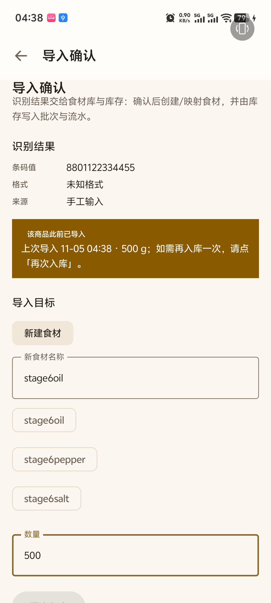
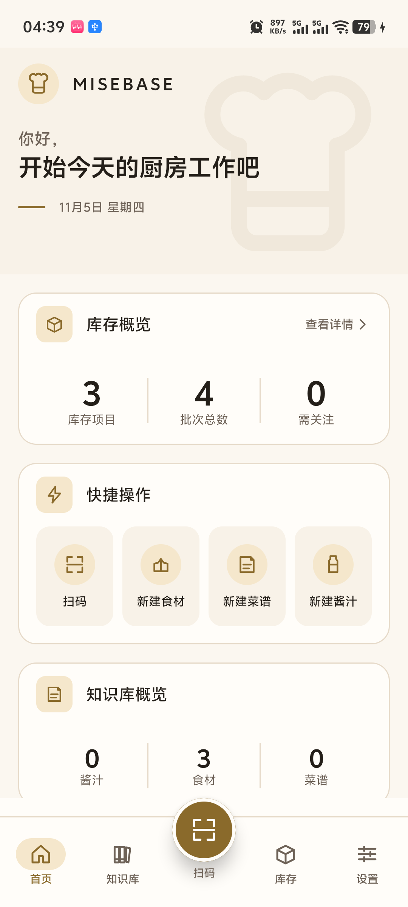
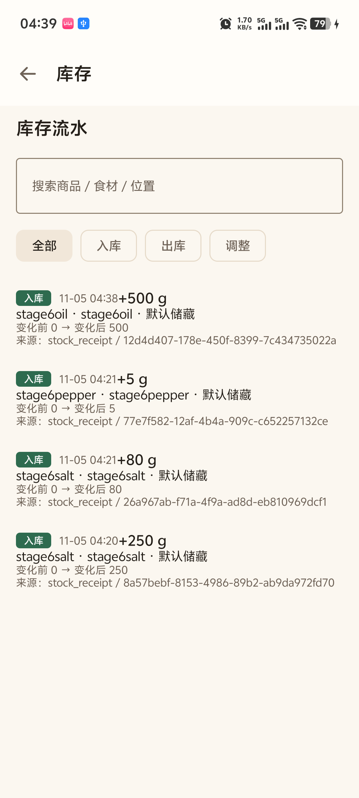

# MB-S6-01 Stage 6 最终发布与交付执行报告

**文档编号**：MB-S6-01  
**任务**：MB-S6-001 Stage 6 最终发布与交付  
**项目**：MISEBASE（`com.culinary`）  
**版本**：`1.0.0`（`versionCode = 1`）  
**文档状态**：`Review`（构建、签名、测试、真机验证与文档已完成，等待项目负责人验收）  
**日期**：2026-11-05  
**真机**：vivo V2429A / Android 16 / API 36 / 1080×2400  
**依据**：MB-S6-001 任务书；MB-D-006、MB-D-010、MB-D-012（2026-11-05 签收）；MB-D-004（14 模块）；MB-D-008 Rev.1（香槟金）；MB-D-009 Rev.2（N3 导航）

---

## 1. 结论

1. **Release APK 已产出并签名**：
   `app/build/outputs/apk/release/app-release.apk`，
   SHA-256 `89435F31DACAF6DF647E17DEE3776094D8F70D6A8408E72B1487F7455AAF7846`，
   大小 23.19 MB（24,315,875 字节），签名校验通过（APK Signature Scheme v2）。
2. **包名与版本**：`applicationId = com.culinary`（锁定，未改）；
   `versionCode = 1`、`versionName = 1.0.0`（AAPT2 badging 实测）。
3. **签名体系**：独立 `release.keystore` 位于仓库外 `D:\MISEBASE_RELEASE\`，
   证书 SHA-256 指纹 `5C:A4:19:59:…:AF:61`；仓库内无任何凭据；已做两份本地备份。
4. **图标**：新增自适应图标（`mipmap-anydpi-v26` 双层）+ 5 个密度 PNG 兜底，
   真机桌面截图验证生效；设计说明见 [MB-S6-02](MB-S6-02-APP-ICON.md)。
5. **升级安装**：`adb install -r` 覆盖成功，升级前后 2 食材 / 2 商品 / 3 批次 / 3 流水全部保留，
   流水中的批次 UUID 与升级前 SQLite 逐条一致；见 [MB-S6-04](MB-S6-04-UPGRADE-DATA-SAFETY.md)。
6. **全量门禁**：`test assembleRelease ktlintCheck detekt` 全部通过；
   **857 次测试执行 / 540 个唯一用例 / 0 失败 / 0 跳过**（13 个含测试的模块，96 个测试类）。
7. **真机冒烟**：Release 包内完成"扫码入库 → 首页数据刷新 → 库存流水"全链路，无崩溃、无异常。
8. **可复现**：新增 [`scripts/build-release.ps1`](../../scripts/build-release.ps1) 与
   [发布构建指南](RELEASE-BUILD-GUIDE.md)，换机按 §5 步骤可重建同签名产物。

> **未新增任何业务功能**；未改 Schema/Entity/DAO/迁移；未改业务逻辑、模块集或依赖规则。

---

## 2. 决策签收与基线

| 决策 | 内容 | 本轮处理 | 证据 |
|---|---|---|---|
| **MB-D-006** | 验收与测试口径 | JVM 自动化测试 + 核心业务真机测试，给出结果清单（§5、§6），不写冗长测试报告 | 本报告 §5、§6；[MB-S6-06](MB-S6-06-TEST-RESULTS.md) |
| **MB-D-010** | CI 形态 | **不采用远端 CI**，使用本地脚本 + 本地门禁 | `scripts/build-release.ps1`；§5 |
| **MB-D-012** | 发布签名 | 生成独立 keystore、仓库外双备份、配置 `signingConfigs`、计算指纹 | [MB-S6-03](MB-S6-03-RELEASE-SIGNING.md) |
| 包名 | `com.culinary` | 未修改 | §4 |
| 版本 | `1` / `1.0.0` | 在 `app/build.gradle.kts` 覆盖约定插件的占位默认值 | §4 |

> **编号说明（避免混淆）**：本任务的 `MB-D-006 / MB-D-010 / MB-D-012` 属于 MISEBASE 决策体系
> （见 `docs/05-handover/MB-S0-07-DECISION-REGISTER.md`）。G2 决策登记册中的 `D-012` 是
> "Hilt 依赖注入"，两者**不是同一体系**，不可互相替代。

---

## 3. 允许修改范围符合性

| 任务书允许范围 | 实际改动 |
|---|---|
| `app/src/main/res/` 新增图标资源 | ✅ 新增 14 个图标资源文件（矢量 1 + 自适应 XML 2 + 背景色 1 + PNG 10） |
| `app/src/main/AndroidManifest.xml` 引用新图标 | ✅ 仅增加 `android:icon` / `android:roundIcon` 两行 |
| `app/build.gradle.kts` 与根级 Gradle 配置 | ✅ 增加签名读取、`signingConfigs`、`versionCode/versionName`；未改依赖 |
| 新增本地构建脚本 | ✅ `scripts/build-release.ps1`、`scripts/generate-app-icon.py` |
| 相关文档 | ✅ `docs/14-stage6/` 六份文档 + 证据；索引与 README 状态更新 |

**未改动**：`core/*`、`feature/*` 的任何 Kotlin 源码，Room Schema/Entity/DAO/迁移，
`settings.gradle.kts`，依赖版本目录，模块集（仍为 14），业务页面与导航。

`git diff --stat`（提交前）：

```text
 app/build.gradle.kts             | 68 ++++++++++++++++++++++++++++++++++++++++
 app/src/main/AndroidManifest.xml |  2 ++
 2 files changed, 70 insertions(+)
```

其余均为新增文件（图标资源、脚本、文档、证据）。

---

## 4. 版本与包名验证

```text
$ aapt2 dump badging app\build\outputs\apk\release\app-release.apk
package: name='com.culinary' versionCode='1' versionName='1.0.0' compileSdkVersion='36'
minSdkVersion:'26'
targetSdkVersion:'36'
application-label:'MISEBASE'
```

| 项 | 值 | 判定 |
|---|---|---|
| applicationId | `com.culinary` | ✅ 与锁定值一致 |
| versionCode | `1` | ✅ |
| versionName | `1.0.0` | ✅ |
| minSdk / targetSdk | 26 / 36 | 与既有基线一致 |
| 签名 | v2 通过；证书与 keystore 一致 | ✅ |
| `debuggable` | Release 包为 false（`pkgFlags` 无 `DEBUGGABLE`） | ✅ |

---

## 5. 全量测试结果

### 5.1 命令

```powershell
# 由 scripts/build-release.ps1 执行（等价于手动执行）
.\gradlew.bat test assembleRelease ktlintCheck detekt --console=plain
```

### 5.2 JVM 测试汇总

从本轮 `build/test-results/**/TEST-*.xml` 汇总（debug + release 两个变体）：

| 指标 | 数值 |
|---|---|
| 测试报告文件 | 154 |
| **执行次数** | **857** |
| **唯一用例数**（class + name 去重） | **540** |
| 失败 / 错误 | **0** |
| 跳过 | **0** |
| 测试类 | 96 |
| 含测试的模块 | 13（`app`、`core:*` 6 个、`feature:*` 6 个；`feature:settings` 无测试） |

按模块的执行次数：

| 模块 | 执行 | 失败 |
|---|---|---|
| `core:data` | 196 | 0 |
| `core:domain` | 168 | 0 |
| `core:database` | 162 | 0 |
| `feature:scan` | 102 | 0 |
| `core:platform` | 52 | 0 |
| `app` | 49 | 0 |
| `feature:inventory` | 27 | 0 |
| `core:designsystem` | 20 | 0 |
| `feature:ingredients` | 19 | 0 |
| `feature:recipes` | 19 | 0 |
| `feature:sauces` | 18 | 0 |
| `feature:products` | 16 | 0 |
| `core:common` | 9 | 0 |

> 执行次数大于唯一用例数，是因为 `test` 同时跑 debug 与 release 两个单元测试变体；
> 540 与 Stage 5 之后的 533 相比，增量来自 MB-S5-08 幂等修复补充的用例。

### 5.3 静态检查

| 任务 | 结果 |
|---|---|
| `ktlintCheck`（全模块，含 Kotlin 脚本） | **通过**（修正了 `app/build.gradle.kts` 两处多行表达式缩进） |
| `detekt`（全模块） | **通过** |
| `assembleRelease`（R8 + resource shrink） | **通过** |

### 5.4 真机测试汇总

| 用例 | 结果 | 证据 |
|---|---|---|
| 升级安装（`install -r`，同签名） | 通过 | [MB-S6-04](MB-S6-04-UPGRADE-DATA-SAFETY.md) §4 |
| 升级后数据完整性 | 通过（2/2/3/3 与 SQLite 一致，批次 UUID 逐条相同） | 同上 |
| 扫码入库（Release 包，手工输入条码 → 新建食材 → 入库） | 通过（`已入库 stage6oil 500 g`） | `evidence/smoke-01-scan-import.png` |
| 首页数据刷新 | 通过（3 个库存项目 / 4 个批次） | `evidence/smoke-02-home.png` |
| 库存流水 | 通过（4 条入库流水，含变化前后数量与来源） | `evidence/smoke-03-ledger.png` |
| 桌面图标 | 通过（圆形遮罩内完整显示，点击可启动） | `evidence/icon-01-launcher-home.png` |
| 崩溃与异常 | 无 `FATAL` / `SQLiteException` / `Room` 异常 | `adb logcat -d` 过滤 |

> 冒烟测试在升级验证（04:32）之后、于同一个 Release 包上执行（04:38–04:39）：
> 先确认升级后 2 商品 / 3 批次完整，再通过扫码入库新增第 3 个商品（`stage6oil` 500 g），
> 首页随之变为 3 商品 / 4 批次，流水变为 4 条。这也顺带验证了首页与流水的实时刷新。

---

## 6. 真机冒烟（截图）

| 扫码入库 | 首页刷新 | 库存流水 |
|---|---|---|
|  |  |  |

---

## 7. 仓库清洁性与安全

| 检查 | 结果 |
|---|---|
| `git status --porcelain` 是否出现 keystore / `local.properties` | **否** |
| `git ls-files` 是否包含 keystore / jks | **否** |
| 代码/配置中是否出现密码 | **否**（签名值仅经 `local.properties`/环境变量读取） |
| keystore 位置 | `D:\MISEBASE_RELEASE\`（仓库外） |
| 构建脚本是否拒绝仓库内 keystore | **是**（`build-release.ps1` §2） |

```powershell
git status --porcelain | Select-String 'keystore|local\.properties'   # 无输出
git ls-files | Select-String 'keystore|\.jks'                          # 无输出
```

---

## 8. 交付物清单

| # | 交付物 | 位置 | 状态 |
|---|---|---|---|
| 1 | 图标真机截图 | `docs/14-stage6/evidence/icon-01-launcher-home.png`、`icon-02-launcher-zoom.png` | ✅ |
| 2 | 升级测试证据 | `docs/14-stage6/MB-S6-04-UPGRADE-DATA-SAFETY.md` + `evidence/upgrade-*.png` + `upgrade-data-before.json` | ✅ |
| 3 | Release APK | `app/build/outputs/apk/release/app-release.apk`；分发副本 `dist/MISEBASE-1.0.0-release.apk` + `.sha256` | ✅ |
| 4 | Keystore 凭据说明 | [MB-S6-03](MB-S6-03-RELEASE-SIGNING.md)（密码不在仓库，由交付消息单独给出） | ✅ |
| 5 | 全量测试结果 | 本报告 §5（857 / 540 / 0，JVM + 真机） | ✅ |
| 6 | 构建脚本与文档 | [`scripts/build-release.ps1`](../../scripts/build-release.ps1)、[RELEASE-BUILD-GUIDE.md](RELEASE-BUILD-GUIDE.md) | ✅ |

### 8.1 APK 指纹

| 项 | 值 |
|---|---|
| 路径 | `app/build/outputs/apk/release/app-release.apk` |
| 分发副本 | `dist/MISEBASE-1.0.0-release.apk` |
| 大小 | 24,315,875 字节（23.19 MB） |
| SHA-256 | `89435F31DACAF6DF647E17DEE3776094D8F70D6A8408E72B1487F7455AAF7846` |
| 签名方案 | v2 主校验（v1 JAR 签名文件随包存在，`minSdk=26` 下 apksigner 不校验 v1） |
| 签名证书 SHA-256 | `5ca41959d9f450cdc851dcb9f052ac9130aaeab71c64062173a699355056af61` |

### 8.2 Keystore 指纹

| 项 | 值 |
|---|---|
| 路径（仓库外） | `D:\MISEBASE_RELEASE\release.keystore` |
| 文件 SHA-256 | `34538C3D818BF5F8B8AC0D2B3E4B2F354D07F952DEEDF422CB8155DFF37A77CA` |
| 证书 SHA-256 | `5C:A4:19:59:D9:F4:50:CD:C8:51:DC:B9:F0:52:AC:91:30:AA:EA:B7:1C:64:06:21:73:A6:99:35:50:56:AF:61` |
| 别名 | `misebase-release` |
| 备份 | `D:\MISEBASE_RELEASE\backup-01\`、`backup-02\`（三份 SHA-256 一致） |

> **密码不写入仓库**。keystore 密码与 key 密码在交付消息中一次性给出；
> 负责人须立即保存到密码管理器并删除该消息记录。详见 [MB-S6-03](MB-S6-03-RELEASE-SIGNING.md) §4。

---

## 9. 变更文件清单

### 9.1 修改

| 文件 | 变更 |
|---|---|
| `app/build.gradle.kts` | 读取 `local.properties`/环境变量的四个签名键；新增 `signingConfigs.release`；release 变体接入签名；`versionCode=1`、`versionName=1.0.0`；debug 变体支持 `-PdebugWithReleaseSigning`（仅升级验证用） |
| `app/src/main/AndroidManifest.xml` | 新增 `android:icon`、`android:roundIcon` |
| `README.md` | 更新"当前状态"：Stage 6 发布完成、三项决策签收、G5 门禁 |
| `docs/00-governance/DOCUMENT-INDEX.md` | 新增 Stage 6 文档索引 |
| `docs/05-handover/MB-S0-07-DECISION-REGISTER.md` | MB-D-006/010/012 签收为 `ACCEPTED`（18/18），补签收记录与版本 0.9.0 |
| `scripts/check-doc-consistency.ps1` | 决策状态断言更新为 18/18（保持文档检查有效） |

### 9.2 新增

| 文件 | 作用 |
|---|---|
| `app/src/main/res/drawable/ic_launcher_foreground.xml` | 自适应图标前景（矢量） |
| `app/src/main/res/mipmap-anydpi-v26/ic_launcher.xml`、`ic_launcher_round.xml` | 自适应图标声明 |
| `app/src/main/res/values/ic_launcher_background.xml` | 背景色 `#FBF7F0` |
| `app/src/main/res/mipmap-{mdpi,hdpi,xhdpi,xxhdpi,xxxhdpi}/ic_launcher{,_round}.png` | 10 个兜底 PNG |
| `scripts/build-release.ps1` | 本地发布流水线 |
| `scripts/generate-app-icon.py` | 图标单一几何源生成器（矢量 + PNG + 预览） |
| `docs/14-stage6/*` | 六份文档 + 证据目录 |

---

## 10. 复现（换机）

1. 安装 JDK 17+、Android SDK Platform 36、Build-Tools（含 `apksigner`/`aapt2`）；
2. 放回 `release.keystore`（仓库外）并用 `keytool` 核对指纹；
3. 写 `local.properties`（`sdk.dir` + 四个签名键）；
4. 执行：

```powershell
powershell -NoProfile -ExecutionPolicy Bypass -File .\scripts\build-release.ps1
```

详见 [RELEASE-BUILD-GUIDE.md](RELEASE-BUILD-GUIDE.md)。

---

## 11. 风险、限制与未验证项

| # | 事项 | 影响 | 处理 |
|---|---|---|---|
| 1 | Debug 与 Release 签名不同，无法字面执行"Debug → Release 覆盖安装" | 任务书 §3.3 字面步骤不可执行 | 用"发布签名的 Debug 变体"作为升级前基线；对照实验证明系统会以 `INSTALL_FAILED_UPDATE_INCOMPATIBLE` 拒绝；详见 MB-S6-04 §5 |
| 2 | Release 包不可 `run-as`，无法在升级后直接导出 SQLite | 升级后证据为 UI + 批次 UUID 比对 | 已保留升级前完整行级快照 `upgrade-data-before.json`；UUID 逐条一致 |
| 3 | 未提供 `monochrome` 单色图标层 | Android 13+ 主题图标回退为彩色图标 | 负空间 M 无法用单色层正确表达；当前不影响使用，如需主题图标需另设计一版轮廓 |
| 4 | 图标 PNG 兜底无法在 API 36 真机触发 | 低版本兜底未被真机执行 | 由脚本生成并以 `aapt2` 打包验证存在；`minSdk=26` 下正常路径始终是自适应图标 |
| 5 | 未验证跨版本数据库迁移（v1→v2 升级链） | 首次发布不涉及 | 迁移由既有 Room 迁移测试覆盖；下一版本发布前需补 |
| 6 | 未做前端/远端 CI | 门禁只在本地执行 | 依据 MB-D-010 签收，不采用远端 CI |
| 7 | 未验证低电量/断电中断的安装场景 | 极端场景 | 不在任务书要求内 |

---

## 12. Git 与 Review

- 分支：`main`；提交见 §13（提交后回填哈希）。
- 状态：**`Review`**——实现、构建、签名、测试、真机验证与文档均已完成，等待项目负责人验收。
- 未执行的操作（按任务书停止条件）：未 tag、未发布到分发渠道、未开展任何新功能开发。

### 12.1 复核清单

| 项 | 结论 | 复核人 | 日期 |
|---|---|---|---|
| 包名/版本未变 | 待复核 | | |
| Release APK 签名与指纹 | 待复核 | | |
| 全量 JVM 测试通过 | 待复核 | | |
| 真机升级数据不丢失 | 待复核 | | |
| 图标真机生效 | 待复核 | | |
| 仓库内无凭据 | 待复核 | | |
| 双备份与密码保管 | 待复核 | | |

---

## 13. 提交记录

```text
（提交后回填：commit hash / 提交信息）
```
