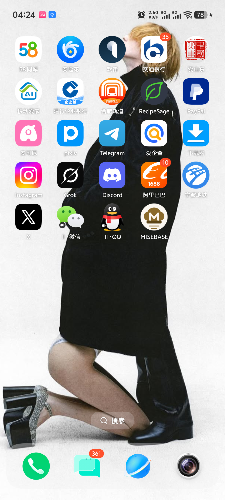
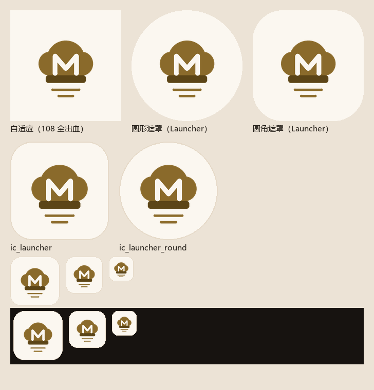
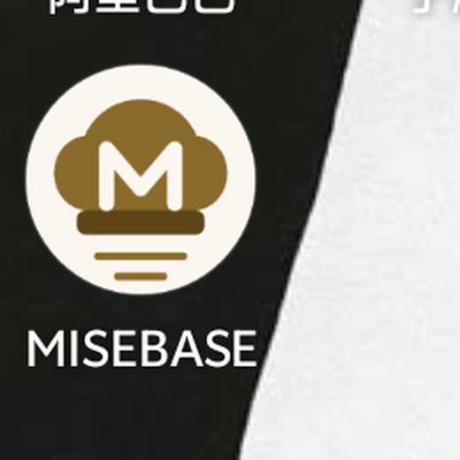

# MB-S6-02 MISEBASE 桌面图标设计说明

**文档编号**：MB-S6-02  
**版本**：`1.0.0`  
**状态**：`Review`  
**日期**：2026-11-05  
**依据**：MB-S6-001 §3.1；MB-D-008 Rev.1（香槟金视觉方向）；`core:designsystem` 的 Color token  
**证据目录**：[`evidence/`](evidence/)

---

## 1. 结论

1. 图标采用 **Android Adaptive Icon**：`mipmap-anydpi-v26/ic_launcher.xml` 与
   `ic_launcher_round.xml`，包含 `background`（暖白 `#FBF7F0`）与 `foreground`（矢量线稿）两层。
2. 低版本/非自适应场景由 `mipmap-mdpi`…`mipmap-xxxhdpi` 的 `ic_launcher.png` 与
   `ic_launcher_round.png` 兜底（5 个密度 × 2 种形状）。
3. 图标已通过 `AndroidManifest.xml` 的 `android:icon` / `android:roundIcon` 生效；
   真机桌面截图见 §6。
4. 图标由可复现脚本 [`scripts/generate-app-icon.py`](../../scripts/generate-app-icon.py) 从同一份几何定义生成本文档全部资源，
   矢量层与 PNG 兜底图不会漂移。

真机桌面（圆形遮罩，Android 16 / vivo V2429A）：



---

## 2. 视觉设计

### 2.1 设计语言

沿用 MB-D-008 Rev.1「专业厨房档案」：暖中性 + 香槟金。香槟金只用于图形本体，不作大面积铺底，
与 App 内的 token 完全一致：

| 用途 | 色值 | 来源 |
|---|---|---|
| 图标背景（暖白） | `#FBF7F0` | `SurfaceLight` |
| 帽冠 / 页纹 / 圆点（香槟金） | `#8A6A2B` | `Champagne40` |
| 帽檐（深金） | `#5C4517` | `Champagne30` |
| 负空间字母 M 与帽冠镂空 | `#FBF7F0` | 与背景同色，形成"镂空"读数 |
| PNG 兜底图描边 | `#E6DAC9` | `WarmNeutral80` |

### 2.2 构成

三个元素组合成"厨房档案"语义，控制在可小尺寸识别的复杂度内：

1. **厨师帽**：三瓣帽冠（左右侧瓣 + 中央高瓣）与帽檐，构成可识别的厨师符号；
2. **字母 M**：以负空间（暖白描边）嵌在帽冠内，落在帽檐上，作为品牌首字母；
3. **档案页纹**：帽檐下方两行由长到短的细线，借用档案卡/书页的排版语汇，避免图标下半部分空泛。

### 2.3 网格与安全区

- 画布：`108 × 108`（Android 自适应图标规范），中心 `(54, 54)`；
- 安全区：半径 33 的圆（被任意遮罩裁切后仍完整可见的最大范围），
  本图标所有可见元素均在安全区内；
- 主要几何（单位：108 网格）：

| 元素 | 几何 |
|---|---|
| 帽冠中央瓣 | 椭圆 `cx=54, cy=47.5, rx=18.5, ry=18` |
| 帽冠左/右瓣 | 椭圆 `cx=38/70, cy=52, rx=10.5, ry=11.5` |
| 帽冠下部 | 矩形 `x=37…71, y=52…64`（补齐平底） |
| 帽檐 | 圆角矩形 `x=34.5…73.5, y=63.4…70.8, r=2.6` |
| 字母 M | 折线 `(43.6,61.4)→(43.6,44.6)→(54,56.8)→(64.4,44.6)→(64.4,61.4)`，线宽 4.6，圆头圆角 |
| 页纹 | `y=77.4`（x 41…67）、`y=83.6`（x 47…61），线宽 2.3，圆头 |

> 说明：帽冠由三个椭圆与一个矩形叠加填充而成。矢量层与 PNG 层使用同一组图形，
> 因此重叠处的边界在两种输出中一致。

---

## 3. 资源清单

### 3.1 新增资源

| 文件 | 作用 | 规格 |
|---|---|---|
| `app/src/main/res/mipmap-anydpi-v26/ic_launcher.xml` | 自适应图标（方形） | `<adaptive-icon>`：background + foreground |
| `app/src/main/res/mipmap-anydpi-v26/ic_launcher_round.xml` | 自适应图标（圆形） | 同上 |
| `app/src/main/res/drawable/ic_launcher_foreground.xml` | 前景矢量层 | `108dp × 108dp`，viewport 108 |
| `app/src/main/res/values/ic_launcher_background.xml` | 背景色 | `#FBF7F0` |
| `app/src/main/res/mipmap-mdpi/ic_launcher.png` | 48px 兜底 | 圆角方形 + 描边 |
| `app/src/main/res/mipmap-mdpi/ic_launcher_round.png` | 48px 圆形兜底 | 圆形 + 描边 |
| `app/src/main/res/mipmap-hdpi/*.png` | 72px 兜底 | 同上 |
| `app/src/main/res/mipmap-xhdpi/*.png` | 96px 兜底 | 同上 |
| `app/src/main/res/mipmap-xxhdpi/*.png` | 144px 兜底 | 同上 |
| `app/src/main/res/mipmap-xxxhdpi/*.png` | 192px 兜底 | 同上 |

### 3.2 清单接线

```xml
<application
    android:icon="@mipmap/ic_launcher"
    android:roundIcon="@mipmap/ic_launcher_round"
    ... />
```

`minSdk = 26`，因此所有受支持设备都会命中 `mipmap-anydpi-v26` 的自适应图标；
PNG 兜底保留给不支持自适应图标的启动器/第三方工具链（也是任务书 §3.1 的明确要求）。

### 3.3 生成脚本

```powershell
# 重新生成资源（需要 Python 3 + Pillow）
python scripts\generate-app-icon.py --assets
# 只出对照预览图
python scripts\generate-app-icon.py --preview docs\14-stage6\evidence\icon-candidate-solid.png
```

可选参数：`--legacy-scale`（兜底图内容缩放，默认 1.16）、`--bg`（背景色）、
`--style solid|outline`（实心/线稿候选）。

---

## 4. 方案对比与取舍

| 方案 | 表现 | 结论 |
|---|---|---|
| **A. 实心帽冠 + 负空间 M（采用）** | 216px/96px/48px 均清晰；深色与浅色壁纸上对比稳定 | **采用** |
| B. 线稿帽冠 + 金色 M | 暖白帽冠在暖白底上对比不足，48px 时轮廓消失 | 否决（见 `evidence/icon-candidate-outline.png`） |

对照图（左：自适应铺底；中：圆形遮罩；右：圆角遮罩；下方为 192/96/72/48px 兜底与深色壁纸检验）：



取舍理由：

- 桌面图标在 48–192px 之间都要成立，实心块面比细线稿更稳；
- 负空间 M 在深色壁纸与浅色壁纸下都不会"糊"成一团；
- 图案只用两种金色与背景色，与 App 内的香槟金体系一致，不引入第三种强调色。

---

## 5. 已知限制

1. **未提供 `monochrome` 层**（Android 13+ 主题图标）。主题图标要求单一色块，
   而本图标的 M 是负空间镂空——用单色层表达需要重新设计一版轮廓，当前阶段不新增方案；
   在未提供 monochrome 层时，系统会回退展示彩色自适应图标，不影响使用。
2. **自适应图标的遮罩形状由启动器决定**：本机（vivo）为圆形；其他厂商可能是方圆/泪滴，
   设计已按"内容全部落在半径 33 安全区内"约束，任意遮罩都不裁切主体。
3. **PNG 兜底无法在 API 36 真机上直接验证**（系统总是优先自适应图标）。
   本轮以脚本生成的 48/72/96/144/192px 预览与 `aapt2` 打包结果验证资源存在；
   兜底图仅在无自适应支持的启动器上启用。

---

## 6. 真机验证

| 项 | 结果 | 证据 |
|---|---|---|
| 图标出现在桌面 | 通过：桌面最后一屏可见 `MISEBASE` 图标，圆形遮罩内为暖白底 + 香槟金厨师帽 + M | `evidence/icon-01-launcher-home.png` |
| 图标细节可读（1080×2400 原图裁切放大） | 通过：帽冠、负空间 M、帽檐、两道页纹均清晰 | `evidence/icon-02-launcher-zoom.png` |
| 点击图标启动 | 通过：点击后 `com.culinary/.MainActivity` 正常恢复 | 本轮 adb 记录（`dumpsys activity activities`） |
| 圆形遮罩裁切 | 通过：未裁到帽冠、M 与页纹 | 同上 |



> 桌面壁纸为设备原有壁纸；图标本身未做任何后期处理，截图由 `adb exec-out screencap -p` 直接取得。

---

## 7. 复核清单（待填）

| 项 | 结论 | 复核人 | 日期 |
|---|---|---|---|
| 视觉方向符合 MB-D-008 Rev.1 | 待复核 | | |
| 自适应图标结构（foreground/background） | 待复核 | | |
| 各密度 PNG 兜底齐全 | 待复核 | | |
| 真机桌面截图可信 | 待复核 | | |
