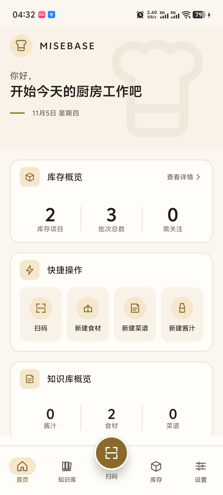
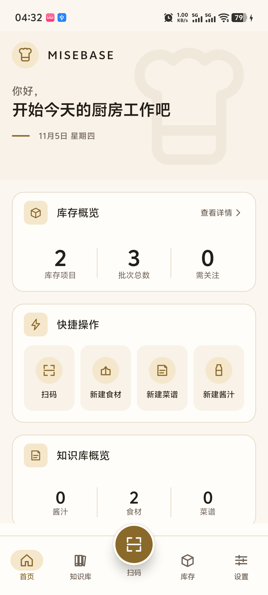
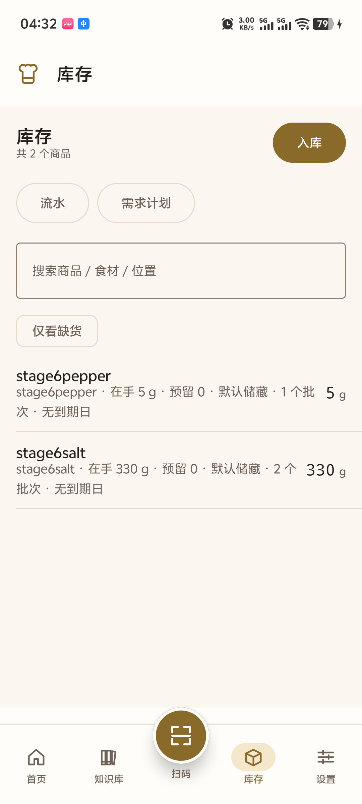
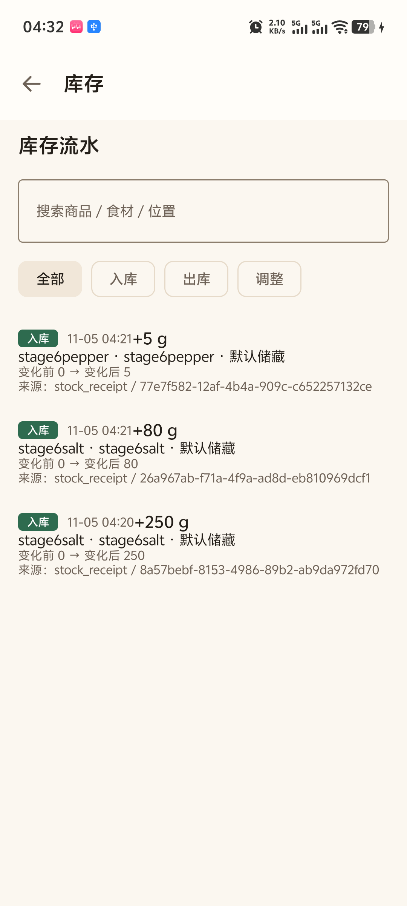
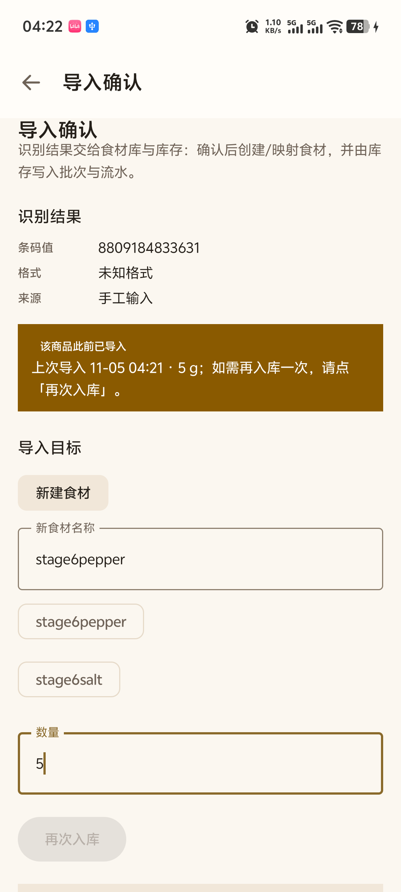

# MB-S6-04 升级安装与数据安全验证

**文档编号**：MB-S6-04  
**版本**：`1.0.0`  
**状态**：`Review`  
**日期**：2026-11-05  
**依据**：MB-S6-001 §3.3；MB-D-006（真机验证口径）；MB-D-012（发布签名）  
**证据目录**：[`evidence/`](evidence/)  
**被测 APK**：`dist/MISEBASE-1.0.0-release.apk`  
SHA-256 `89435F31DACAF6DF647E17DEE3776094D8F70D6A8408E72B1487F7455AAF7846`

---

## 1. 结论

| 项 | 结果 |
|---|---|
| 包名 | `com.culinary`（未变） |
| 版本 | `versionCode=1` / `versionName=1.0.0`（升级前后一致） |
| 升级方式 | `adb install -r`（覆盖安装，不卸载） |
| 升级结果 | **Success**，`pkgFlags` 由 `DEBUGGABLE HAS_CODE …` 变为 `HAS_CODE …` |
| 业务数据 | **未丢失**：2 个食材 / 2 个商品 / 3 个批次 / 3 条流水全部保留 |
| SQLite 结构 | `PRAGMA user_version = 2`，升级后正常打开，无迁移、无重建 |
| 崩溃 | 升级后 `logcat` 无 `FATAL` / `AndroidException` / `SQLiteException` |

> **必须说明的前置事实**：Android 只允许"同签名"覆盖安装。Debug 包用 `debug.keystore` 签，
> Release 包用发布 keystore 签，**两者无法直接覆盖**（实测见 §5）。
> 因此升级前的基线包是"**与发布同签名的 Debug 变体**"
> （`-PdebugWithReleaseSigning=true`，仍然 `debuggable`，便于用 `run-as` 导出 SQLite）。
> 这是对任务书 §3.3 的可执行等价物，验证的升级路径与真实用户一致：
> **旧数据 + 旧包 → 同签名新包（R8 压缩、`debuggable=false`）→ 数据仍在**。

---

## 2. 设备与版本

| 字段 | 值 |
|---|---|
| 设备 | vivo V2429A（PD2429），序列号 `10CEBG0DGT0008D` |
| 系统 | Android 16 / API 36，构建号 `compiler260905102531` |
| 屏幕 | 1080×2400（override），density 480 |
| 连接 | USB，`adb devices` 状态 `device` |

| 包 | 签名证书 SHA-256 | versionCode / versionName | debuggable | APK SHA-256 |
|---|---|---|---|---|
| 升级前基线（Debug 变体 + 发布签名） | `5ca41959…56af61` | 1 / 1.0.0 | 是 | `E23DF11C8DC1D29A4BECE602777C44481DAE49C1A68D5501657E6E7D3BD92BC8` |
| 升级后（Release） | `5ca41959…56af61` | 1 / 1.0.0 | 否 | `89435F31DACAF6DF647E17DEE3776094D8F70D6A8408E72B1487F7455AAF7846` |

证书完全相同，因此系统把它当作同一应用的新版本安装。

---

## 3. 测试数据

在升级前基线包中，通过**扫码入库**真实写入（非直接改库、非 Mock）：

| 操作 | 条码 | 食材 | 数量 | 结果 |
|---|---|---|---|---|
| 第 1 次导入 | `6901234567892` | `stage6salt`（新建） | 250 g | 入库成功 |
| 第 2 次导入 | `6909876543210` | `stage6salt`（复用） | 80 g | 入库成功 |
| 第 3 次导入 | `8809184833631` | `stage6pepper`（新建） | 5 g | 入库成功 |

升级前数据库导出（`adb exec-out run-as com.culinary cat databases/culinary.db`，
连同 `-wal` / `-shm` 一起导出后用 SQLite 只读打开）：

```json
{
  "user_version": 2,
  "counts": { "ingredient": 2, "product": 2, "inventory_batch": 3, "inventory_ledger": 3, "barcode": 0 },
  "data_fingerprint_sha256": "f79e95d4d238f69d264a9fcd9996083aabc157a5a85753ccdd66c8e5a3b6d289"
}
```

完整行级快照见 [`evidence/upgrade-data-before.json`](evidence/upgrade-data-before.json)，
其中包含每个批次的 UUID 与每条流水的 `idempotency_key`（`scan-import:<条码>:<operation_id>`）。

---

## 4. 升级前后对比

| 观测点 | 升级前（Debug 基线, SQLite） | 升级后（Release, 应用内 UI） | 一致 |
|---|---|---|---|
| 库存项目 | `product` 2 行 | 首页「库存项目 **2**」 | ✅ |
| 批次总数 | `inventory_batch` 3 行 | 首页「批次总数 **3**」 | ✅ |
| 食材数 | `ingredient` 2 行 | 首页「食材 **2**」 | ✅ |
| `stage6salt` 在手 | 批次 250 + 80 = **330 g**（2 个批次） | 库存页「在手 **330 g** · **2** 个批次」 | ✅ |
| `stage6pepper` 在手 | 批次 **5 g**（1 个批次） | 库存页「在手 **5 g** · **1** 个批次」 | ✅ |
| 流水条目 | 3 条 `PURCHASE_RECEIPT` | 流水页 3 条「入库」 | ✅ |
| 批次 UUID | `8a57bebf…`、`26a967ab…`、`77e7f582…` | 流水页「来源：stock_receipt / **8a57bebf…**、**26a967ab…**、**77e7f582…**」 | ✅ **UUID 逐条相同** |
| 数量与变化 | +250 / +80 / +5 | 流水页 +250 g / +80 g / +5 g，变化前 0 | ✅ |
| 数据库版本 | `user_version = 2` | 应用正常启动（Room 打开 v2，无破坏性迁移） | ✅ |

> 流水页展示的 `stock_receipt / <批次 UUID>` 与升级前 SQLite 中的批次主键逐条相同，
> 这是"同一份数据被新包读取"的直接证据，而不仅是数字巧合。

### 4.1 升级前

| 首页 | 库存 | 流水 |
|---|---|---|
|  |  |  |

### 4.2 升级后（Release，`debuggable=false`）

| 首页 | 库存 | 流水 |
|---|---|---|
|  |  |  |

### 4.3 数据写入证据（升级前，扫码导入结果页）



---

## 5. 对照实验：为什么不能用"官方 Debug 包"直接覆盖

同一台设备上，安装**官方 debug 签名**的 Debug 包后，尝试覆盖安装 Release 包：

```powershell
adb install -r build\stage6-device\app-debug-debugsigned.apk   # 签名为 debug.keystore
adb install -r dist\MISEBASE-1.0.0-release.apk                 # 签名为 release.keystore
```

实测输出：

```text
adb: failed to install dist\MISEBASE-1.0.0-release.apk:
Failure [INSTALL_FAILED_UPDATE_INCOMPATIBLE: Existing package com.culinary signatures do not match newer version; ignoring!]
```

结论：

1. 该失败**与数据、版本号、minSdk 无关**，是 Android 的签名一致性保护；
2. 任务书 §3.3 的字面步骤（装 Debug → `install -r` Release）在当前签名策略下**物理上不可执行**；
3. 本轮采用"发布签名的 Debug 变体"作为升级前基线（§1 说明），既保留了 Debug 的可调试性
   （能 `run-as` 导出 SQLite），又与最终 Release 同签名，是唯一能同时验证"数据不丢"的做法；
4. 该对照实验的 APK 与结果保留在 `build/stage6-device/`（本地构建目录，不提交）。

---

## 6. 复现步骤

```powershell
$adb = "$env:ANDROID_HOME\platform-tools\adb.exe"

# 1) 升级前基线：Debug 变体 + 发布签名
.\gradlew.bat :app:assembleDebug -PdebugWithReleaseSigning=true
& $adb install -r app\build\outputs\apk\debug\app-debug.apk
& $adb shell pm clear com.culinary

# 2) 启动并录入数据（扫码 → 手工输入条码 → 新建/复用食材 → 确认导入）
& $adb shell am start -n com.culinary/.MainActivity

# 3) 导出升级前 SQLite（Debuggable 才能 run-as）
& $adb shell am force-stop com.culinary
& $adb exec-out run-as com.culinary cat databases/culinary.db > before.db
& $adb exec-out run-as com.culinary cat databases/culinary.db-wal > before.db-wal
& $adb exec-out run-as com.culinary cat databases/culinary.db-shm > before.db-shm

# 4) 覆盖安装 Release（同签名；不卸载）
& $adb install -r dist\MISEBASE-1.0.0-release.apk

# 5) 确认版本与可调试位
& $adb shell dumpsys package com.culinary | Select-String 'versionCode|versionName|pkgFlags'
#   versionCode=1 / versionName=1.0.0 / pkgFlags=[ HAS_CODE ALLOW_CLEAR_USER_DATA ]（DEBUGGABLE 已消失）

# 6) 启动并核对首页/库存/流水数字与批次 UUID
& $adb shell am start -n com.culinary/.MainActivity
```

---

## 7. 局限与说明

1. **升级后无法再用 `run-as` 读库**（Release 不可调试，这是发布包应有的状态）。
   因此升级后的证据是"界面显示值 + 流水中的批次 UUID"，与升级前的 SQLite 行级快照逐条比对；
   已保留升级前的完整 JSON 快照（`evidence/upgrade-data-before.json`）。
2. **未验证跨大版本升级**（例如 v1 → v2 迁移）。当前只有 `versionCode=1` 一个发布版本，
   数据库迁移路径由既有 Room 迁移测试覆盖，不在本轮范围。
3. **未验证降级安装**：`versionCode` 相同，`adb install -r` 成功；若未来降低 `versionCode`，
   Android 会拒绝（`INSTALL_FAILED_VERSION_DOWNGRADE`），属于预期行为。
4. 本轮升级验证使用**增量构建产物**（同一份源码、同一签名配置）；最终 APK 重新构建后的
   SHA-256 与升级测试时**完全相同**（`89435F31…7846`），排除了"测试的是另一个包"的疑虑。

---

## 8. 复核清单（待填）

| 项 | 结论 | 复核人 | 日期 |
|---|---|---|---|
| 升级前基线包与 Release 同签名 | 待复核 | | |
| `install -r` 覆盖成功且版本一致 | 待复核 | | |
| 升级后数据与升级前 SQLite 一致 | 待复核 | | |
| 批次 UUID 逐条一致 | 待复核 | | |
| 无崩溃/异常 | 待复核 | | |
