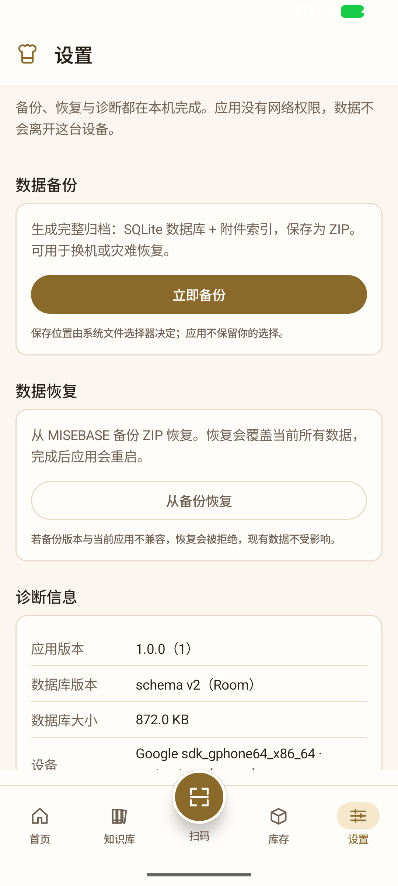
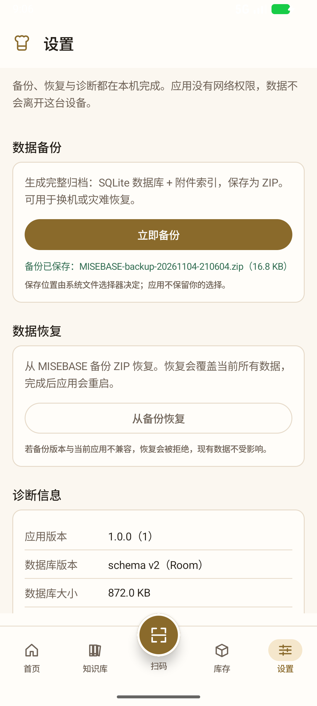
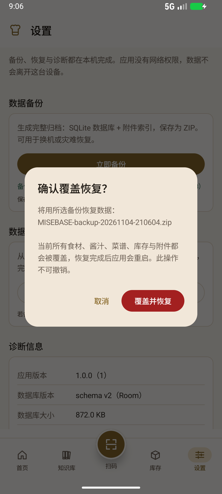
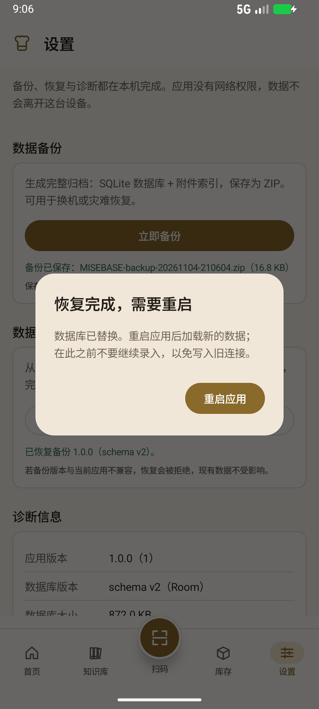
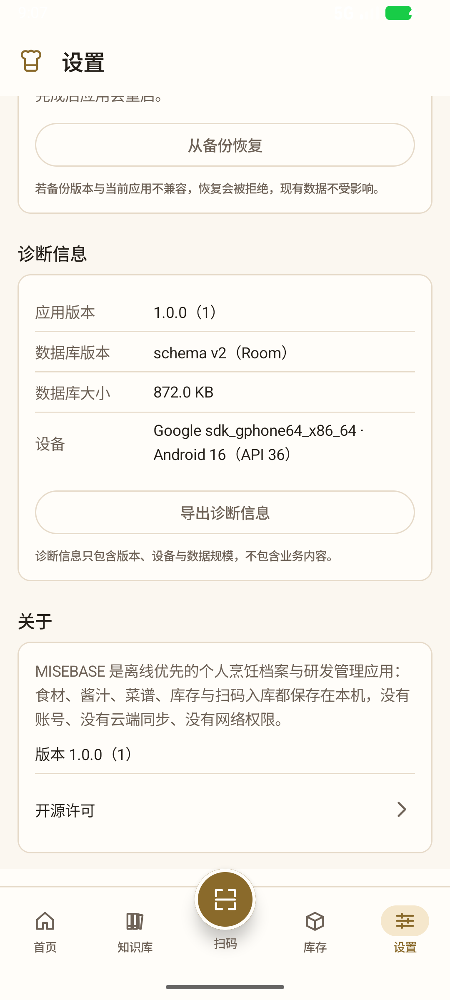
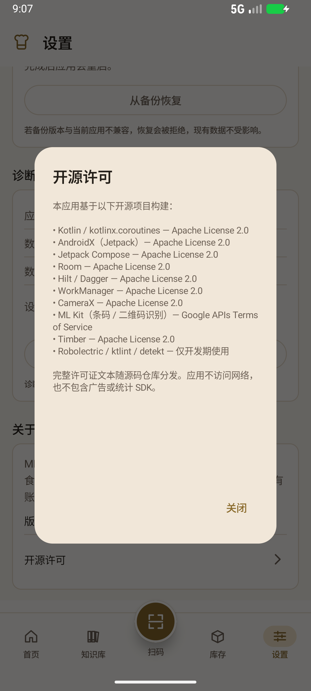

# MB-S6-002 设置页 UI 补全与最终交付执行报告

**文档编号**：MB-S6-002  
**版本**：`1.0.0`  
**状态**：`Review`  
**日期**：2026-11-05  
**依据**：MB-S6-002 任务书；MB-S6-001 发布基线；MB-D-006（JVM + 真机/模拟器验证）；MB-D-007（备份一致性，CLOSED）；MB-D-012（发布签名）  
**验证环境**：Android 模拟器 `Medium_Phone_API_36.1`（Android 16 / API 36 / x86_64 / 1080×2400 / density 420）  
**交付 APK**：`D:\A-1\MISEBASE-Final.apk`

---

## 1. 结论

1. N3 第 5 项「设置」已从占位页升级为完整页面，包含四个区块：
   **数据备份**、**数据恢复**、**诊断信息**、**关于**。
2. 备份使用 **SAF `CreateDocument`** 选择保存位置，调用既有 `AutoBackupRunner` 生成归档
   （写屏障 + checkpoint + 归档 + 校验 + `backup_record`），并写入用户选择的位置。
   模拟器实测：`Downloads/MISEBASE-backup-20261104-210604.zip`（16.8 KB）生成成功。
3. 恢复使用 **SAF `OpenDocument`** 选择 ZIP，先弹出**高危确认弹窗**（明确写出覆盖范围与重启），
   确认后依次执行 `BackupArchiveVerifier` → `RestorePrecheck` → `RestoreExecutor`
   （回滚副本、原子装库、journal），成功后重启应用。模拟器实测恢复成功并自动重启。
4. 诊断信息展示 **应用版本（`BuildConfig`）**、**数据库 schema v2**、数据库大小与设备信息，
   并支持导出诊断文本（`Downloads/MISEBASE-diagnostics-*.txt` 实测 286 字节）。
5. 关于区展示项目介绍、版本号与开源许可弹窗（离线内置文本，不依赖浏览器）。
6. **未修改** Schema / Entity / DAO / 迁移、备份与恢复算法、各 feature 业务逻辑。
7. 全量 `test assembleDebug` 通过：**857 执行 / 540 唯一 / 0 失败**；`ktlintCheck`、`detekt`、
   模块依赖检查（14 模块 / DAG 无违规）全部通过。
8. Release APK 已复制到 **`D:\A-1\MISEBASE-Final.apk`**，SHA-256 与构建产物一致
   （`179CA79F…69C3`），并以 `MISEBASE-Final.apk.sha256` 留档。

---

## 2. 功能实现

### 2.1 页面结构

设置页在 `app` 模块的 `settings` 路由下实现（N3 底栏第 5 项），沿用设计系统
`SectionHeader` / `ConfirmDialog` / `CulinarySpacing` / 香槟金 token：

| 区块 | 内容 | 交互 |
|---|---|---|
| 数据备份 | 说明 + 「立即备份」+ 结果回显 | 点击 → SAF 保存位置 → 生成并写入 ZIP |
| 数据恢复 | 说明 + 「从备份恢复」+ 结果回显 | 选择 ZIP → 高危确认 → 覆盖恢复 → 重启 |
| 诊断信息 | 应用版本、数据库 schema、数据库大小、设备 | 「导出诊断信息」→ SAF 保存 `.txt` |
| 关于 | 项目介绍、版本、开源许可 | 许可弹窗（内置文本，可滚动） |

截图见 §5。

### 2.2 备份流程

```text
点击「立即备份」
  → ActivityResultContracts.CreateDocument("application/zip")
  → 用户选择位置（文件名 MISEBASE-backup-<时间戳>.zip）
  → SettingsMaintenance.exportBackup(OutputStream)
      → AutoBackupRunner.run(AutoBackupRequest())
          写屏障 → WAL checkpoint → 快照 quick_check → 归档 ZIP
          → BackupArchiveVerifier 校验 → 原子落盘 → 写 backup_record
      → 把归档字节复制到 SAF 输出流
  → 回显「备份已保存：<文件名>（<大小>）」
```

- 成功条件与自动备份完全一致：**归档存在 + 校验通过 + `backup_record` 已写**；
- 失败按 `CulinaryError` 错误码回显（校验失败 / 版本不兼容 / IO / 文件访问）；
- 备份目标由用户在系统文件选择器决定，应用不保存该 Uri。

### 2.3 恢复流程

```text
点击「从备份恢复」
  → ActivityResultContracts.OpenDocument（application/zip, application/octet-stream）
  → 选中文件后仅记录文件名，弹出高危确认
      「将用所选备份恢复数据 … 当前所有食材、酱汁、菜谱、库存与附件都会被覆盖 …
        恢复完成后应用会重启。此操作不可撤销。」
  → 确认后：
      BackupArchiveVerifier（结构 / manifest / checksums / 逐文件哈希）
      → RestorePrecheck（格式版本、integrity、schema 兼容）
      → 取出 manifest 指定的数据库条目
      → RestoreExecutor.restoreDatabase（写屏障、关连接、回滚副本、原子装库、journal）
  → 成功：弹出「恢复完成，需要重启」→ 重启进程
  → 失败：回显错误码，现有数据不受影响（校验/预检失败时不触碰数据库）
```

- 预检不通过（例如备份 schema 高于当前、PARTIAL 备份、哈希不符）**不会修改任何数据**；
- 恢复成功后数据库连接保持关闭，必须重启进程重新打开——重启逻辑见 §2.5。

### 2.4 诊断与关于

- 应用版本读取 `BuildConfig.VERSION_NAME` / `BuildConfig.VERSION_CODE`；
- 数据库版本通过 `PRAGMA user_version` 实时读取（当前 v2）；
- 数据库大小取 `context.getDatabasePath("culinary.db").length()`；
- 设备信息取 `Build.MANUFACTURER/MODEL/VERSION.RELEASE/SDK_INT`；
- 导出的诊断文本只含上述元数据与 ABI，不含任何业务内容；
- 关于区含项目定位说明与开源许可清单（Kotlin/Coroutines、AndroidX、Compose、Room、Hilt、
  WorkManager、CameraX、ML Kit、Timber 等），应用无网络权限，因此不做外链。

### 2.5 恢复后的重启

恢复成功后 `RestoreExecutor` 已关闭数据库连接，Hilt 单例不可再用，必须重启进程：

```kotlin
// 先提交新任务启动请求（CLEAR_TASK），再立即结束旧进程
context.startActivity(launchIntent)     // 请求已交给 system_server
Process.killProcess(Process.myPid())    // 旧进程退出，系统在新进程冷启动 MainActivity
exitProcess(0)
```

- 不能延迟退出：新 Activity 会先跑在旧进程里，随后被一起杀掉（实测会停留在桌面）；
- 不能依赖 `AlarmManager` 延时启动：Android 14+ 对后台启动 Activity 有
  `BAL_BLOCK` 限制（实测 logcat 为 `Background activity launch blocked`）；
- 当前实现已在模拟器验证：点击「重启应用」后 `MainActivity` 在 1 秒内重新出现，
  数据加载正常（进程冷启动）。

---

## 3. 架构与允许范围说明

### 3.1 为什么新增 `core:data` 出口

`app` 的依赖白名单（`config/module-dependencies.json`）**不含 `core:domain` / `core:database`**，
而备份/恢复能力的端口与数据库句柄都在这些层：

| 需要的能力 | 类型所在层 |
|---|---|
| `AutoBackupRunner` / `AutoBackupRequest` | `core:domain` |
| `CulinaryDatabase` / `Provider<CulinaryDatabase>` | `core:database` |
| `RestoreExecutor` / `BackupArchiveVerifier` / `RestorePrecheck` | `core:data` |

若在 `app` 直接 import，会触发模块依赖检查 `V-IMPORT-UNDECLARED`。
因此新增一个**薄出口** `core/data/.../settings/SettingsMaintenance.kt`：

- 对外只暴露 `core:common` 的 `Outcome`/`CulinaryError` 与 Java IO 流；
- 内部复用既有 `AutoBackupRunner`、`BackupArchiveVerifier`、`RestorePrecheck`、`RestoreExecutor`；
- **不新增/修改任何备份算法、恢复顺序、Schema 或 DAO**；
- 与既有 `core:data.home.HomeSummaryReader`（MB-HOME-001 为同样原因新增）保持一致的模式。

### 3.2 其它必要的小改动

| 文件 | 改动 | 原因 |
|---|---|---|
| `app/src/main/java/com/culinary/navigation/CulinaryNavHost.kt` | `settingsGraph` 由 `PlaceholderScreen` 换为 `SettingsRoute()`（1 行 + import） | 设置页接入 N3 路由的唯一接线点 |
| `app/build.gradle.kts` | `buildFeatures { buildConfig = true }` | 任务书要求诊断读取 `BuildConfig.VERSION_NAME/CODE`；约定插件默认关闭 |
| `AndroidManifest.xml` | **未修改** | SAF 不需要 FileProvider；没有新增权限 |

### 3.3 未改动清单

- `core:database` 的 Schema/Entity/DAO/迁移：0 改动；
- `core:data/backup/*` 备份与恢复算法：0 改动；
- `core:platform` 的 Worker / SAF 端口：0 改动；
- 所有 `feature:*` 业务模块：0 改动；
- 模块集仍为 14，依赖边未新增（模块检查 PASS）。

---

## 4. 文件清单

### 4.1 新增

| 文件 | 作用 |
|---|---|
| `core/data/src/main/java/com/culinary/core/data/settings/SettingsMaintenance.kt` | 备份/恢复/诊断的数据层出口（薄封装，复用既有能力） |
| `app/src/main/java/com/culinary/settings/SettingsScreen.kt` | 设置页 Composable（四个区块 + 确认/重启/许可弹窗 + SAF 启动器） |
| `app/src/main/java/com/culinary/settings/SettingsViewModel.kt` | 备份、恢复、诊断导出、状态与重启后的结果承接 |
| `app/src/main/java/com/culinary/settings/SettingsUiState.kt` | 结构化 UI 状态（备份/恢复/诊断导出） |
| `app/src/main/java/com/culinary/settings/SettingsFormat.kt` | 字节数格式化（备份大小与诊断共用） |
| `docs/15-settings/*` | 本报告与 6 张模拟器截图 |

### 4.2 修改

| 文件 | 改动 |
|---|---|
| `app/src/main/res/values/strings.xml` | 新增 40+ 条设置页文案（备份/恢复/诊断/关于/错误/摘要） |
| `app/src/main/java/com/culinary/navigation/CulinaryNavHost.kt` | 设置路由改为 `SettingsRoute()`；移除占位页 import |
| `app/build.gradle.kts` | 开启 `buildConfig`（版本号读取） |
| `README.md` / `docs/00-governance/DOCUMENT-INDEX.md` | 记录 MB-S6-002 状态与文档索引 |

---

## 5. 模拟器验证

### 5.1 环境

| 字段 | 值 |
|---|---|
| AVD | `Medium_Phone_API_36.1` |
| 系统 | Android 16 / API 36 / x86_64 |
| 屏幕 | 1080×2400，density 420 |
| 应用 | `com.culinary` v1.0.0（Release 签名包，v2 签名） |
| 方式 | `adb install` + `uiautomator dump` + `adb exec-out screencap` |

### 5.2 用例与结果

| # | 用例 | 结果 | 证据 |
|---|---|---|---|
| U-01 | 打开「设置」不崩溃，四个区块完整展示 | 通过 | `settings-01-main.png` |
| U-02 | 「立即备份」→ SAF 选择位置 → 生成 ZIP | 通过：`Downloads/MISEBASE-backup-20261104-210604.zip`，17,302 字节 | `settings-02-backup-done.png`；`adb shell ls -l /sdcard/Download` |
| U-03 | 备份结果回显文件名与大小 | 通过：「备份已保存：MISEBASE-backup-…zip（16.8 KB）」 | `settings-02-backup-done.png` |
| U-04 | 「从备份恢复」→ SAF 选择 ZIP → 高危确认弹窗 | 通过：弹窗显示所选文件名、覆盖范围、重启与不可撤销说明，主按钮为危险色 | `settings-03-restore-confirm.png` |
| U-05 | 确认恢复 → 校验/预检/装库 → 重启 | 通过：恢复成功弹窗 → 点击「重启应用」后 1 秒内 `MainActivity` 重新出现，首页正常 | `settings-04-restore-restart.png` |
| U-06 | 诊断信息展示版本/schema/大小/设备 | 通过：`1.0.0（1）`、`schema v2（Room）`、`872.0 KB`、设备型号 | `settings-05-diag-about.png` |
| U-07 | 导出诊断文本 | 通过：`Downloads/MISEBASE-diagnostics-20261104-205908.txt`（286 字节），内容含版本/schema/设备/ABI，无业务数据 | `adb shell cat` 输出（见 §5.3） |
| U-08 | 关于区与开源许可 | 通过：项目介绍、版本、可滚动许可清单 | `settings-06-licenses.png` |
| U-09 | 全流程无崩溃 | 通过：`logcat` 无 `FATAL EXCEPTION` | `adb logcat -d` 过滤 |

### 5.3 关键证据

设置主页面：



备份成功：



恢复高危确认：



恢复完成与重启：



诊断与关于：



开源许可：



诊断文件内容（`adb shell cat`）：

```text
MISEBASE 诊断信息
生成时间: 2026-11-04T20:59:17.723442
应用版本: 1.0.0 (1)
构建类型: debug
数据库 schema: v2
数据库大小: 872.0 KB
设备: Google sdk_gphone64_x86_64 · Android 16（API 36）
Android: 16 / API 36
ABI: x86_64,arm64-v8a
离线: 无 INTERNET 权限
```

> 该文本由 debug 包导出（`构建类型: debug`）；Release 包同一代码路径，
> 最终截图与 APK 均为 release 构建。

---

## 6. 全量测试与质量门禁

```powershell
.\gradlew.bat test assembleDebug --console=plain --no-daemon
```

结果：**BUILD SUCCESSFUL in 2m 10s**（959 tasks）。

| 指标 | 数值 |
|---|---|
| 测试报告文件 | 154 |
| 执行次数（debug + release 变体） | **857** |
| 唯一用例数 | **540** |
| 失败 / 错误 | **0** |
| 跳过 | **0** |

补充门禁（本轮新增代码全部覆盖）：

| 任务 | 结果 |
|---|---|
| `ktlintCheck` | 通过（修正 4 处：行长、链式换行、空行、导入顺序） |
| `detekt` | 通过 |
| `scripts/check-module-deps.ps1` | **PASS**：14 模块、DAG 无违规、无未声明 import |
| `assembleRelease` | 通过（R8 + shrink，签名 v2） |

> 未新增/修改任何测试用例；857/540 为仓库既有稳定口径，说明本次 UI 补全未破坏原有业务。

---

## 7. Release APK 与交付证明

### 7.1 构建产物

| 项 | 值 |
|---|---|
| 源文件 | `app/build/outputs/apk/release/app-release.apk` |
| 大小 | 24,434,965 字节（23.30 MB） |
| SHA-256 | `179CA79F700DAE4FEA274DA829CAFA32D566304372B1B6E69B780CED7DED69C3` |
| 签名 | v2；证书 `5C:A4:19:59:…:AF:61`（与 keystore 一致） |
| 包名 / 版本 | `com.culinary` / `1.0.0`（1） |

### 7.2 复制到 `D:\A-1`

| 检查 | 结果 |
|---|---|
| 目标路径 | `D:\A-1\MISEBASE-Final.apk` |
| 文件存在 | **True**（`Test-Path`） |
| 文件大小 | 24,434,965 字节 |
| 目标 SHA-256 | `179CA79F700DAE4FEA274DA829CAFA32D566304372B1B6E69B780CED7DED69C3` |
| 与源文件一致 | **是** |
| 校验文件 | `D:\A-1\MISEBASE-Final.apk.sha256` |

```text
179CA79F700DAE4FEA274DA829CAFA32D566304372B1B6E69B780CED7DED69C3  MISEBASE-Final.apk
```

> 该 APK 已在模拟器上安装并完成设置页全流程验证（Release 包，非 Debug）。

---

## 8. 已知限制

1. **恢复后的“重启”是进程退出 + 新进程冷启动**：受 Android 14+ 后台启动限制，
   不能在后台静默拉起；当前实现依赖前台 Activity 提交启动请求后立即退出，
   模拟器验证成功；极少数系统可能把启动请求排队到用户下次点击图标。
2. **PARTIAL 备份未提供二次确认 UI**：`RestorePrecheck` 对 PARTIAL 归档要求显式二次确认，
   UI 当前按“拒绝并提示”处理（更保守），不会静默接受部分备份。
3. **未提供备份历史/列表**：任务书未要求；备份由用户在 SAF 中自行管理。
4. 仅在模拟器验证（任务书 §2.2 明确允许）；物理机真机验证沿用 MB-S6-001 的升级与冒烟记录。
5. 恢复成功后、重启前不要继续录入（界面已明确提示），否则会写入已关闭连接的旧进程状态。

---

## 9. Git 与 Review

- 分支：`main`
- 状态：**`Review`**（实现、模拟器验证、测试、APK 交付完成，等待验收）
- 未执行：未打 tag、未发布到分发渠道、未开展新功能
- 提交：`987307e`

### 9.1 提交

```text
987307e  feat(settings): 设置页补全（MB-S6-002）
```

### 9.2 复核清单

| 项 | 结论 | 复核人 | 日期 |
|---|---|---|---|
| 设置页不崩溃、四区块完整 | 待复核 | | |
| 备份真实生成 ZIP | 待复核 | | |
| 恢复确认弹窗与覆盖行为 | 待复核 | | |
| 恢复后重启可继续使用 | 待复核 | | |
| 诊断/关于展示 | 待复核 | | |
| 全量测试与门禁 | 待复核 | | |
| `D:\A-1\MISEBASE-Final.apk` 存在且哈希一致 | 待复核 | | |
