# MB-UI-001 执行报告：全局视觉系统重建与 UI 统一

**任务**：MB-UI-001（全局 Design System 重建与 UI 视觉统一）  
**项目**：MISEBASE / `D:\MISEBASE`  
**执行分支**：`misebase/main`  
**基线提交**：`ac60690`（196 次提交，工作区干净）  
**状态**：`Review`（代码、构建、测试、模拟器视觉验收完成，等待负责人验收）  
**日期**：2026-11-05

---

## 1. 结论摘要

| 项 | 结果 |
|---|---|
| 视觉方向 | Editorial Minimalism + Swiss Style 落地；MB-D-008 Rev.2 取代 Rev.1 |
| Design System | 色彩 / 字体 / 数字 / 间距 / 圆角 / 线条 / 图标 / 组件全部重建 |
| 页面覆盖 | 首页、知识库、食材/酱汁/菜谱列表·详情·编辑、库存总览·详情·流水·入库·调整·需求计划、扫码·确认、设置、启动/恢复页 |
| 业务边界 | 未改数据库、Entity、DAO、Repository、UseCase、Domain、路由语义、applicationId、依赖版本 |
| 构建 | `assembleDebug`、`assembleRelease`（R8 + 签名）通过 |
| 测试 | Debug 单元/Compose 测试 **365 / 365 通过**；完整 `test`（Debug + Release）通过 |
| 质量门禁 | `ktlintCheck`、`detekt` 通过；`lintDebug` 通过（修复本地 `local.properties` 转义后） |
| 视觉证据 | 21 张模拟器截图（Pixel 5 / API 30，1080×2340） |
| 遗留 | 见 §11（扫码错误文案仍含错误码、`feature:products` 无 UI、仅模拟器验证等） |

---

## 2. 已确认决策与偏差

### 2.1 视觉方向（已获负责人确认）

- 采用任务书 §3 的 **Editorial Minimalism + Swiss**；
- 记录为 **MB-D-008 Rev.2**，UI 设计书升至 **2.0.0**；
- Rev.1 的暖米色画布 `#FBF7F0` 与 `#8A6A2B` 大面积强调被取代；
- 品牌金 `#B8996D` 仅作填充/下划线，文字使用 `#8A6A2B` / `#7A5C24`；
- N3 导航（首页/知识库/扫码凸起/库存/设置）保持不变。

### 2.2 与任务书的偏差（以真实代码为准）

| 项 | 任务书 | 实际处理 |
|---|---|---|
| 设计系统文件名 | `CulinaryPalette.kt` 等 | 实际为 `Color.kt / Type.kt / Shape.kt / Dimens.kt / Theme.kt`，沿用真实文件名 |
| 根目录 | §4 写 `D:\MISEBASECP\` | 实际 `D:\MISEBASE` |
| 文档编号 | `MB-UI-001` | 与既有 UI 设计书同号：本次升级设计书为 2.0.0，报告独立编号 |
| `feature:products` | 「商品相关页面」需统一 | 该模块**没有 Screen**，仅有网关/DI；商品相关 UI 位于扫码确认与库存入库，未新建页面 |
| 参考色值 | `#8C8C8C`、`#B3B3B3`、`#4A8B60` | 实测对比度不足，按 WCAG ≥4.5:1 调整为 `#5C5C5C`/`#707070`/`#2F6B47`，色相方向不变 |

---

## 3. 最终设计系统

### 3.1 色彩

完整令牌与实测对比度见 [UI 设计书 2.0.0 §23.2](../design/MISEBASE-UI-DESIGN-SPEC.md)。
核心值（亮色）：

| 角色 | 值 | 对比度 |
|---|---|---|
| 画布 | `#FFFFFF` | — |
| 主文字 | `#1F1F1F` | 16.48:1 |
| 辅助文字 | `#5C5C5C` | 6.69:1 |
| 元信息 | `#707070` | 4.95:1 |
| 细线 | `#EDEDED` | — |
| 品牌填充 | `#B8996D` | 2.69:1（仅填充） |
| 品牌文字 | `#8A6A2B` | 5.03:1 |
| 成功 | `#2F6B47` on `#E8F2EC` | 5.53:1 |
| 警告 | `#7A4E00` on `#FBF1E0` | 6.43:1 |
| 错误 | `#A32020` on `#FBEAE8` | 6.48:1 |

暗色使用中性黑灰（`#121212` / `#171717`），语义色重新取值；
`DesignSystemTokensTest` 强制正文与容器文字 ≥4.5:1，并锁定“品牌金不得承载小字”。

### 3.2 字体与数字

- 15 级 Material 槽位 + `pageTitle` / `sectionTitle` / `eyebrow` / `numeralXl–S`；
- 数字统一系统 sans + `tnum`（不再使用 Monospace），单位 12sp 且降对比；
- 全大写拉丁小标题字距 0.12em。

### 3.3 间距 / 圆角 / 线条

- 间距 4/8/12/16/20/24/32/40/48/64；页面边距 20dp（窄屏 16dp）；区块 40dp；
- 圆角 2dp（按钮/输入/标签）、4dp（轻容器）、12dp（弹窗）、16dp（弹层）、列表行直角；
- 1dp 细线分节，1.5dp 聚焦/选中线；内容无阴影。

### 3.4 图标

- 功能图标迁移到 **Material Symbols Outlined**（Apache-2.0），28 个；
- 统一 24dp 视口与填充轮廓；选中态只改颜色 + 下划线；
- 品牌 `ChefHat` 自绘，独立规范；
- 转换脚本 `tools/icon_pipeline/convert_symbols.py`，许可证 `core/designsystem/NOTICE` + Apache-2.0 全文。

### 3.5 组件

`PageHeader`、`CollectionHeader`、`SectionHeader`、`CulinaryListRow`、`ArchiveListItem`、
`CulinaryButton`（6 变体）、`CulinaryTextField`（2 重载）、`CulinarySearchField`、
`CulinarySegmentedControl`、`CulinaryFilterPill`、`StatusBadge`、`MetricValue`、
`QuantityText`、`DeltaText`、`CulinaryInfoRow`、`ErrorBanner`、`InlineError`、
`EmptyState`、`LoadingRows`、`ResultPanel`、`ConfirmDialog`、`BrandBar`、`CulinaryRule`。

旧 API（`SectionHeader` / `ArchiveListItem` / `StatusBadge` / `QuantityText` / `EmptyState` /
`ErrorBanner` / `LoadingRows` / `FormSection` / `ConfirmDialog`）保持签名兼容。

---

## 4. 第三方资源评估（最终结论）

| 资源 | 结论 | 理由 |
|---|---|---|
| Material 3（已引入） | 保留为交互/无障碍底座 | TextField、Dialog、IME、Semantics 可靠；外观由 token/自有组件接管 |
| Material Symbols（SVG → ImageVector） | **引入（仅 path 数据）** | Apache-2.0、线性风格契合、零运行时依赖；已转 28 个 |
| Lucide（Compose 端口） | 不引入 | 第三方 KMP，版本/维护风险；当前无必须性 |
| `material-icons-extended` | 不引入 | 旧 Material Icons 体系、体量大、与线性风格不符 |
| 其他整套 Compose UI 框架 | 不引入 | 会覆盖设计方向 |
| Inter / IBM Plex Sans | 暂不引入 | 系统 sans + `tnum` + 字距已满足；避免 APK 与许可成本 |
| Google Fonts 运行时下载 | 不采用 | 离线应用不可依赖网络 |

**依赖变化：0 个新运行时依赖，0 次版本升级。**

---

## 5. 页面统一策略

| 层级 | 统一方式 |
|---|---|
| 顶栏 | 只保留返回/品牌标记 + 1dp 细线；页面标题由 `PageHeader` 承担 |
| 页面标题 | `PageHeader`（eyebrow + 28sp 标题 + 说明 + 动作） |
| 聚合页 | `PageHeader` + `CulinarySegmentedControl` + `CollectionHeader`（知识库三库） |
| 列表 | 通栏行 + 细线 + 右对齐数量/状态；`LoadingRows` / `EmptyState` / `ErrorBanner` |
| 详情 | `PageHeader` + 细线分节 + 数量表；动作按钮 2dp 圆角 |
| 表单 | `CulinaryTextField` + `CulinaryButton` + 细线选择弹窗 |
| 状态 | `StatusBadge`（成功/警告/危险/中性/强调）+ `ResultPanel` |
| 导航 | 底栏细线 + 下划线选中 + 香槟金圆形扫码；160ms 淡入淡出 |
| 系统栏 | 亮色白底深图标 / 暗色黑底浅图标 |

---

## 6. 修改文件清单

### 6.1 新增（35）

```text
core/designsystem/NOTICE
core/designsystem/LICENSE-APACHE-2.0.txt
core/designsystem/src/main/java/com/culinary/core/designsystem/component/CulinaryButtonVariant.kt
core/designsystem/src/main/java/com/culinary/core/designsystem/component/CulinaryButtons.kt
core/designsystem/src/main/java/com/culinary/core/designsystem/component/CulinaryData.kt
core/designsystem/src/main/java/com/culinary/core/designsystem/component/CulinaryFeedback.kt
core/designsystem/src/main/java/com/culinary/core/designsystem/component/CulinaryFields.kt
core/designsystem/src/main/java/com/culinary/core/designsystem/component/CulinaryLists.kt
core/designsystem/src/main/java/com/culinary/core/designsystem/component/CulinaryNavigation.kt
core/designsystem/src/main/java/com/culinary/core/designsystem/icon/MaterialSymbolPaths.kt
tools/icon_pipeline/convert_symbols.py
app/src/main/res/values/themes.xml
app/src/main/res/values-night/themes.xml
docs/16-ui/MB-UI-001-EXECUTION-REPORT.md
docs/16-ui/evidence/*.png（21 张）
```

（`docs/16-ui/` 与系统栏主题为本次新增；其余新增为设计系统拆分文件。）

### 6.2 修改（50 个代码 / 资源 / 文档）

- DS：`theme/Color.kt`、`Type.kt`、`Shape.kt`、`Dimens.kt`、`Theme.kt`、
  `icon/CulinaryIcons.kt`、`component/CulinaryComponents.kt`、`DesignSystemTokensTest.kt`；
- 首页：`HomeScreen.kt`、`HomeSections.kt`、`HomeUiState.kt`、`HomeViewModel.kt`；
- 导航/外壳：`CulinaryNavHost.kt`、`CulinaryBottomBar.kt`、`LibraryScreen.kt`、`LibraryRoute.kt`；
- 设置/启动：`SettingsScreen.kt`、`StartupScreens.kt`、`AndroidManifest.xml`；
- 食材：列表/详情/编辑 3 个 Screen；
- 酱汁：列表/详情/编辑 3 个 Screen；
- 菜谱：列表/详情/编辑 3 个 Screen；
- 库存：总览/详情/流水/出入库/需求计划 5 个 Screen；
- 扫码：`ScanScreen.kt`、`ScanConfirmScreen.kt`；
- 资源：`app/strings.xml`、`feature/inventory/strings.xml`、`feature/recipes/strings.xml`；
- 测试：`HomeViewModelTest`、`HomeScreenTest`、`NavigationShellTest`、5 个 feature UI 测试；
- 配置：`config/detekt/detekt.yml`。

### 6.3 删除

**无。** 未删除任何页面、组件、测试、资源或历史文档。

---

## 7. 架构与业务边界

| 检查项 | 结果 |
|---|---|
| 模块边界 | 未改（仍为 14 个模块） |
| Navigation 路由 | 路由字符串与语义未改；仅顶栏展示与动效调整 |
| Hilt / ViewModel / StateFlow | 未改绑定；HomeViewModel 仅调整刷新合并与错误码拆分 |
| Room / Entity / DAO / 迁移 | 未改；schema 不变 |
| Repository / UseCase / Domain | 未改 |
| 库存计算 / 单位换算 / 扫码流程 | 未改 |
| applicationId / namespace | 未改（`com.culinary`） |
| 依赖版本 | 未升级、未新增运行时依赖 |
| 深色模式 | 保留并验证（见 18-home-dark.png） |

唯一的行为性修改（任务书 §8.1 / §8.5 明确要求）：

1. `HomeSection.Failed` 拆分为 `message` + `diagnosticCode`，UI 不再显示错误码；
2. 首页刷新改为“最新请求获胜”，不再静默丢弃；刷新保留旧数据并显示 2dp 细进度条；
3. 新增 2 个刷新相关单元测试。

---

## 8. 构建与测试报告

### 8.1 执行命令

```powershell
.\gradlew.bat ktlintCheck detekt
.\gradlew.bat test
.\gradlew.bat :app:assembleDebug
.\gradlew.bat :app:assembleRelease
.\gradlew.bat :app:lintDebug
```

### 8.2 结果

| 命令 | 结果 |
|---|---|
| `ktlintCheck` | 通过（全部模块） |
| `detekt` | 通过（全部模块） |
| `test`（Debug + Release） | 通过；Debug 报告 **365 tests / 0 failures / 0 errors** |
| `:app:assembleDebug` | 通过 |
| `:app:assembleRelease` | 通过（R8、资源压缩、发布签名） |
| `:app:lintDebug` | 通过（修复 `local.properties` 路径转义后；其余为依赖版本提示） |
| `:core:designsystem:testDebugUnitTest` | 通过（色彩/对比度/字阶/间距/圆角/数字契约） |

### 8.3 测试变更说明

- 未删除任何测试；
- 长页面断言由「直接 assertIsDisplayed」改为「先 `performScrollTo` 再断言」，
  因为新页面标题更高、内容更长；元素与文案未删除；
- 导航测试的两条标题断言改为新顶栏契约（品牌标记 + 无设置入口），
  页面标题改由 `PageHeader` 承担；
- 首页错误文案断言改为「message 不含错误码 + diagnosticCode 等于 CUL-DB-001」；
- 新增 2 个刷新行为测试。

---

## 9. 视觉验收截图

模拟器：Pixel 5 / Android 11（API 30）/ 1080×2340。截图位于 `docs/16-ui/evidence/`。

| 页面 | 截图 |
|---|---|
| 首页（有数据） | 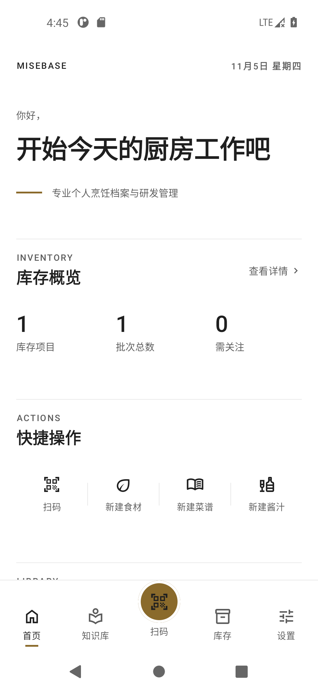 |
| 首页（空状态） | 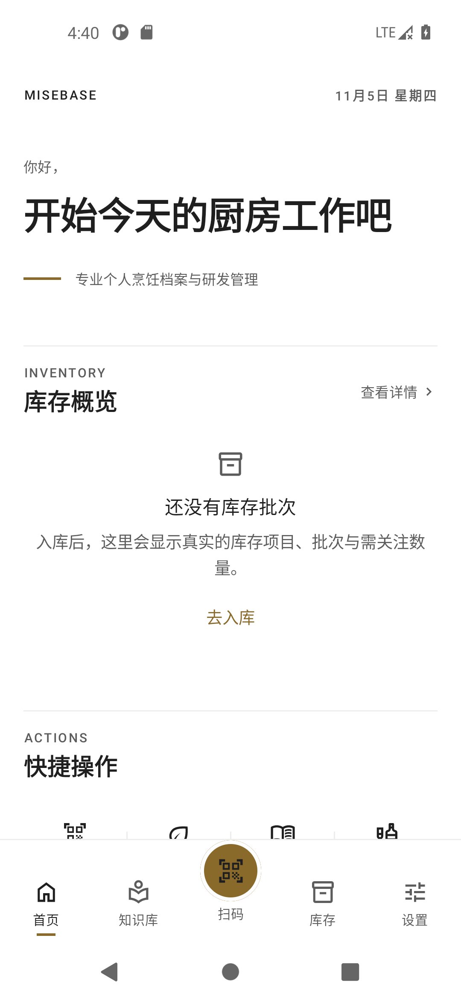 |
| 知识库 · 酱汁 | 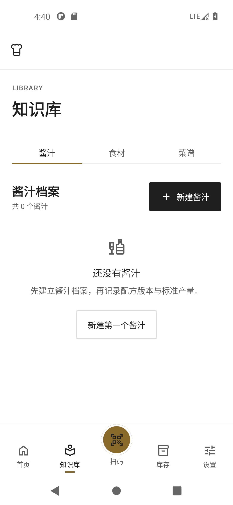 |
| 知识库 · 食材 | 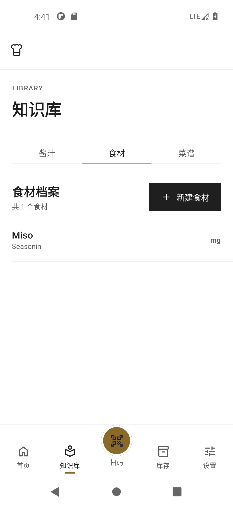 |
| 食材详情 | 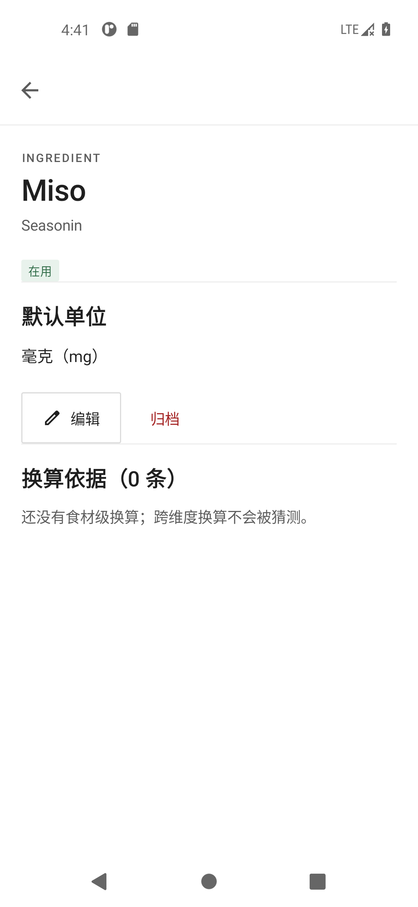 |
| 食材编辑 | 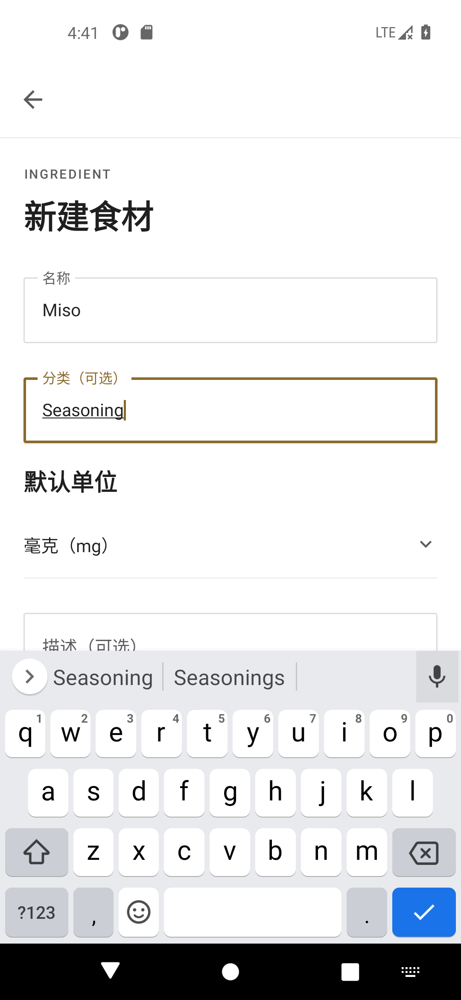 |
| 酱汁列表 | 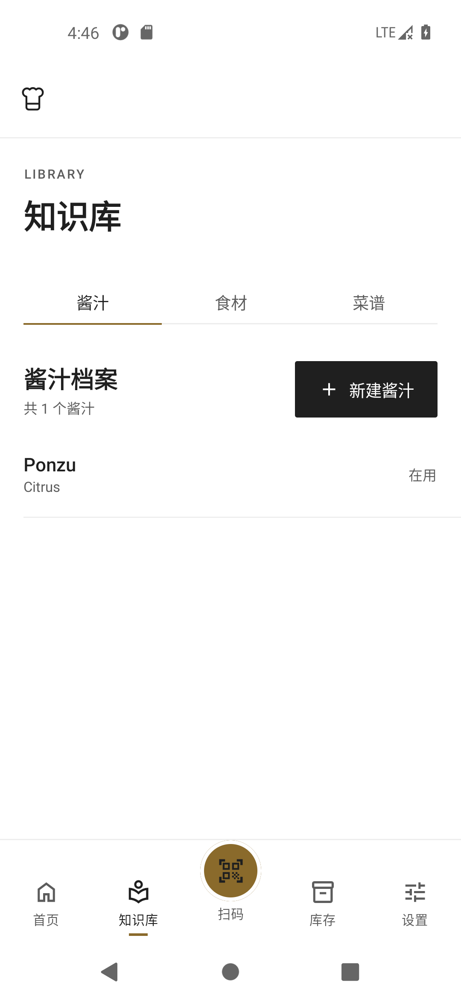 |
| 酱汁详情 | 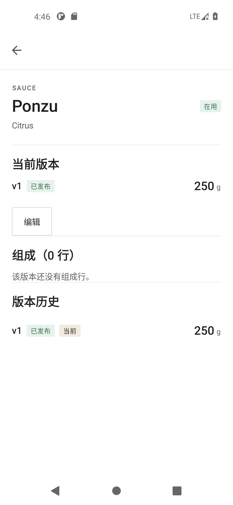 |
| 菜谱列表 | 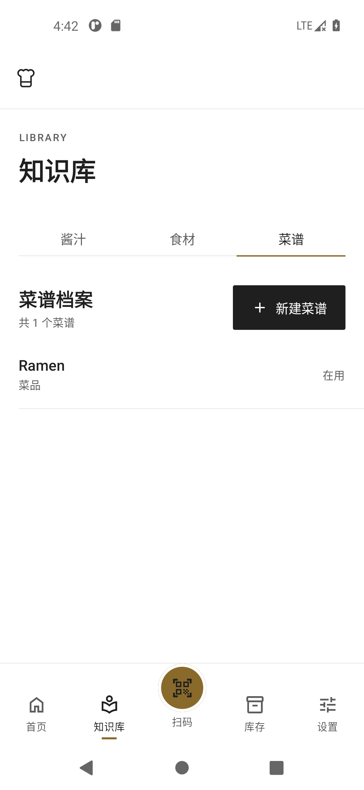 |
| 菜谱详情 | 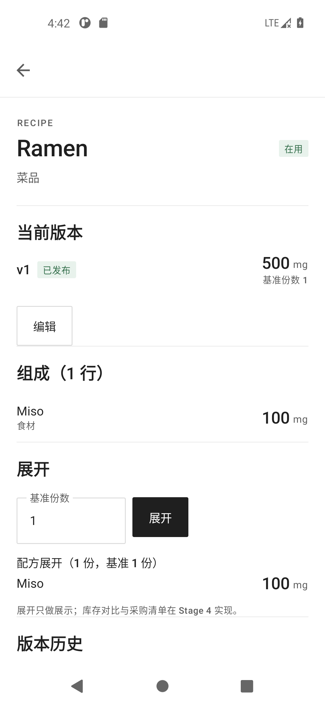 |
| 菜谱编辑 | 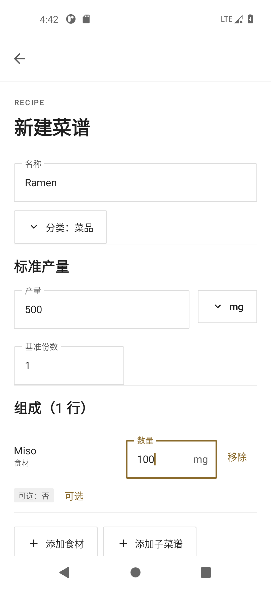 |
| 库存总览 | 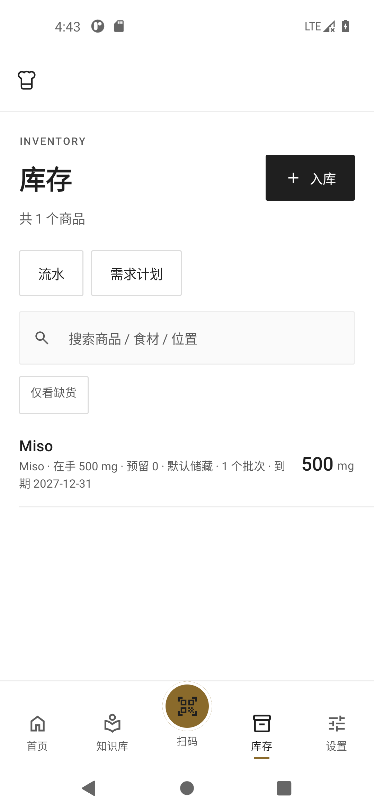 |
| 库存详情 | 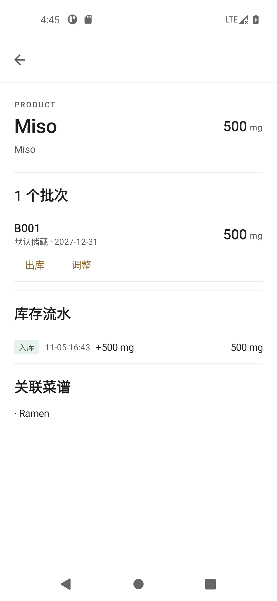 |
| 库存流水 | 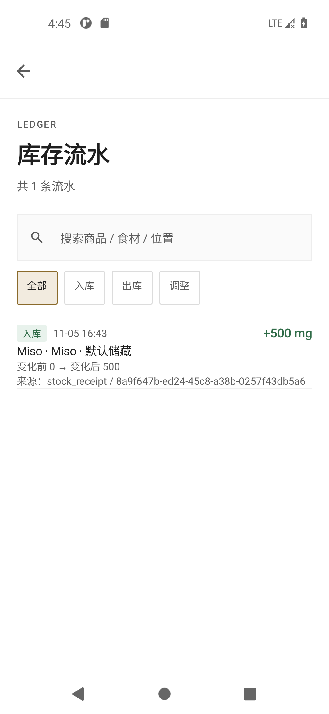 |
| 入库 | 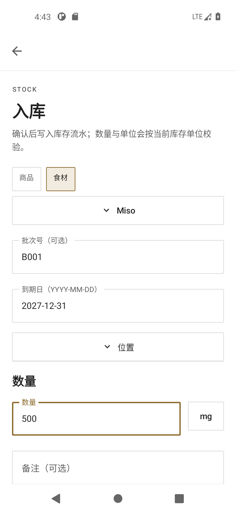 |
| 扫码 | 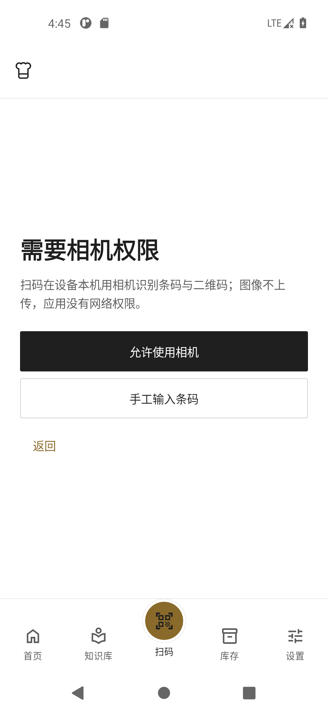 |
| 设置 | 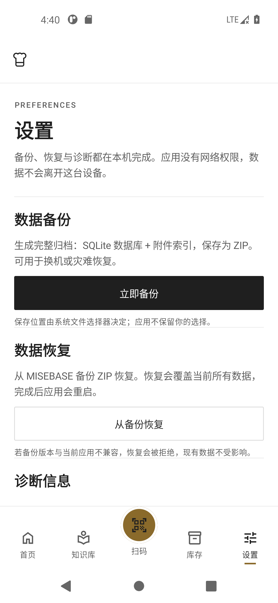 |
| 暗色首页 | 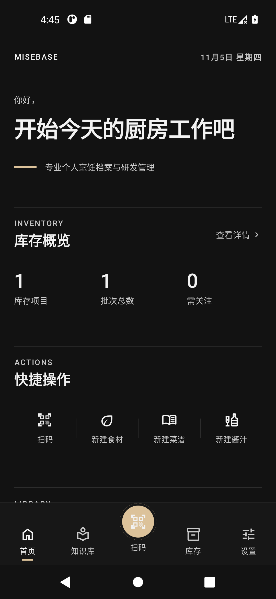 |
| 1.3× 字体缩放 | 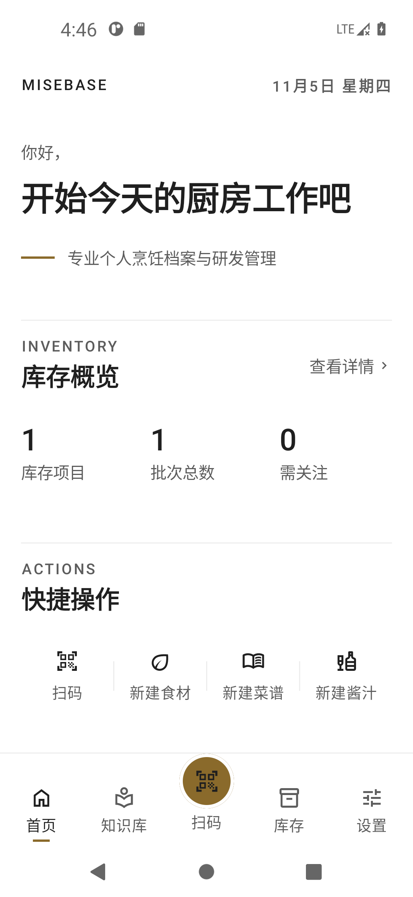 |

---

## 10. Git 记录

| 提交 | 内容 |
|---|---|
| `24b567d` | Stage 2：设计令牌、图标、组件体系重建 |
| `9f92f6a` | Stage 3：首页重构 + 刷新/错误码修正 |
| `364491a` | Stage 4：全局页面统一 |
| `52954a8` | Stage 5：顶栏/底栏/页面切换 |
| `89e7b55` | Stage 6：系统栏主题、首页/流水细节、文档与验收证据 |

回档点：`checkpoint/mb-ui-001-start-20261105`（`ac60690`）。

---

## 11. 遗留问题与风险

| # | 问题 | 影响 | 建议 |
|---|---|---|---|
| 1 | 扫码确认页的失败文案仍可能包含内部错误码（如 `CUL-UNKNOWN-001`） | 与 §8.1 的“界面不显示错误码”原则不完全一致 | 后续按首页方式拆分 message/diagnostic；本次未扩大范围 |
| 2 | `feature:products` 无 UI，无页面可统一 | 任务书 §9 的“商品相关页面”实际落在扫码/入库 | 保持模块边界，不新建页面 |
| 3 | 仅模拟器验证（无真机） | 相机实际扫码、TalkBack 真实语速未验证 | 发布前补真机验收 |
| 4 | 空数据库无法展示复杂数据态 | 截图以最小真实数据 + 空状态覆盖 | 验收时可导入真实数据复查 |
| 5 | `DebugScreen` / `PlaceholderScreen` 为未引用死代码 | 不影响运行 | 后续单独清理，本次不删 |
| 6 | `local.properties` 需转义 Windows 路径才能通过 lint | 仅本机环境 | 已在本地修复；仓库不提交该文件 |
| 7 | 列表行右侧数量在极长名称下可能被压缩 | 窄屏 + 超长名称 | 已用 maxLines/省略；后续可加约束 |

---

## 12. 验收清单

- [x] 所有页面使用统一 token 与组件，无 M3 默认按钮/输入框残留（相机遮罩按钮使用专用变体）
- [x] 无内容卡片阴影、无装饰性渐变（相机操作区遮罩除外，属功能需要）
- [x] 数字使用 tabular figures，数量与单位分离
- [x] 亮色/暗色对比度达标（测试强制）
- [x] 触控目标 ≥48dp；底栏/顶栏有语义
- [x] 空 / 加载 / 错误 / 成功状态统一
- [x] 首页库存与知识库数字排版一致；知识库图标修正为 Library
- [x] 首页刷新不被静默丢弃；刷新保留旧数据
- [x] 界面不显示首页内部错误码
- [x] 深色模式可用
- [x] 1.3× 字体缩放无截断（截图）
- [x] Debug / Release 构建通过
- [x] 单元 / Compose 测试通过
- [x] ktlint / detekt / lint 通过
- [ ] 真机扫码与 TalkBack 人工验收（待负责人环境）
