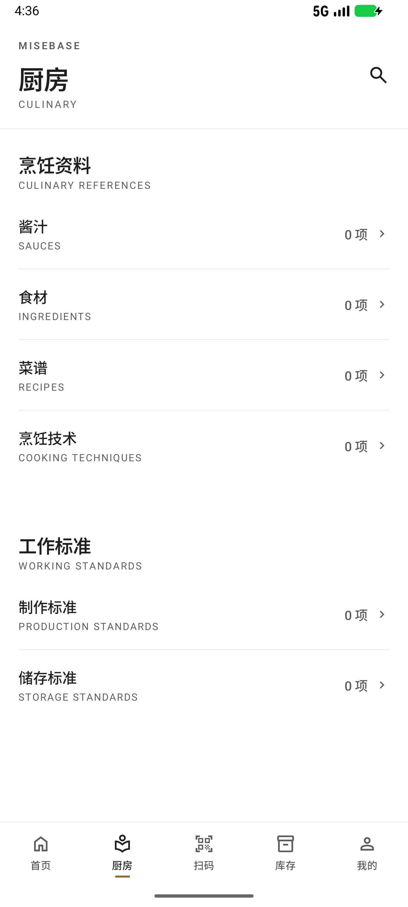
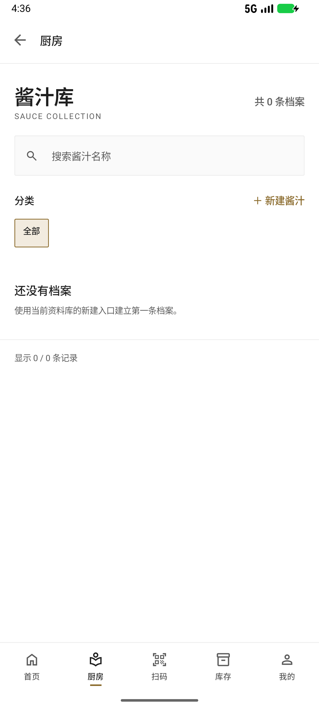
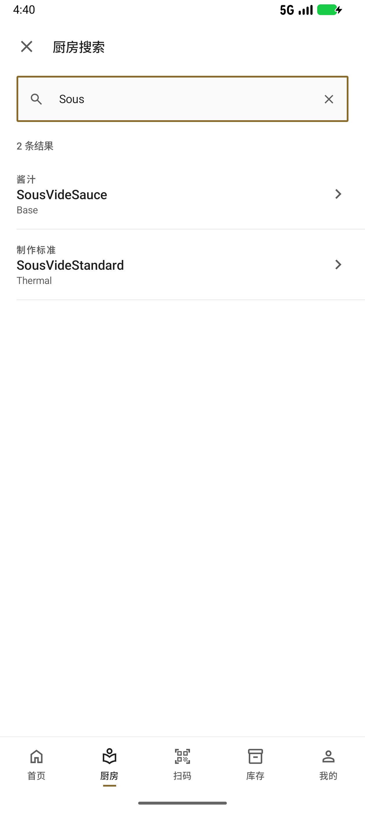
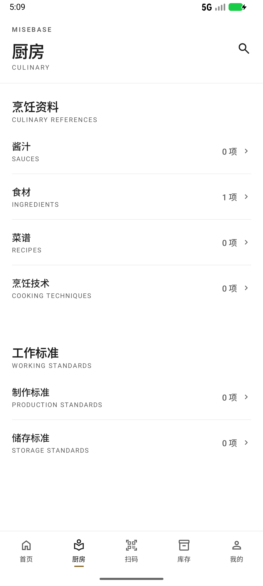

# 厨房六库统一与全局搜索交付报告

日期：2026-11-09  
版本：**1.0.2 (3)**  
包名：`com.culinary`  
构建产物：[MISEBASE-1.0.2-kitchen-libraries-20261109-release.apk](../../dist/KITCHEN-LIBRARIES-001/MISEBASE-1.0.2-kitchen-libraries-20261109-release.apk)

---

## 1. 交付摘要

本轮完成：

1. 厨房首页右上角去掉问号/帮助，只保留一个厨房全局搜索入口。
2. 首页不再提供会话式“统一新建档案”按钮。
3. 酱汁、食材、菜谱、烹饪技术、制作标准、储存标准六个分类始终纵向展开。
4. 六个资料库统一为同一套页面骨架，并各自保留本库搜索、分类筛选、本库新建入口、列表和“显示 X / N 条记录”。
5. 新增烹饪技术、制作标准、储存标准的真实数据表、仓库、用例、详情/新增/编辑/归档页面，不再使用占位页。
6. 厨房首页增加跨六库全局搜索：从右侧滑入，可搜索、可定位详情、空态明确、可返回/关闭/右滑退出，全程只读。
7. 数据库升级到 **v3**，只新增 `kitchen_reference` 表；旧表、旧数据和 v2 备份恢复路径保持可用。
8. 已生成原证书签名的 1.0.2 (3) 安装包，并在真实 1.0.1 (2) 旧库上完成不卸载覆盖升级验证。

---

## 2. 安装包、版本与签名

| 项 | 值 |
|---|---|
| 版本 | `1.0.2` |
| versionCode | `3` |
| 包名 | `com.culinary` |
| minSdk / targetSdk | `26` / `36` |
| 文件 | `dist/KITCHEN-LIBRARIES-001/MISEBASE-1.0.2-kitchen-libraries-20261109-release.apk` |
| 大小 | 24,529,178 bytes |
| SHA-256 | `399185b88effb944909606fcc7bdf4f5d00dc94969996331ca3a282f62a61454` |
| 签名证书 SHA-256 | `5ca41959d9f450cdc851dcb9f052ac9130aaeab71c64062173a699355056af61` |
| 签名证书 DN | `CN=MISEBASE Release, OU=Culinary, O=MISEBASE, L=Hong Kong, ST=Hong Kong, C=HK` |
| 签名校验 | `apksigner verify` 通过（exit 0） |

签名说明：

- 使用原发布证书，没有新建 keystore，没有更换包名。
- 未修改 `local.properties`。
- 未在交付物、日志或报告中输出任何密码、alias 或密钥内容。
- `adb install -r` 覆盖安装成功，`firstInstallTime` 保持 `2026-11-08 16:59:23` 不变，数据保留。

校验命令：

```powershell
Get-FileHash -Algorithm SHA256 `
  "dist\KITCHEN-LIBRARIES-001\MISEBASE-1.0.2-kitchen-libraries-20261109-release.apk"
```

---

## 3. 修改文件清单

### 3.1 app 模块

新增：

```text
app/src/main/java/com/culinary/kitchen/KitchenGlobalSearchPanel.kt
app/src/main/java/com/culinary/kitchen/archive/ArchiveLibraryScreen.kt
app/src/main/java/com/culinary/kitchen/archive/ArchiveLibraryViewModel.kt
app/src/main/java/com/culinary/kitchen/archive/KitchenArchiveSection.kt
app/src/main/java/com/culinary/kitchen/archive/KitchenArchiveRoutes.kt
app/src/main/java/com/culinary/kitchen/archive/KitchenReferenceDetailViewModel.kt
app/src/main/java/com/culinary/kitchen/archive/KitchenReferenceEditorViewModel.kt
app/src/main/java/com/culinary/kitchen/archive/KitchenReferenceScreens.kt
app/src/test/java/com/culinary/kitchen/archive/KitchenArchiveSectionTest.kt
app/src/test/java/com/culinary/kitchen/archive/KitchenReferenceViewModelTest.kt
app/src/testDebug/java/com/culinary/kitchen/archive/ArchiveLibraryScreenTest.kt
```

修改：

```text
app/build.gradle.kts
app/src/main/java/com/culinary/kitchen/KitchenCategory.kt
app/src/main/java/com/culinary/kitchen/KitchenScreen.kt
app/src/main/java/com/culinary/kitchen/KitchenViewModel.kt
app/src/main/java/com/culinary/navigation/CulinaryNavHost.kt
app/src/main/res/values/strings.xml
app/src/test/java/com/culinary/kitchen/KitchenViewModelTest.kt
app/src/testDebug/java/com/culinary/kitchen/KitchenScreenTest.kt
app/src/testDebug/java/com/culinary/navigation/NavigationShellTest.kt
```

删除：

```text
app/src/main/java/com/culinary/kitchen/KitchenRoutes.kt
```

说明：`KitchenRoutes.kt` 仅包含旧问号说明页和三类占位页路由，本轮已被六库真实路由替代。

### 3.2 core:data

新增：

```text
core/data/src/main/java/com/culinary/core/data/kitchen/KitchenArchiveReader.kt
core/data/src/main/java/com/culinary/core/data/kitchen/DefaultKitchenArchiveReader.kt
core/data/src/main/java/com/culinary/core/data/kitchen/KitchenReferenceStore.kt
core/data/src/main/java/com/culinary/core/data/kitchen/DefaultKitchenReferenceStore.kt
core/data/src/main/java/com/culinary/core/data/kitchen/DefaultKitchenCountsReader.kt
core/data/src/main/java/com/culinary/core/data/di/KitchenModule.kt
core/data/src/main/java/com/culinary/core/data/di/KitchenReferenceUseCaseModule.kt
core/data/src/main/java/com/culinary/core/data/mapper/KitchenReferenceMapper.kt
core/data/src/main/java/com/culinary/core/data/repository/KitchenReferenceRepositoryImpl.kt
```

修改：

```text
core/data/src/main/java/com/culinary/core/data/di/ArchiveDaoModule.kt
core/data/src/main/java/com/culinary/core/data/di/RepositoryModule.kt
core/data/src/main/java/com/culinary/core/data/settings/SettingsMaintenance.kt
core/data/src/main/java/com/culinary/core/data/startup/StartupCoordinator.kt
core/data/src/test/java/com/culinary/core/data/backup/QuiescedDatabaseSnapshotterTest.kt
core/data/src/test/java/com/culinary/core/data/debug/DebugInfoProviderTest.kt
core/data/src/test/java/com/culinary/core/data/startup/StartupCoordinatorTest.kt
```

重命名并更新：

```text
core/data/src/test/java/com/culinary/core/data/backup/BackupRestoreV2Test.kt
  -> core/data/src/test/java/com/culinary/core/data/backup/BackupRestoreV3Test.kt
```

`SettingsMaintenance` 额外把 v2 备份纳入已测试迁移来源（`setOf(2)`），因此 1.0.1 的 v2 备份仍可在 v3 上通过预检并由 Room 执行 2→3 迁移。

### 3.3 core:domain

新增：

```text
core/domain/src/main/kotlin/com/culinary/core/domain/model/KitchenReference.kt
core/domain/src/main/kotlin/com/culinary/core/domain/repository/KitchenReferenceRepository.kt
core/domain/src/main/kotlin/com/culinary/core/domain/usecase/kitchen/ListKitchenReferencesUseCase.kt
core/domain/src/main/kotlin/com/culinary/core/domain/usecase/kitchen/GetKitchenReferenceUseCase.kt
core/domain/src/main/kotlin/com/culinary/core/domain/usecase/kitchen/SaveKitchenReferenceUseCase.kt
core/domain/src/main/kotlin/com/culinary/core/domain/usecase/kitchen/ArchiveKitchenReferenceUseCase.kt
```

### 3.4 core:database

新增：

```text
core/database/src/main/java/com/culinary/core/database/entity/KitchenReferenceEntity.kt
core/database/src/main/java/com/culinary/core/database/dao/KitchenReferenceDao.kt
core/database/src/main/java/com/culinary/core/database/model/KitchenReferenceKindDb.kt
core/database/schemas/com.culinary.core.database.CulinaryDatabase/3.json
core/database/src/test/java/com/culinary/core/database/CulinaryMigrationV2ToV3Test.kt
```

修改：

```text
core/database/src/main/java/com/culinary/core/database/CulinaryDatabase.kt
core/database/src/main/java/com/culinary/core/database/CulinaryMigrations.kt
core/database/src/main/java/com/culinary/core/database/converter/CoreConverters.kt
core/database/src/androidTest/java/com/culinary/core/database/CulinaryDatabaseMigrationTest.kt
core/database/src/test/java/com/culinary/core/database/CulinaryMigrationV1ToV2Test.kt
core/database/src/test/java/com/culinary/core/database/CulinaryRollbackV1Test.kt
core/database/src/test/java/com/culinary/core/database/DatabaseFoundationTest.kt
core/database/src/test/java/com/culinary/core/database/SchemaExportTest.kt
```

### 3.5 文档与证据

```text
docs/20-kitchen-libraries/REPORT.md
docs/20-kitchen-libraries/evidence/*.png
docs/20-kitchen-libraries/evidence/*.xml
docs/20-kitchen-libraries/evidence/40-six-library-titles.txt
docs/20-kitchen-libraries/evidence/41-upgrade-proof.txt
```

---

## 4. 原功能与新入口映射

| 原功能/入口 | 本轮变化 | 当前入口 |
|---|---|---|
| 厨房首页右上角问号“厨房模块说明” | 移除问号说明页 | 右上角仅保留“厨房全局搜索” |
| 厨房首页“统一新建档案” | 不新增该按钮 | 各资料库页面右侧“＋ 新建…” |
| 酱汁列表（feature:sauces） | 厨房入口改为统一资料库页 | 厨房 → 酱汁库；详情/编辑仍走原 `SaucesRoutes` |
| 食材列表（feature:ingredients） | 厨房入口改为统一资料库页 | 厨房 → 食材库；详情/编辑仍走原 `IngredientsRoutes` |
| 菜谱列表（feature:recipes） | 厨房入口改为统一资料库页 | 厨房 → 菜谱库；详情/编辑仍走原 `RecipesRoutes` |
| 烹饪技术占位页 | 改为真实资料库 | 厨房 → 烹饪技术 |
| 制作标准占位页 | 改为真实资料库 | 厨房 → 制作标准 |
| 储存标准占位页 | 改为真实资料库 | 厨房 → 储存标准 |
| 底部五项导航 | 顺序与语义不变 | 首页 / 厨房 / 扫码 / 库存 / 我的 |
| 首页、扫码、库存、我的 | 未改业务流程 | 原路由不变 |

关键保留点：

- 酱汁、食材、菜谱原有新增、编辑、详情页面没有被重写或删除；统一资料库只替换了“列表入口与列表外观”，详情/编辑继续复用原 feature 路由。
- 新三类资料（烹饪技术、制作标准、储存标准）走独立的通用详情/编辑页面，不与酱汁/食材/菜谱模型混表。
- 资料库页面的底部导航仍显示，并保持“厨房”选中。

---

## 5. 六个资料库状态

六个页面统一使用 `ArchiveLibraryScreen`；标题、英文副标题、搜索占位、新建文案和数据类型由 `KitchenArchiveSection` 提供。

| 资料库 | 英文副标题 | 数据来源 | 新建/详情 |
|---|---|---|---|
| 酱汁库 | `SAUCE COLLECTION` | `sauce` 现有档案 | 原酱汁编辑器/详情 |
| 食材库 | `INGREDIENT COLLECTION` | `ingredient` 现有档案 | 原食材编辑器/详情 |
| 菜谱库 | `RECIPE COLLECTION` | `recipe` 现有档案 | 原菜谱编辑器/详情 |
| 烹饪技术 | `COOKING TECHNIQUES` | 新 `kitchen_reference`（`TECHNIQUE`） | 通用新增/详情/编辑 |
| 制作标准 | `PRODUCTION STANDARDS` | 新 `kitchen_reference`（`PRODUCTION_STANDARD`） | 通用新增/详情/编辑 |
| 储存标准 | `STORAGE STANDARDS` | 新 `kitchen_reference`（`STORAGE_STANDARD`） | 通用新增/详情/编辑 |

每个页面均具备：

- 顶栏：返回箭头 + “厨房”；没有帮助/搜索等重复图标。
- 标题区：中文标题、英文副标题、本库总数“共 N 条档案”。
- 本库搜索：只过滤当前资料库，不与全局搜索混用。
- 分类：左侧“分类”，右侧“＋ 新建…”；下方横向筛选，默认“全部”。
- 列表：名称、副标题、类型/分类元信息、右侧箭头；纵向列表。
- 空态：明确提示“还没有档案”，不伪造数据。
- 页脚：`显示 X / N 条记录`，X 为当前筛选/搜索后的数量，N 为本库总数。
- 底栏：保留五项导航，厨房选中。

分类规则：

- 酱汁、食材、新三类参考资料按已存在档案的真实分类动态生成筛选项；没有分类的显示“未分类”。
- 菜谱固定保留 `STOCK / PREP / COMPONENT / DISH / OTHER` 五个业务筛选，即“汤底 / 高汤、预制件、组件、菜品、其他”，即使当前为空也保留分类定义。
- 没有把酱汁的“基础/衍生/自创”分类机械套到其他资料库。

六库最终安装包设备实测标题：

```text
sauces     => 酱汁库   | SAUCE COLLECTION      | 共 0 条档案
ingredients=> 食材库   | INGREDIENT COLLECTION | 共 1 条档案
recipes    => 菜谱库   | RECIPE COLLECTION     | 共 0 条档案
techniques => 烹饪技术 | COOKING TECHNIQUES    | 共 0 条档案
production => 制作标准 | PRODUCTION STANDARDS  | 共 0 条档案
storage    => 储存标准 | STORAGE STANDARDS     | 共 0 条档案
```

证据：[40-six-library-titles.txt](evidence/40-six-library-titles.txt)

---

## 6. 厨房全局搜索

### 6.1 入口和交互

- 入口只在厨房首页右上角，替换原问号。
- 通过 Compose `AnimatedVisibility` 从右侧滑入，并带淡入淡出。
- 面板是覆盖层，底下的厨房内容不参与点击。
- 左上角关闭按钮；系统返回键由 `BackHandler` 关闭；向右拖动超过 80dp 关闭。
- 退出后回到原厨房页面，不改变导航栈。

### 6.2 搜索范围和数据来源

搜索读取 `KitchenArchiveReader.observeEntries()`，该 Flow 合并：

- 酱汁列表；
- 食材列表；
- 菜谱列表；
- 三类 `kitchen_reference`。

因此结果覆盖六个资料库，而不是只搜当前库。

### 6.3 匹配字段

对每条档案拼接以下内容并按 `Locale.ROOT` 小写后做包含匹配：

- 名称；
- 副标题/描述；
- 分类（菜谱分类会转成中文标签）；
- 所属资料库类型（如“酱汁”“食材”“制作标准”）；
- 数据层已准备的 `searchText`（酱汁的风味、质地、用途、储存说明；食材分类/描述；菜谱分类；新参考资料分类/说明）。

### 6.4 结果呈现

每条结果显示：

- 所属资料库类型（如“酱汁”“制作标准”）；
- 名称；
- 分类/副标题；
- 右侧进入箭头。

顶部显示“N 条结果”。空查询显示提示；无匹配显示“没有匹配的厨房档案。”

### 6.5 详情跳转

| 结果类型 | 跳转 |
|---|---|
| 酱汁 | `SaucesRoutes.detail(id)` |
| 食材 | `IngredientsRoutes.detail(id)` |
| 菜谱 | `RecipesRoutes.detail(id)` |
| 烹饪技术 | `kitchen/reference/technique/{id}` |
| 制作标准 | `kitchen/reference/production-standard/{id}` |
| 储存标准 | `kitchen/reference/storage-standard/{id}` |

点击后先关闭搜索，再进入对应详情；返回后回到厨房，不修改任何数据。

### 6.6 只读保证

搜索面板只调用 `archiveEntries` 的过滤，不调用保存、归档、删除或用例写入；没有隐式创建记录。

### 6.7 已知边界

当前全局搜索覆盖档案级字段（名称、描述、分类和上述 `searchText`），**没有把酱汁/菜谱的组成行（例如某条酱汁用了黄油）单独展开进搜索索引**。  
因此“黄油”会命中名称为黄油或有黄油描述的档案；如果“黄油”只出现在某条酱汁的组成行里，当前不会因为该组成行而命中这条酱汁。六库分类覆盖和结果定位本身是完整的。

---

## 7. 数据库与升级

### 7.1 变更

- `CulinaryDatabase` 版本：`2 -> 3`。
- v3 仅新增表 `kitchen_reference`。
- 新增索引：
  - `index_kitchen_reference_kind`
  - `index_kitchen_reference_status`
  - `index_kitchen_reference_kind_normalized_name`
- 旧表未改名、未删列、未搬数据。
- `kitchen_reference` 字段覆盖 id、kind、name、normalized_name、category、description、status、created_at、updated_at、deleted_at、revision。

### 7.2 迁移

`MIGRATION_2_3`：

1. 先删除运行时局部索引 `ux_ingredient_normalized_name`、`ux_recipe_current` 等；
2. 创建 `kitchen_reference` 和三个索引；
3. Room 校验通过后，`CulinarySchemaExtras.onOpen` 按原定义重建局部索引。

这一步是实测中发现的必要修复：旧 v2 库带有 Room 导出 schema 之外的局部唯一索引，若不先移除，Room 会报“Migration didn't properly handle: ingredient”，应用进入恢复页。

### 7.3 真实升级验证

- 基线：1.0.1 (2)，v2 数据库，含食材 `MigrationCarrot`。
- 方式：`adb install -r`，不卸载。
- 结果：1.0.2 (3) 启动正常；厨房“食材 1 项”；食材库显示 `MigrationCarrot`；`firstInstallTime` 不变。
- v2 真实库迁移后：`PRAGMA user_version = 3`，`kitchen_reference` 存在，局部索引在 onOpen 后恢复。
- 第二次冷启动 849 ms，未出现 FATAL / ANR / Incompatible。

证据：[41-upgrade-proof.txt](evidence/41-upgrade-proof.txt)

### 7.4 备份兼容

- 新建备份记录当前 v3。
- v2 备份在恢复预检中被视为“已测试迁移来源”，允许恢复并标记需要迁移；应用重启后 Room 执行 2→3。
- `BackupRestoreV3Test` 覆盖 v3 备份导出、校验、恢复与数据完整性。
- 不自动清空、不破坏性回退。

---

## 8. 测试情况

### 8.1 单元与 Robolectric 测试

最终统计：

| 模块 | 测试数 | 失败 |
|---|---:|---:|
| app | 53 | 0 |
| core:data | 98 | 0 |
| core:database | 83 | 0 |
| **合计** | **234** | **0** |

重点覆盖：

- 厨房首页：六分类、动态数量、搜索入口替代问号、全局搜索六种类型结果、空结果、关闭。
- 本库页：标题、总数、空态、页脚数量、分类筛选、本库搜索、添加/打开回调、菜谱五类固定筛选。
- 新参考资料：新增保存、空名校验、详情加载、归档。
- v1→v3、v2→v3 迁移；v2 运行时局部索引移除与恢复；旧数据保留；Schema v3 表数 34。
- 启动协调器：持久化 v3 库、v1→v3、版本过高拒绝。
- 备份恢复 v3、DebugInfo 数据库版本。
- 导航顶栏：资料库页返回 + “厨房”，不出现全局搜索图标。

命令：

```powershell
.\gradlew.bat :app:testDebugUnitTest :core:data:testDebugUnitTest :core:database:testDebugUnitTest
```

### 8.2 静态检查

以下全部通过：

```text
:app:ktlintCheck
:app:detekt
:core:data:ktlintCheck
:core:data:detekt
:core:domain:ktlintCheck
:core:domain:detekt
:core:database:ktlintCheck
:core:database:detekt
:core:database:compileDebugAndroidTestKotlin
```

### 8.3 设备冒烟

最终 1.0.2 (3) 安装包实测：

- 六库页面全部打开，标题/总数/底栏正确。
- 烹饪技术库新建 `FinalCheck` 成功，保存后 `共 1 条档案`，归档确认后回到 `共 0 条档案`。
- 全局搜索输入 `Migration` 命中食材 `MigrationCarrot`，点击进入食材详情。
- 1.0.1 v2 真实库覆盖升级，旧食材保留。
- 冷启动无 FATAL / ANR。

同一代码的开发构建补充实测：

- 酱汁库新建并保存成功，列表与厨房计数更新。
- 全局搜索输入 `Sous` 同时命中酱汁和制作标准；点击分别进入对应详情。
- 本库搜索：烹饪技术库输入 `Sous` 显示 `显示 1 / 1 条记录`。
- 全局搜索向右滑动关闭，回到厨房。
- 烹饪技术与制作标准的新增、详情、归档链路成功；储存标准共用同一套页面与用例。

---

## 9. 验收路径

1. 安装 `dist/KITCHEN-LIBRARIES-001/MISEBASE-1.0.2-kitchen-libraries-20261109-release.apk`。
2. 首页底部点“厨房”。
3. 确认顶部只有 MISEBASE / 厨房 / CULINARY 和右上角搜索图标，没有问号或新建档案按钮。
4. 依次点击六个分类，确认均进入统一骨架页面，底部导航仍在且“厨房”选中。
5. 在任一库使用本库搜索和分类筛选，确认页脚 `显示 X / N` 随之变化。
6. 在酱汁库点“＋ 新建酱汁”，确认进入原酱汁编辑器；保存后返回列表和首页数量更新。
7. 在烹饪技术页点“＋ 新建烹饪技术”，填写名称保存，再进入详情编辑/归档。
8. 返回厨房，点右上角搜索，输入关键词，确认结果跨多个资料库；点击进入详情。
9. 用关闭按钮、系统返回、向右滑动三种方式退出搜索，确认回到厨房。
10. 如从 1.0.1 升级，确认无需卸载、数据仍在。

---

## 10. 证据截图

厨房搜索入口：



统一酱汁库：



全局搜索结果：



全局搜索右滑关闭后的厨房：


最终 1.0.2 覆盖升级后的厨房：


