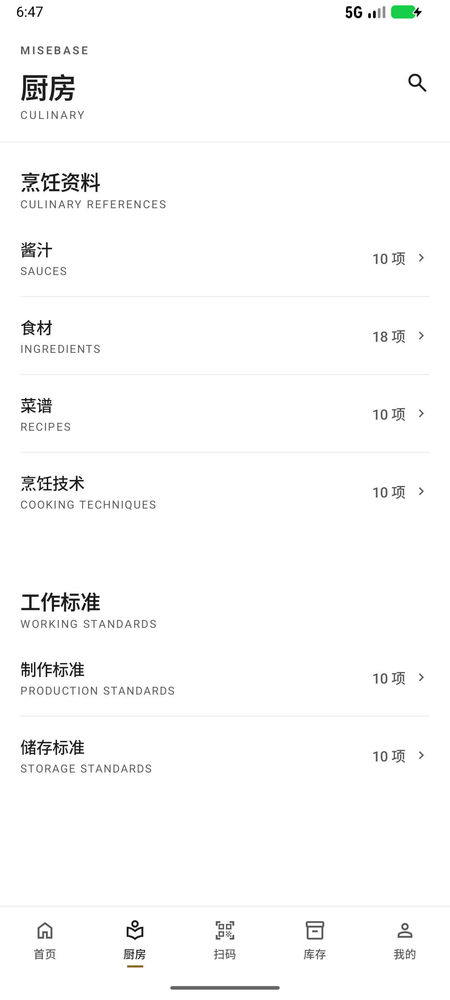
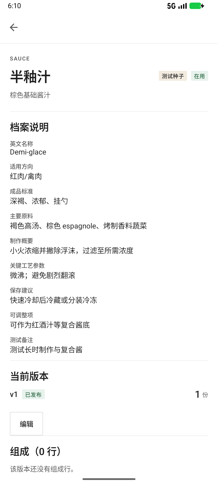
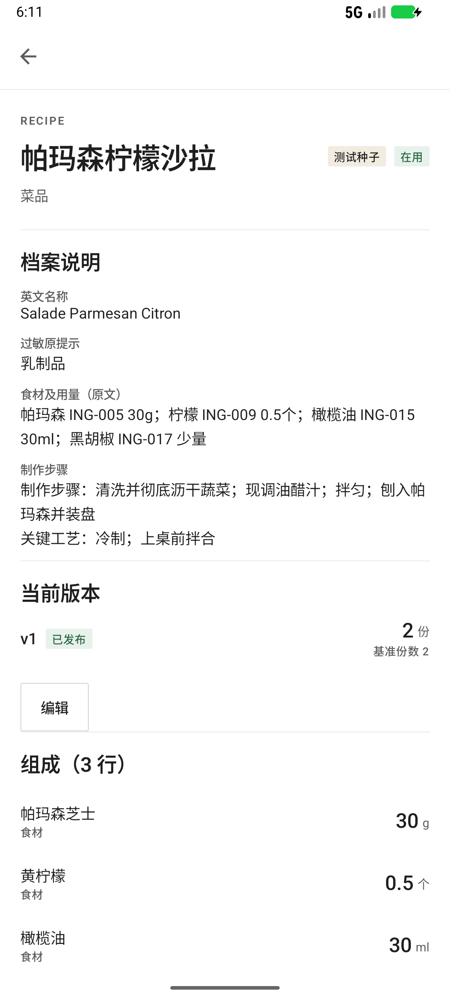
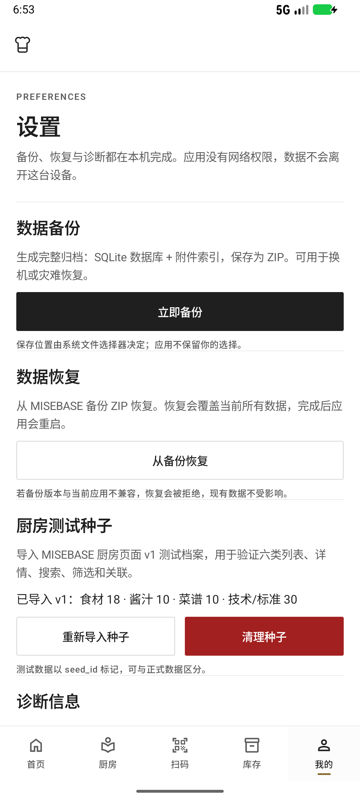

# 厨房页面种子数据导入交付报告

日期：2026-11-09  
版本：**1.0.3 (4)**  
包名：`com.culinary`  
种子文件：`D:\A-1\MISEBASE_厨房页面种子数据_v1.xlsx`

---

## 1. 交付摘要

已将种子文件中的全部档案导入项目正常数据链路：

| 类别 | 数量 |
|---|---:|
| 食材 | 18 |
| 酱汁 | 10 |
| 菜谱 | 10 |
| 烹饪技术 | 10 |
| 制作标准 | 10 |
| 储存标准 | 10 |
| **档案合计** | **68** |
| 菜谱组成行 | 30 |
| 档案关联 | 260 |

说明：种子文件“使用说明”写的是“6 类 × 10 条 = 60 条”，但“食材档案”实际有 18 条，因此按实际内容导入 68 条，未丢弃 8 条食材。

实现方式不是界面写死或示例文案：

- 种子被规范化为版本化 JSON，放在 `core/data/src/main/assets/kitchen_seed_v1.json`。
- 启动时由 `KitchenSeedImporter` 通过既有 Repository、Domain 模型和 `TransactionRunner` 写入 Room。
- 每条种子带 `seed_id`、`seed_version=v1` 标记，可与正式数据区分。
- 使用稳定 seed_id 生成确定性 UUID，重复启动不会重复插入。
- 支持设置页“重新导入种子”和“清理种子”，清理后不会在下次启动自动回填。

---

## 2. 安装包

| 项 | 值 |
|---|---|
| 版本 | `1.0.3` |
| versionCode | `4` |
| 包名 | `com.culinary` |
| 文件 | [MISEBASE-1.0.3-kitchen-seed-20261109-release.apk](../../dist/KITCHEN-SEED-001/MISEBASE-1.0.3-kitchen-seed-20261109-release.apk) |
| 大小 | 24,593,630 bytes |
| SHA-256 | `a6c6056459a19188cc1c916d8476b81ad3b86ab53b28c7b4eed9aab135f7840a` |
| 签名证书 SHA-256 | `5ca41959d9f450cdc851dcb9f052ac9130aaeab71c64062173a699355056af61` |
| 签名校验 | `apksigner verify` 通过（exit 0） |

使用原 MISEBASE 发布证书，未新建 keystore、未修改包名、未修改 `local.properties`，未输出任何密码或密钥内容。

校验：

```powershell
Get-FileHash -Algorithm SHA256 `
  "dist\KITCHEN-SEED-001\MISEBASE-1.0.3-kitchen-seed-20261109-release.apk"
```

---

## 3. 数据范围与字段映射

### 3.1 食材（18 条）

来源工作表：`食材档案`。

| 种子字段 | 落库字段 |
|---|---|
| seed_id | `ingredient.seed_id` |
| 名称 | `name` / `normalized_name` |
| 英文/类型标识 | `english_name` |
| 一级分类 | `category` |
| 基础单位 | `default_unit_id`（克→g、毫升→ml、个/枚→piece） |
| 示例商品/规格 | `example_products` |
| 储存建议 | `storage_notes` |
| 过敏原提示 | `allergen_notes` |
| 测试备注 | `seed_note` |
| 版本 | `seed_version=v1` |

### 3.2 酱汁（10 条）

来源工作表：`酱汁档案`。

| 种子字段 | 落库字段 |
|---|---|
| seed_id | `sauce.seed_id` |
| 名称 | `name` / `normalized_name` |
| 英文名称 | `english_name` |
| 酱汁类型 | `family` |
| 适用方向 | `usage_notes` |
| 主要原料 | `main_ingredients` |
| 制作概要 | `preparation_summary` |
| 关键工艺参数 | `key_parameters` |
| 保存建议 | `storage_notes` |
| 成品标准 | `flavor_profile` |
| 可调整项 | `adjustable_notes` |
| 测试备注 | `seed_note` |

每条酱汁建立已发布 v1 版本；种子未给酱汁原料用量，因此不伪造组成行，主要原料以文本和“主要原料”关联呈现。

### 3.3 菜谱（10 条）

来源工作表：`菜谱档案`。

| 种子字段 | 落库字段 |
|---|---|
| seed_id | `recipe.seed_id` |
| 名称 | `name` / `normalized_name` |
| 英文名称 | `english_name` |
| 菜品分类 | `category`（主菜/汤品/沙拉/主食/早餐轻食→DISH，配菜→COMPONENT） |
| 标准份量 | `recipe_version.servings` + 产量 `份` |
| 食材及用量原文 | `recipe.description`（展示为“食材及用量（原文）”） |
| 制作步骤概要 + 关键工艺 | `recipe_version.instructions_md` |
| 过敏原提示 | `allergen_notes` |
| 食材 seed_id | `recipe_component` 行 + `kitchen_relation` |
| 关联酱汁/技术/标准 | `kitchen_relation` |

30 条有明确数值的食材用量被写成真实组成行；“适量”“少量”“0g”不伪造数量，原文保留在“食材及用量（原文）”中，同时保留可跳转的食材关系。

### 3.4 烹饪技术 / 制作标准 / 储存标准（各 10 条）

来源工作表：`烹饪技术`、`制作标准`、`储存标准`。

落到 `kitchen_reference`：

- `seed_id`、`seed_version`
- `name`、`normalized_name`
- `english_name`
- `kind`：`TECHNIQUE` / `PRODUCTION_STANDARD` / `STORAGE_STANDARD`
- `category`：技术分类 / 标准分类 / 储存类别
- `description`：按“定义、操作要点、常见问题、应用场景、难度、验证观察点”或“目的、执行要求、检查频率、适用区域、标准级别、备注”等字段逐项拼接，保留全部文本
- 适用档案关系写入 `kitchen_relation`

### 3.5 关联关系

共 260 条，覆盖：

- 酱汁 → 烹饪技术、制作标准、主要原料
- 菜谱 → 酱汁、食材、烹饪技术、制作标准
- 食材 → 被引用酱汁/菜谱、储存标准
- 烹饪技术 → 关联档案
- 制作标准 → 适用档案
- 储存标准 → 适用食材

关系表存目标 kind + record id + 关系标签；详情页读取时按当前档案名称解析目标标签，目标改名后关系标签不会陈旧。

---

## 4. 数据库变更

### 4.1 Schema v4

`CulinaryDatabase` 从 v3 升到 **v4**。

新增列（全部 nullable，旧行不迁移数据）：

| 表 | 新增列 |
|---|---|
| `sauce` | `english_name`、`main_ingredients`、`preparation_summary`、`key_parameters`、`adjustable_notes`、`seed_note`、`seed_id`、`seed_version` |
| `ingredient` | `english_name`、`example_products`、`seed_note`、`seed_id`、`seed_version` |
| `recipe` | `english_name`、`allergen_notes`、`seed_note`、`seed_id`、`seed_version` |
| `kitchen_reference` | `english_name`、`seed_note`、`seed_id`、`seed_version` |
| `kitchen_relation` | 新表：`id`、`source_record_id`、`source_kind`、`target_record_id`、`target_kind`、`target_label`、`relation_label`、`seed_version`、`created_at` |

新增：

- `sauce/ingredient/recipe/kitchen_reference` 的 `seed_id` 唯一索引（NULL 可重复）。
- `kitchen_relation` 的 source/target/seed_version 索引。
- `app_metadata` 删除键方法，用于清理 `kitchen_seed_version`。

### 4.2 迁移 `3 → 4`

`MIGRATION_3_4` 只做增量：

1. 先移除 v3 运行时局部索引（Room 导出 schema 之外）；
2. `ALTER TABLE` 增加可空列；
3. 创建 `kitchen_relation` 与索引；
4. 由 `CulinarySchemaExtras.onOpen` 重新创建局部唯一索引。

不删除、不改写任何旧表数据。

### 4.3 启动与备份

- `StartupCoordinator.EXPECTED_SCHEMA_VERSION = 4`。
- 恢复预检允许 v2、v3 备份通过已测试迁移链恢复到 v4。
- 新增 `CulinaryMigrationV3ToV4Test`，并用真实 v3 运行时局部索引覆盖迁移校验。
- 备份测试与诊断版本断言同步到 v4。

---

## 5. 导入实现

### 5.1 资产

```text
core/data/src/main/assets/kitchen_seed_v1.json
```

JSON 由种子 XLSX 规范化生成，保留原始中文、英文名和各字段。

### 5.2 正常写入路径

`KitchenSeedImporter` 注入：

- `KitchenSeedReader`（读取 assets）
- `IngredientRepository`
- `SauceRepository`
- `RecipeRepository`
- `KitchenReferenceRepository`
- `UnitRepository`
- `TransactionRunner`
- `AppMetadataDao`
- `KitchenRelationDao`
- 清理用 DAO

在单个 `TransactionRunner.write` 中按依赖顺序写入：

```text
ingredients → sauces + published versions → recipes + published versions
→ kitchen_reference → kitchen_relation → seed metadata
```

任一步失败都会整体回滚，不会留下半套种子。

### 5.3 幂等

- 每条记录使用 `UUID.nameUUIDFromBytes("MISEBASE-KITCHEN-SEED:<seed_id>")`。
- 元数据键：`kitchen_seed_version = v1`。
- 启动时：
  - 已导入 v1 → 直接跳过；
  - 已清理（`kitchen_seed_disabled=true`）→ 跳过；
  - 其他情况 → 清理旧种子后重新导入。
- 设置页“重新导入种子”会先清理再完整写入，重复操作不会产生重复档案。

### 5.4 清理

设置页“清理种子”：

1. 删除 `seed_version IS NOT NULL` 的关系；
2. 删除带 seed 标记的菜谱、酱汁、参考资料、食材；
3. 删除版本、组成行随聚合级联；
4. 设置 `kitchen_seed_disabled=true`，并删除版本标记。

正式档案不受影响；清理后重启不会自动回填。

---

## 6. 界面与交互补充

### 6.1 详情页

- 酱汁详情：英文名、适用方向、成品标准、主要原料、制作概要、关键参数、保存建议、可调整项、测试备注。
- 食材详情：英文/类型、示例商品/规格、储存建议、过敏原提示、测试备注。
- 菜谱详情：英文名、过敏原、食材及用量原文、制作步骤与关键工艺。
- 通用参考资料详情：英文名、测试备注、关联档案。
- 详情页显示“测试种子”徽标。

### 6.2 关联跳转

新增 `CulinaryRelationSection`，在四类详情页展示可点击关联：

```text
酱汁/食材/菜谱/技术/制作标准/储存标准
```

点击复用既有详情路由，不新增一级页面或导航入口。目标名称从当前档案动态解析。

### 6.3 编辑

- 食材编辑器新增英文/类型、示例商品/规格、储存建议、过敏原提示。
- 酱汁编辑器保留扩展字段（编辑核心字段时不会清空种子字段）。
- 保存后详情页在 ON_RESUME 自动刷新，不需要退出重进。
- 改名、改分类、改扩展字段均走既有 UseCase/Repository。

### 6.4 设置页

新增“厨房测试种子”分节：

- 显示当前版本与各类计数；
- `重新导入种子`；
- `清理种子`（二次确认）；
- 说明测试数据以 `seed_id` 标记。

### 6.5 搜索

`KitchenArchiveReader.searchText` 已纳入新增字段：

- 酱汁英文名、主要原料、制作概要、关键参数、调整项、测试备注；
- 食材英文/类型、示例商品、储存建议、过敏原；
- 菜谱英文名、过敏原、食材原文；
- 参考资料英文名、测试备注。

因此全局搜索“黄油”可以命中黄油食材、使用黄油的酱汁和菜谱，而不是只命中食材名。

---

## 7. 验证结果

### 7.1 全新安装

`adb uninstall` 后安装最终 APK：

```text
酱汁 10 项
食材 18 项
菜谱 10 项
烹饪技术 10 项
制作标准 10 项
储存标准 10 项
```

种子自动导入成功，无重复。

证据：[30-fresh-install-seed.png](evidence/30-fresh-install-seed.png)

### 7.2 重启持久性

冷启动后再次打开厨房：

```text
10 / 18 / 10 / 10 / 10 / 10
```

未重复插入，无 FATAL / ANR。

证据：[31-fresh-restart.xml](evidence/31-fresh-restart.xml)

### 7.3 列表与详情

- 酱汁库 `共 10 条档案`，分类筛选项来自真实 family。
- 菜谱库固定五类筛选：汤底/高汤、预制件、组件、菜品、其他。
- 半釉汁详情显示英文名、成品标准、主要原料、关键参数、4 条关联。
- 帕玛森柠檬沙拉详情显示英文名、过敏原、食材原文、制作步骤、3 行组成、8 条关联。
- 三文鱼详情显示英文/类型、示例商品、储存建议、过敏原、2 条关联。

### 7.4 搜索与筛选

- 酱汁库筛选“基础母酱” → `显示 3 / 10 条记录`。
- 酱汁库本库搜索 `Beurre` → `显示 2 / 10 条记录`。
- 全局搜索 `Beurre` → 4 条结果：2 个酱汁 + 2 个菜谱。

证据：
[24-final-filter.xml](evidence/24-final-filter.xml)  
[25-final-local-search.xml](evidence/25-final-local-search.xml)  
[11-global-search.png](evidence/11-global-search.png)

### 7.5 编辑保存

最终包实测：把三文鱼英文/类型从 `Seafood` 改为 `SeafoodX`：

- 保存成功返回详情；
- 详情立即显示 `SeafoodX`（ON_RESUME 刷新）；
- 种子标记、示例商品、储存建议、过敏原均未被清空。

证据：[26-final-edit-save.xml](evidence/26-final-edit-save.xml)

### 7.6 关联跳转

- 酱汁详情“关联烹饪技术 → 高汤/酱汁浓缩”跳到技术详情；
- 技术详情再点“半釉汁”返回酱汁详情；
- 食材详情“被引用 → 香煎三文鱼配白奶油黄油酱”跳到菜谱详情。

证据：
[06-relation-jump.xml](evidence/06-relation-jump.xml)  
[07-relation-back.xml](evidence/07-relation-back.xml)  
[27-final-relation-jump.xml](evidence/27-final-relation-jump.xml)

### 7.7 种子清理与恢复

设置页实测：

1. 重新导入：计数保持 18/10/10/30，无重复；
2. 清理：状态变为“测试种子已清理，重启后不会自动回填”；
3. 强制停止并重启：厨房只剩正式数据（1 条旧食材），种子未回填；
4. 再次重新导入：恢复 18/10/10/30。

证据：
[16-settings-reimport.xml](evidence/16-settings-reimport.xml)  
[18-seed-cleared.xml](evidence/18-seed-cleared.xml)  
[19-cleared-not-refilled.xml](evidence/19-cleared-not-refilled.xml)  
[21-clean-reseed.xml](evidence/21-clean-reseed.xml)

---

## 8. 测试

### 8.1 单元 / Robolectric

| 模块 | 测试数 | 失败 |
|---|---:|---:|
| app | 53 | 0 |
| core:data | 100 | 0 |
| core:database | 85 | 0 |
| feature:sauces | 11 | 0 |
| feature:ingredients | 11 | 0 |
| feature:recipes | 11 | 0 |
| **合计** | **271** | **0** |

新增重点测试：

- `KitchenSeedImporterTest`：
  - v1 首次导入计数 18/10/10/30/260；
  - 第二次启动不重复；
  - 清理后 disabled，不自动回填；
  - 重新导入恢复完整种子。
- `CulinaryMigrationV3ToV4Test`：
  - v3 真实局部索引下迁移；
  - 新增列、关系表、旧数据保留。
- Schema / 启动 / 备份测试同步到 v4。
- 详情 ViewModel/UI 关联回调编译与点击路径。

命令：

```powershell
.\gradlew.bat :app:testDebugUnitTest `
  :core:data:testDebugUnitTest `
  :core:database:testDebugUnitTest `
  :feature:sauces:testDebugUnitTest `
  :feature:ingredients:testDebugUnitTest `
  :feature:recipes:testDebugUnitTest
```

### 8.2 静态检查

以下全部通过：

```text
:app:ktlintCheck / :app:detekt
:core:data:ktlintCheck / :core:data:detekt
:core:domain:ktlintCheck / :core:domain:detekt
:core:database:ktlintCheck / :core:database:detekt
:core:designsystem:ktlintCheck / :core:designsystem:detekt
:feature:sauces:ktlintCheck / :feature:sauces:detekt
:feature:ingredients:ktlintCheck / :feature:ingredients:detekt
:feature:recipes:ktlintCheck / :feature:recipes:detekt
:core:database:compileDebugAndroidTestKotlin
```

### 8.3 设备

- 最终 APK 全新安装：种子自动导入 68 条。
- 最终 APK 覆盖安装：`firstInstallTime` 不变，数据保留。
- 冷启动：610–822 ms，无 FATAL/ANR。
- 已验证列表、详情、本库搜索、分类筛选、全局跨库搜索、编辑保存、关联跳转、清理、重新导入、重启持久性。

---

## 9. 修改文件清单

### app

```text
app/build.gradle.kts
app/src/main/java/com/culinary/navigation/CulinaryNavHost.kt
app/src/main/java/com/culinary/settings/SettingsScreen.kt
app/src/main/java/com/culinary/settings/SettingsUiState.kt
app/src/main/java/com/culinary/settings/SettingsViewModel.kt
app/src/main/java/com/culinary/startup/StartupViewModel.kt
app/src/main/java/com/culinary/kitchen/archive/KitchenReferenceDetailViewModel.kt
app/src/main/java/com/culinary/kitchen/archive/KitchenReferenceScreens.kt
app/src/main/res/values/strings.xml
app/src/test/java/com/culinary/kitchen/archive/KitchenReferenceViewModelTest.kt
```

### core:data

```text
core/data/src/main/assets/kitchen_seed_v1.json
core/data/src/main/java/com/culinary/core/data/kitchen/KitchenSeedModels.kt
core/data/src/main/java/com/culinary/core/data/kitchen/KitchenSeedReader.kt
core/data/src/main/java/com/culinary/core/data/kitchen/KitchenSeedImporter.kt
core/data/src/main/java/com/culinary/core/data/kitchen/KitchenReferenceStore.kt
core/data/src/main/java/com/culinary/core/data/kitchen/DefaultKitchenReferenceStore.kt
core/data/src/main/java/com/culinary/core/data/kitchen/DefaultKitchenArchiveReader.kt
core/data/src/main/java/com/culinary/core/data/mapper/KitchenRelationMapper.kt
core/data/src/main/java/com/culinary/core/data/repository/KitchenRelationRepositoryImpl.kt
core/data/src/main/java/com/culinary/core/data/mapper/IngredientMapper.kt
core/data/src/main/java/com/culinary/core/data/mapper/RecipeMapper.kt
core/data/src/main/java/com/culinary/core/data/mapper/SauceMapper.kt
core/data/src/main/java/com/culinary/core/data/di/ArchiveDaoModule.kt
core/data/src/main/java/com/culinary/core/data/di/KitchenModule.kt
core/data/src/main/java/com/culinary/core/data/di/KitchenReferenceUseCaseModule.kt
core/data/src/main/java/com/culinary/core/data/di/RepositoryModule.kt
core/data/src/main/java/com/culinary/core/data/settings/SettingsMaintenance.kt
core/data/src/main/java/com/culinary/core/data/startup/StartupCoordinator.kt
core/data/src/test/java/com/culinary/core/data/kitchen/KitchenSeedImporterTest.kt
core/data/src/test/java/com/culinary/core/data/backup/BackupRestoreV4Test.kt
core/data/src/test/java/com/culinary/core/data/backup/RestorePrecheckTest.kt
core/data/src/test/java/com/culinary/core/data/backup/QuiescedDatabaseSnapshotterTest.kt
core/data/src/test/java/com/culinary/core/data/debug/DebugInfoProviderTest.kt
core/data/src/test/java/com/culinary/core/data/startup/StartupCoordinatorTest.kt
```

### core:domain

```text
core/domain/src/main/kotlin/com/culinary/core/domain/model/KitchenRelation.kt
core/domain/src/main/kotlin/com/culinary/core/domain/repository/KitchenRelationRepository.kt
core/domain/src/main/kotlin/com/culinary/core/domain/usecase/kitchen/ObserveKitchenRelationsUseCase.kt
core/domain/src/main/kotlin/com/culinary/core/domain/model/Ingredient.kt
core/domain/src/main/kotlin/com/culinary/core/domain/model/Recipe.kt
core/domain/src/main/kotlin/com/culinary/core/domain/model/RecipeVersion.kt
core/domain/src/main/kotlin/com/culinary/core/domain/model/Sauce.kt
core/domain/src/main/kotlin/com/culinary/core/domain/model/SauceVersion.kt
core/domain/src/main/kotlin/com/culinary/core/domain/model/KitchenReference.kt
core/domain/src/main/kotlin/com/culinary/core/domain/usecase/ingredient/SaveIngredientUseCase.kt
core/domain/src/main/kotlin/com/culinary/core/domain/usecase/recipe/RecipeDraftModels.kt
core/domain/src/main/kotlin/com/culinary/core/domain/usecase/recipe/RecipeInputValidator.kt
core/domain/src/main/kotlin/com/culinary/core/domain/usecase/recipe/SaveRecipeUseCase.kt
core/domain/src/main/kotlin/com/culinary/core/domain/usecase/sauce/SaveSauceDraftUseCase.kt
core/domain/src/main/kotlin/com/culinary/core/domain/usecase/sauce/SaveSauceUseCase.kt
core/domain/src/main/kotlin/com/culinary/core/domain/usecase/kitchen/SaveKitchenReferenceUseCase.kt
```

### core:database

```text
core/database/src/main/java/com/culinary/core/database/entity/KitchenRelationEntity.kt
core/database/src/main/java/com/culinary/core/database/dao/KitchenRelationDao.kt
core/database/src/main/java/com/culinary/core/database/entity/SauceEntity.kt
core/database/src/main/java/com/culinary/core/database/entity/IngredientEntity.kt
core/database/src/main/java/com/culinary/core/database/entity/RecipeEntity.kt
core/database/src/main/java/com/culinary/core/database/entity/KitchenReferenceEntity.kt
core/database/src/main/java/com/culinary/core/database/dao/AppMetadataDao.kt
core/database/src/main/java/com/culinary/core/database/dao/SauceDao.kt
core/database/src/main/java/com/culinary/core/database/dao/RecipeDao.kt
core/database/src/main/java/com/culinary/core/database/dao/IngredientDao.kt
core/database/src/main/java/com/culinary/core/database/dao/KitchenReferenceDao.kt
core/database/src/main/java/com/culinary/core/database/CulinaryDatabase.kt
core/database/src/main/java/com/culinary/core/database/CulinaryMigrations.kt
core/database/schemas/com.culinary.core.database.CulinaryDatabase/4.json
core/database/src/test/java/com/culinary/core/database/CulinaryMigrationV3ToV4Test.kt
core/database/src/test/java/com/culinary/core/database/CulinaryMigrationV2ToV3Test.kt
core/database/src/test/java/com/culinary/core/database/CulinaryMigrationV1ToV2Test.kt
core/database/src/test/java/com/culinary/core/database/CulinaryRollbackV1Test.kt
core/database/src/test/java/com/culinary/core/database/DatabaseFoundationTest.kt
core/database/src/test/java/com/culinary/core/database/SchemaExportTest.kt
core/database/src/androidTest/java/com/culinary/core/database/CulinaryDatabaseMigrationTest.kt
```

### core:designsystem

```text
core/designsystem/src/main/java/com/culinary/core/designsystem/component/CulinaryRelations.kt
core/designsystem/src/main/java/com/culinary/core/designsystem/component/CulinaryRelationItem.kt
```

### features

```text
feature/sauces/.../SauceDetailScreen.kt
feature/sauces/.../SauceDetailViewModel.kt
feature/sauces/.../SauceEditorViewModel.kt
feature/sauces/.../SaucesUiState.kt
feature/sauces/src/main/res/values/strings.xml
feature/ingredients/.../IngredientDetailScreen.kt
feature/ingredients/.../IngredientDetailViewModel.kt
feature/ingredients/.../IngredientEditorScreen.kt
feature/ingredients/.../IngredientEditorViewModel.kt
feature/ingredients/.../IngredientUiState.kt
feature/ingredients/src/main/res/values/strings.xml
feature/recipes/.../RecipeDetailScreen.kt
feature/recipes/.../RecipeDetailViewModel.kt
feature/recipes/.../RecipeUiState.kt
feature/recipes/src/main/res/values/strings.xml
```

测试同步更新：

```text
feature/sauces/src/test & testDebug
feature/ingredients/src/test & testDebug
feature/recipes/src/test & testDebug
```

### docs

```text
docs/21-kitchen-seed/REPORT.md
docs/21-kitchen-seed/evidence/*
```

---

## 10. 已知边界

1. 种子酱汁没有原料用量，因此酱汁不生成伪造的组成行；主要原料以文本 + 关联呈现。
2. 菜谱中“适量/少量/0g”没有数值，不写入组成行；完整原文保留在“食材及用量（原文）”，同时保留可跳转食材关联。
3. 种子中部分原料（如 shallot、高汤、espagnole、松子等）不在 18 条食材档案内，保留在酱汁/菜谱文本中，不强行创建额外食材档案。
4. 种子“使用说明”写 60 条，实际可导入 68 条；以实际工作表内容为准。
5. 这是开发测试种子，不是正式食品安全操作规程；温度、期限、过敏原与 HACCP 要求仍需门店按供应商标签和当地制度确认。

---

## 11. 证据

全新安装后厨房计数：



酱汁详情（种子字段、测试种子标记、关联）：



菜谱详情（英文名、过敏原、食材原文、制作步骤）：



全局搜索跨酱汁/菜谱：


编辑保存后立即刷新：


设置页种子状态与清理/重建入口：


