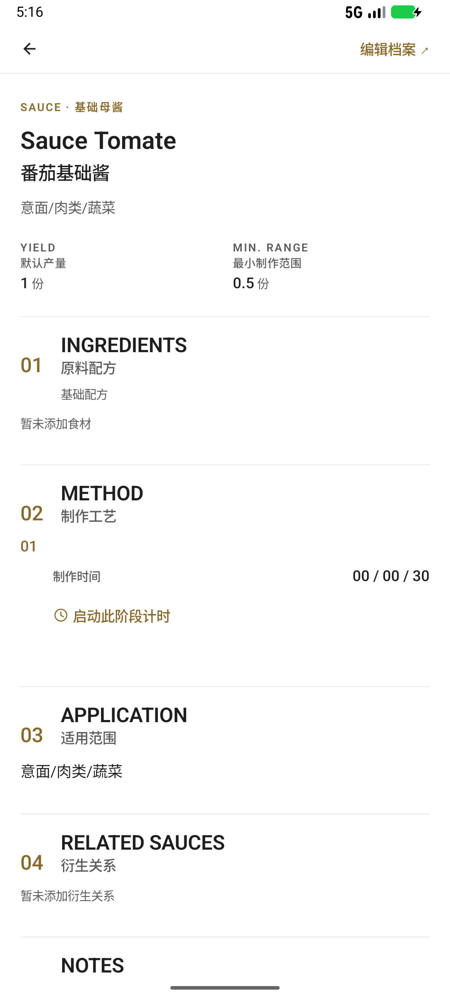
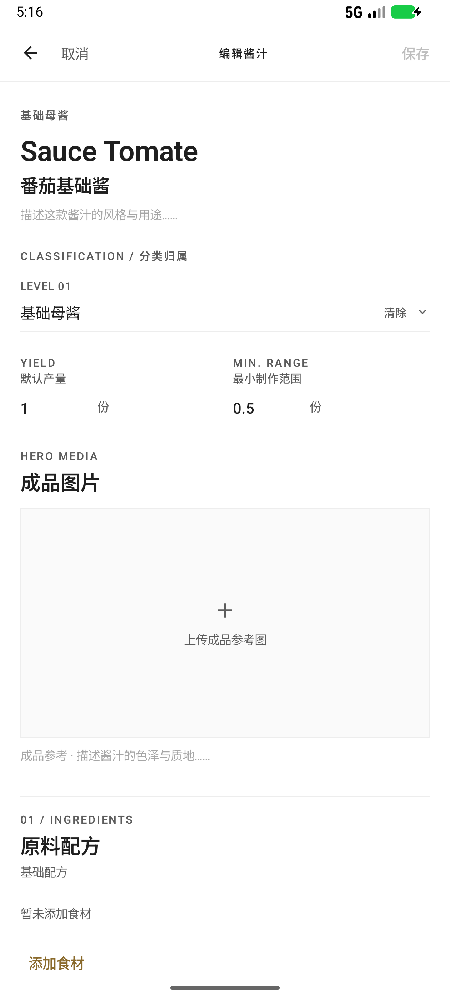
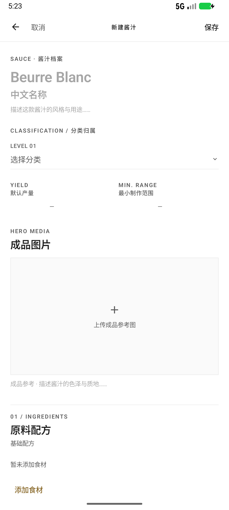
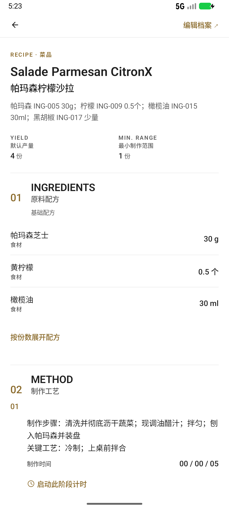
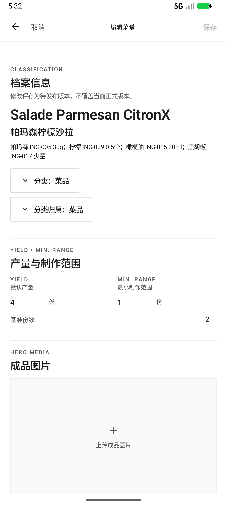
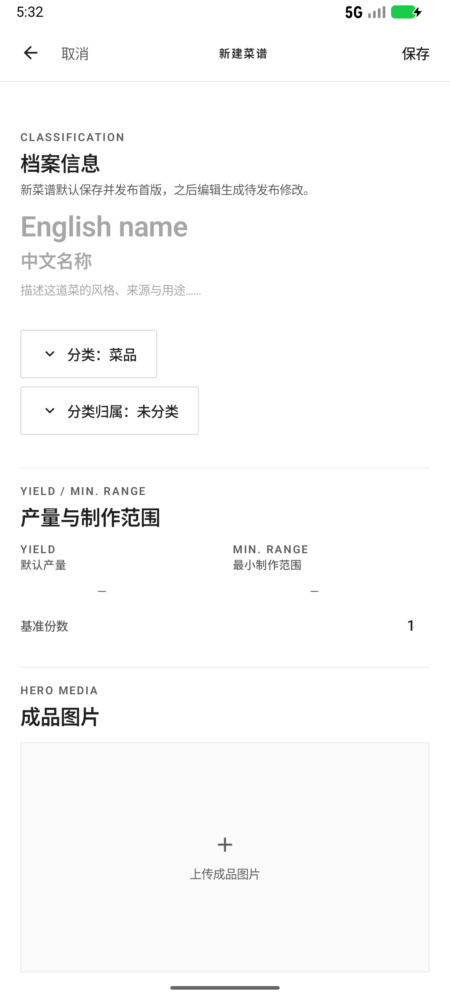
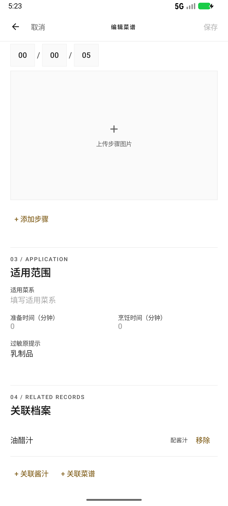

# MISEBASE 酱汁库与菜谱库 UI 完整替换交付说明

- 版本：`1.0.8`（`versionCode = 9`）
- 数据库：schema `v8`
- 构建：`:app:assembleRelease` 成功，APK 已使用发布证书签名
- APK：`dist/MISEBASE-1.0.8.apk`
- SHA-256：`FFC2CF7FD5B009901BA07BBB572636AE690C15E1B88E92CDF14AE19BF21FADE1`
- 签名证书 SHA-256：`5ca41959d9f450cdc851dcb9f052ac9130aaeab71c64062173a699355056af61`

> 编译成功不等于功能完成。本说明同时列出实机交互、持久化、迁移与回归证据，以及未覆盖项。

## 1. 替换范围

只替换以下 6 个页面，不新增首页、食材、库存、扫码、采购、我的或其它库：

| 模块 | 展示页 | 新建页 | 编辑页 |
| --- | --- | --- | --- |
| 酱汁库 | `SauceDetailScreen` | `SauceEditorScreen`（新建） | `SauceEditorScreen`（编辑） |
| 菜谱库 | `RecipeDetailScreen` | `RecipeEditorScreen`（新建） | `RecipeEditorScreen`（编辑） |

两个模块仍保持独立路由、独立列表、独立详情；只共享设计组件与编辑规格，不合并业务模块。

## 2. 截图

### 2.1 酱汁展示



### 2.2 酱汁编辑



### 2.3 新建酱汁



### 2.4 菜谱展示



### 2.5 菜谱编辑



### 2.6 新建菜谱



### 2.7 三段时间输入补充证据



## 3. 共享组件清单

设计层：`core:designsystem`

### 3.1 展示组件（`ArchiveDetail.kt`）

| 组件 | 用途 |
| --- | --- |
| `ArchiveDetailBar` | 返回 + “编辑档案”顶级操作 |
| `ArchiveDetailHeading` | 分类 eyebrow、英文名、中文名、描述 |
| `ArchiveYieldRange` | `YIELD / MIN. RANGE` 双列，数值 + 单位 |
| `ArchiveMeasureValue` | 单列测量值 |
| `ArchiveModuleHeader` | `01 INGREDIENTS` 式编号 + 英文 + 中文模块头 |
| `ArchiveIngredientRow` | 食材/组成行，名称、角色、数量 |
| `ArchiveProcedureStep` | 步骤编号、标题、正文、`制作时间`、计时入口 |
| `ArchiveNoteImages` | 研发照片 |
| `ArchiveVersionItem` / `ArchiveVersionHistory` | 版本号、状态、当前标记 |
| `ArchiveDetailFooter` | `MISEBASE`、版本标签、更新时间 |
| `ArchiveProse` | 档案正文段落 |

### 3.2 编辑组件（`ArchiveEditor.kt`）

| 组件 | 用途 |
| --- | --- |
| `ArchiveEditorTopBar` | 取消 / 标题 / 保存；无底部保存按钮 |
| `ArchiveEditorSectionHeader` | 编号 + 英文 + 中文 + 说明 + 可选操作 |
| `ArchiveEditorInlineField` | 无边框行内输入 |
| `ArchiveEditorDragHandle` | 组成行拖动/排序 |
| `ArchiveMeasurementColumn` | 数值 + 单位选择，数值与单位同一行 |
| `ArchiveYieldRangeFields` | `YIELD` + `MIN. RANGE` 双列编辑 |
| `KitchenTimeSegmentsField` | `[00] / [00] / [00]` 三段时间输入，无 h/m/s 文案 |
| `ArchiveEditorNotesBox` | 研发备注浅底输入框 |
| `ArchiveEditorImageBox` | 主图/步骤图空态、替换、删除 |

### 3.3 业务侧复用

| 文件 | 作用 |
| --- | --- |
| `feature/recipes/RecipeImagePicker.kt` | 系统照片选择器，复用主图、步骤图、研发照片 |
| `feature/recipes/RecipeMethodEditor.kt` | 菜谱步骤编辑；复用三段时间、步骤图 |
| `feature/sauces/SauceEditorSections.kt` | 酱汁分区；复用双列产量、三段时间、备注、关系 |
| `feature/recipes/RecipeEditorScreen.kt` | 菜谱编辑页；复用顶栏、分区、产量、图片、备注 |
| `feature/sauces/SauceEditorScreen.kt` | 酱汁编辑页；复用顶栏、产量、图片、备注 |

## 4. 字段映射与兼容

### 4.1 新增字段

| 层级 | 字段 | 说明 |
| --- | --- | --- |
| `sauce_version` | `min_range_qty REAL` | 最小制作范围数值，可空 |
| `sauce_version` | `min_range_unit_id TEXT` | 最小制作范围单位，可空 |
| `recipe_version` | `min_range_qty REAL` | 最小制作范围数值，可空 |
| `recipe_version` | `min_range_unit_id TEXT` | 最小制作范围单位，可空 |
| `recipe` | `notes TEXT` | 菜谱研发备注，可空 |

### 4.2 领域模型

| 模型 | 字段 | 说明 |
| --- | --- | --- |
| `SauceVersion` | `minRange: Quantity?` | 放在构造器末尾，保持旧位置参数兼容 |
| `RecipeVersion` | `minRange: Quantity?` | 同上 |
| `Recipe` | `notes: String?` | 菜谱备注 |
| `Quantity` | `isSameDimensionAs` / `isAtMost` | 跨单位维度与上限比较 |
| `RecipeImage` | `RecipeImageOwner/Role` | 主图、步骤图、研发照片 |

### 4.3 保留但不展示的旧字段

- `sauce.difficulty`、`recipe.difficulty`：数据库列和领域字段保留，历史值不改写、不清空；新 UI 不展示、不提供难度选择。
- `sauce.yield_qty / yield_unit_id`、`recipe.yield_qty / yield_unit_id`：继续作为默认产量。
- `recipe.servings`：继续作为基准份数。
- `sauce_version.usage_notes`：继续作为适用范围；描述为空时展示页回退到它。
- `recipe.seed_note`：继续只读展示为“原有测试记录”，不覆盖。

### 4.4 时间映射

- 存储：步骤 `time_seconds`（Int，秒）。
- 展示：`KitchenTime.formatSpaced()` 输出 `00 / 05 / 30`，无 h/m/s 标签。
- 输入：`KitchenTimeSegmentsField` 三段分别编辑，`secondsOfParts()` 回写总秒数。
- 无时间步骤：保留步骤与编号，隐藏“制作时间”行和计时按钮；计时入口只出现在有时长的步骤。

### 4.5 图片与关系

- 图片复用 `image_asset` 与私有图片存储，不新增表。
- 主图：`owner = RECIPE`，`role = PRIMARY`。
- 步骤图：`owner = RECIPE_VERSION`，`role = PROCESS`，`step_no` 标记步骤。
- 研发照片：`owner = RECIPE`，`role = REFERENCE`。
- 关系继续使用 `kitchen_relation`。菜谱编辑只替换 `SAUCE` 与 `RECIPE` 两类关系，其它关系不删除。

## 5. 校验规则

1. 最小制作范围必须为正数。
2. 最小制作范围必须与默认产量同维度。
3. 最小制作范围不得大于默认产量（按单位 `baseFactor` 折算后比较）。
4. 最小制作范围数值与单位必须成对出现。
5. 不合法时阻止保存，返回 `CUL-VAL-001`，编辑内容保留。
6. 数据库侧继续校验正数、成对、单位非空；已发布版本的不可变触发器包含最小制作范围字段。

## 6. 版本与发布行为

- 新建酱汁 / 菜谱：保存即发布首版（发布指针指向首版）。
- 编辑已有正式档案：保存生成待发布版本，不覆盖当前正式版。
- 展示页默认读取当前正式发布版本；待发布版本单独显示为“待发布修改”并提供发布入口。
- 版本历史保留全部版本；发布后旧版本仍可追溯。
- 正式版本不可原地改写；最小制作范围变化同样受发布保护。

## 7. 数据库迁移 v7 → v8

`MIGRATION_7_8` 只做 5 个 `ALTER TABLE ... ADD COLUMN`：

```sql
ALTER TABLE sauce_version ADD COLUMN min_range_qty REAL;
ALTER TABLE sauce_version ADD COLUMN min_range_unit_id TEXT;
ALTER TABLE recipe_version ADD COLUMN min_range_qty REAL;
ALTER TABLE recipe_version ADD COLUMN min_range_unit_id TEXT;
ALTER TABLE recipe ADD COLUMN notes TEXT;
```

- 全部为可空列，不重写表、不删除列、不改历史行。
- `CulinaryDatabase.version = 8`；`CulinaryMigrations.ALL` 已包含 `MIGRATION_7_8`。
- `StartupCoordinator` 的 `EXPECTED_SCHEMA_VERSION = 8`。
- 已实机验证：在已有 v7 数据上安装 1.0.8 后正常启动，原酱汁、菜谱、版本、分类数据保留。
- 旧版 1.0.7 遇到 v8 数据库会进入不兼容提示，不会降级写入；回退需恢复 v7 备份或重装 1.0.7 并恢复备份。

## 8. 编译与测试结果

### 8.1 编译

| 命令 | 结果 |
| --- | --- |
| `:feature:recipes:compileDebugKotlin` | 通过 |
| `:feature:sauces:compileDebugKotlin` | 通过 |
| `:app:compileDebugKotlin` | 通过 |
| `:app:assembleRelease` | 通过 |

### 8.2 单元/UI 测试

| 模块 | 结果 |
| --- | --- |
| `feature:recipes` | 17 通过，0 失败 |
| `feature:sauces` | 13 通过，0 失败 |
| `core:database` | 90 通过，0 失败 |
| `core:data`（debug） | 100 通过，0 失败 |
| `core:data`（release） | 通过 |
| `core:domain` | 176 通过，1 失败 |

唯一失败为既有基线 `SaveIngredientUseCaseTest > keeps the id when editing an existing ingredient`，与本次酱汁/菜谱 UI、最小制作范围、schema v8 无关；本次未修改该用例与食材模块。

### 8.3 实机验证

| 场景 | 结果 |
| --- | --- |
| v7 → v8 覆盖安装 | 正常启动，原数据保留 |
| 酱汁最小制作范围 0.5 份 | 保存为待发布 v2，发布后展示页显示 `0.5 份` |
| 酱汁步骤时间 30 秒 | 展示为 `00 / 00 / 30`，计时入口存在 |
| 菜谱最小制作范围 1 份 | 发布 v2 后展示页显示 `1 份` |
| 菜谱步骤时间 5 秒 | 编辑页为 `[00] / [00] / [05]`，展示页为 `00 / 00 / 05` |
| 新建菜谱保存 | 首版自动发布，版本历史显示 `v01 已发布 · 当前` |
| 编辑正式菜谱 | 展示页仍读正式版，底部显示“待发布修改 v2 / 发布 v2” |
| 空食材 | 展示为“暂未添加食材” |

## 9. 未完成 / 未测试项

1. 菜谱主图、步骤图、研发照片的选择器已接入并通过编译，但未在真机/模拟器完整走通“选图 → 保存 → 重开 → 读回”链路；需要补充图片持久化实机证据。
2. `SaveRecipeRelationsUseCase` 分两次替换 `SAUCE`、`RECIPE` 关系，不是单事务；第二次失败时第一次可能已落库，当前未做补偿。
3. `RecipeImageRepositoryImpl` 主图替换采用“先删旧、再加新”；新增失败时旧图可能丢失，未做回滚。
4. 菜谱分类归属可以新增/修改，但没有“清除已有分类归属”的入口。
5. 版本历史展示版本号、状态、当前标记，但未展示每一版的独立时间戳；现有领域模型没有该字段。
6. 难度字段仅保留数据，不展示，也没有迁移/清理脚本。
7. 本次未运行 `ktlintCheck`、`detekt`；未做完整无障碍/大字体/深浅色回归。
8. 未在本轮重新完整回归统一制作模式与计时器完成反馈；仅验证了展示页的步骤时间格式。
9. 最小制作范围跨单位比较依赖单位 `baseFactor`；无换算系数的单位无法可靠比较，当前依赖种子单位表。

## 10. 回退点

- 本次提交前基线：`d12de0a`（`restore-v7` 分支历史）
- 上一功能提交：`17bdfa2`
- 上一交付文档：`1d9579b`
- 本次提交：`c60bfc3`（提交信息 `feat(sauces,recipes): replace archive display and editor UI with shared editorial system`）

数据库 schema v8 为单向迁移：
- 回退代码到 1.0.7 前，需先恢复 v7 数据库备份；
- 或保留 v8 数据并在兼容层处理，不能让 1.0.7 直接写入 v8；
- 1.0.7 APK SHA-256 为 `9c72b033bc5fdc984a3d31f782313656d2f3cd0f4d31862f05beed241dc017f0`。
